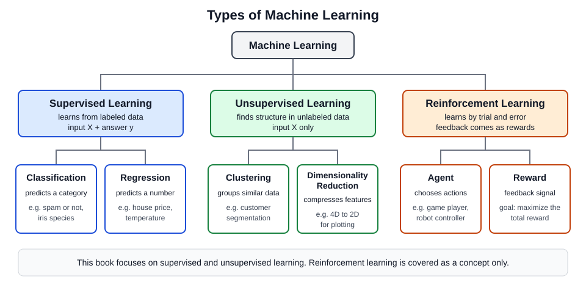

# 1장. 머신러닝이란 무엇인가

📖 [◀ 목차](00-목차.md) | [다음: 2장. 개발 환경과 데이터 다루기 ▶](ch02-개발환경과데이터다루기.md)

---

## 이 장에서 다루는 내용

이 책의 목표는 "머신러닝을 직접 만들어 보며 이해하기"입니다. 라이브러리가 대신 해 주는 일의 겉모습만 외우지 않고, 어떤 문제에 어떤 도구를 왜 쓰는지, 그리고 결과를 어떻게 믿을 수 있는지를 코드로 확인하면서 배웁니다. 그 출발점으로 1장에서는 머신러닝이라는 말이 정확히 무엇을 뜻하는지부터 정리합니다.

이 장에서는 다음 내용을 다룹니다.

1. 전통적 프로그래밍과 머신러닝은 무엇이 다른가
2. 머신러닝의 세 가지 학습 유형: 지도학습, 비지도학습, 강화학습
3. 머신러닝 프로젝트의 전체 작업 흐름
4. 특성(feature), 레이블(label), 훈련 데이터와 테스트 데이터라는 기본 용어
5. scikit-learn으로 처음 해 보는 머신러닝: 붓꽃 품종 분류
6. 과대적합(overfitting)이라는 함정 맛보기
7. 이 책의 로드맵

이 책은 Python 문법을 이미 알고 있다고 가정합니다. 변수, 리스트, 함수, 클래스, 모듈 가져오기 같은 내용은 따로 설명하지 않습니다. 아직 익숙하지 않다면 이 저장소의 [Python 기초부터 응용까지](../../Languages/Python/Python기초/00-목차.md)를 먼저 읽고 오시기 바랍니다.

이 장의 코드는 scikit-learn과 NumPy가 설치되어 있어야 실행됩니다. 설치 방법은 2장에서 자세히 다루므로, 지금은 코드와 출력을 눈으로 따라가도 충분합니다.

## 1.1 규칙을 쓰는 프로그래밍, 데이터에서 배우는 프로그래밍

### 전통적 프로그래밍

지금까지 우리가 작성한 프로그램은 대부분 다음 구조였습니다. 사람이 문제를 분석해서 **규칙**을 찾아내고, 그 규칙을 코드로 옮깁니다. 컴퓨터는 입력을 받아 규칙대로 처리해서 결과를 내놓습니다.

스팸 메일을 걸러 내는 프로그램을 이 방식으로 만든다고 해 봅시다. 가장 먼저 떠오르는 방법은 스팸에 자주 나오는 단어 목록을 만들어 두고, 제목에 그 단어가 들어 있으면 스팸으로 분류하는 것입니다.

```python
def is_spam(subject):
    banned_words = ["무료", "당첨", "대출", "클릭"]
    return any(word in subject for word in banned_words)

print(is_spam("축하합니다! 경품에 당첨되셨습니다"))
print(is_spam("내일 회의 자료 공유드립니다"))
print(is_spam("무.료 체험 안내"))        # 글자를 살짝 비틀면?
print(is_spam("무료 점심 메뉴 투표"))     # 정상 메일인데?
```

```
True
False
False
True
```

처음 두 줄은 기대한 대로 동작합니다. 하지만 세 번째 줄처럼 스팸 발송자가 `무.료`처럼 글자를 살짝 비틀면 규칙을 빠져나갑니다(놓친 스팸). 네 번째 줄은 반대로 정상적인 사내 투표 메일인데도 "무료"라는 단어 때문에 스팸으로 분류됩니다(잘못 걸러낸 정상 메일). 이를 보완하려고 규칙을 하나씩 추가하면 규칙은 끝없이 늘어나고, 규칙끼리 서로 충돌하기 시작하며, 스팸 수법이 바뀔 때마다 사람이 다시 손봐야 합니다.

### 머신러닝: 데이터에서 규칙을 학습한다

머신러닝은 방향을 뒤집습니다. 규칙을 사람이 쓰는 대신, **입력과 정답이 짝지어진 예시 데이터**를 컴퓨터에게 많이 보여 주고, 그 안에서 규칙을 스스로 찾아내게 합니다. 스팸 필터라면 "스팸으로 확인된 메일 수만 건"과 "정상 메일 수만 건"을 주고, 두 부류를 구분하는 패턴을 알고리즘이 찾아내도록 하는 식입니다.

| | 전통적 프로그래밍 | 머신러닝 |
|---|---|---|
| 사람이 주는 것 | 규칙 + 입력 데이터 | 입력 데이터 + 정답 |
| 컴퓨터가 내놓는 것 | 결과(답) | 규칙(모델) |
| 규칙을 만드는 주체 | 사람 | 알고리즘 |
| 환경이 바뀌면 | 사람이 규칙을 수정 | 새 데이터로 다시 학습 |

이 표에서 "규칙"에 해당하는 것을 머신러닝에서는 **모델(model)** 이라고 부릅니다. 모델은 입력을 받아 출력을 내놓는 함수이고, 그 함수의 세부 값(매개변수)은 데이터로 결정됩니다. 데이터로 모델의 매개변수를 정하는 과정을 **학습(training)** 또는 **적합(fitting)** 이라 하고, 학습이 끝난 모델에 새 입력을 넣어 출력을 얻는 과정을 **예측(prediction)** 또는 **추론(inference)** 이라고 합니다.

아주 단순한 예로 직접 확인해 봅시다. 섭씨온도를 화씨온도로 바꾸는 공식은 `F = C × 9/5 + 32`로 잘 알려져 있습니다. 전통적 프로그래밍에서는 이 공식을 코드로 옮기면 끝입니다. 이번에는 공식을 알려 주지 않고 (섭씨, 화씨) 쌍만 보여 주었을 때 컴퓨터가 공식을 찾아내는지 봅니다.

```python
import numpy as np
from sklearn.linear_model import LinearRegression

# 전통적 프로그래밍: 사람이 공식(규칙)을 직접 코드로 쓴다
def to_fahrenheit(celsius):
    return celsius * 9 / 5 + 32

print("공식으로 계산:", to_fahrenheit(30))

# 머신러닝: 공식은 알려 주지 않고, (입력, 정답) 쌍만 보여 준다
celsius = np.array([[-40], [-10], [0], [10], [25], [37], [100]])
fahrenheit = np.array([-40.0, 14.0, 32.0, 50.0, 77.0, 98.6, 212.0])

model = LinearRegression()
model.fit(celsius, fahrenheit)          # 데이터에서 규칙을 학습

print("학습된 기울기:", model.coef_.round(3))
print("학습된 절편:", round(model.intercept_, 3))
print("30도에 대한 예측:", model.predict([[30]]).round(2))
```

```
공식으로 계산: 86.0
학습된 기울기: [1.8]
학습된 절편: 32.0
30도에 대한 예측: [86.]
```

`to_fahrenheit` 함수에는 `9 / 5`와 `32`라는 숫자가 사람의 손으로 적혀 있습니다. 반면 `LinearRegression` 모델에게는 그 숫자를 한 번도 알려 주지 않았습니다. 그런데도 `fit()`을 거치고 나니 기울기 1.8(= 9/5)과 절편 32.0을 스스로 찾아냈고, 학습에 쓰지 않은 30도에 대해서도 86.0이라는 정확한 예측을 내놓았습니다. 선형 회귀의 내부는 3장에서 NumPy로 직접 구현하면서 열어 볼 것입니다. 지금은 "데이터를 주면 규칙이 나온다"는 구조만 기억하면 됩니다.

여기서는 규칙이 단순한 일차식이라 사람이 직접 쓰는 편이 훨씬 낫습니다. 머신러닝의 진가는 규칙을 사람이 말로 설명하기 어려운 문제에서 드러납니다. 손으로 쓴 숫자 이미지가 3인지 8인지를 가려내는 규칙을 `if`문으로 쓴다고 상상해 보면 쉽게 납득이 됩니다.

### 언제 머신러닝을 쓰는가

머신러닝이 어울리는 상황은 대체로 다음과 같습니다.

- **규칙이 너무 복잡하거나 말로 설명하기 어려운 경우**: 이미지 인식, 음성 인식, 스팸 분류
- **규칙이 자주 바뀌는 경우**: 스팸 수법, 소비자 취향, 시장 가격 흐름. 규칙을 고치는 대신 새 데이터로 다시 학습하면 됩니다.
- **데이터 속에 사람이 눈치채지 못한 패턴이 숨어 있는 경우**: 수백 개의 항목을 가진 고객 기록에서 이탈 징후를 찾아내는 일

반대로 다음과 같은 경우에는 머신러닝이 오히려 어울리지 않습니다.

- 규칙이 명확하고 단순한 경우(소득세 계산, 윤년 판별, 단위 변환)
- 100% 정확해야 하고 오차를 허용할 수 없는 경우
- 학습에 쓸 데이터가 거의 없는 경우

머신러닝은 만능 도구가 아니라, "규칙을 직접 쓰기 어려울 때 데이터를 믿고 쓰는 도구"입니다. 문제를 마주쳤을 때 먼저 "규칙으로 풀 수 있는가?"를 묻는 습관이 필요합니다.

### 인공지능, 머신러닝, 딥러닝

세 용어는 자주 뒤섞여 쓰이지만 포함 관계가 있습니다.

- **인공지능(AI)**: 사람이 하는 지능적인 일을 컴퓨터가 하게 만드는 넓은 분야입니다. 규칙 기반 전문가 시스템도 여기에 속합니다.
- **머신러닝(ML)**: 인공지능 중에서 데이터로부터 학습하는 방법들을 가리킵니다.
- **딥러닝(DL)**: 머신러닝 중에서 여러 층으로 쌓은 신경망을 사용하는 방법입니다.

이 책은 선형 회귀, 결정 트리, 군집화 같은 **전통적 머신러닝**을 scikit-learn으로 다루고, 책의 뒷부분에서 신경망을 NumPy로 직접 구현해 본 다음 PyTorch로 딥러닝의 입구까지 안내합니다.

## 1.2 머신러닝의 학습 유형

머신러닝은 "학습할 때 어떤 데이터와 어떤 피드백이 주어지는가"에 따라 크게 세 가지로 나눕니다. 아래 그림은 세 유형과 대표적인 과제를 한눈에 보여 줍니다.



### 지도학습: 정답이 있는 데이터로 배운다

**지도학습(supervised learning)** 은 입력 `X`와 그에 대한 정답 `y`가 짝지어진 데이터로 학습합니다. 선생님이 문제와 정답을 함께 보여 주며 가르치는 것과 같다고 해서 "지도(supervised)"라는 이름이 붙었습니다. 학습이 끝나면 정답을 모르는 새 입력 `X`가 주어졌을 때 `y`를 예측합니다.

지도학습은 정답 `y`의 성격에 따라 두 가지 과제로 나뉩니다.

- **분류(classification)**: 정답이 **범주**(몇 개 중 하나)입니다. 메일이 스팸인지 아닌지, 붓꽃이 세 품종 중 어느 것인지, 종양이 양성인지 악성인지를 맞히는 문제가 해당합니다.
- **회귀(regression)**: 정답이 **연속적인 숫자**입니다. 집값, 내일의 기온, 상품의 일주일 뒤 판매량을 맞히는 문제가 해당합니다. 앞에서 본 섭씨-화씨 예제도 회귀 문제였습니다.

분류인지 회귀인지 헷갈릴 때는 "정답이 될 수 있는 값이 정해진 목록인가, 아니면 숫자 범위인가?"를 물어보면 됩니다. 3장에서 회귀를 다루고, 이어지는 장들에서 분류 알고리즘(로지스틱 회귀, k-NN, SVM, 결정 트리 등)을 하나씩 만납니다.

### 비지도학습: 정답 없이 구조를 찾는다

**비지도학습(unsupervised learning)** 은 정답 `y` 없이 입력 `X`만으로 학습합니다. 정답이 없으니 "맞혔다/틀렸다"를 말할 수 없는 대신, 데이터가 가진 구조를 찾아내는 것이 목표입니다. 대표적인 과제는 다음 두 가지입니다.

- **군집화(clustering)**: 비슷한 샘플끼리 묶습니다. 구매 기록이 비슷한 고객을 묶어 고객 층을 나누는 일이 예입니다.
- **차원 축소(dimensionality reduction)**: 많은 특성을 정보 손실을 최소화하면서 적은 수의 특성으로 압축합니다. 특성이 수십 개인 데이터를 2차원 평면에 그려서 눈으로 확인하고 싶을 때 쓰입니다.

붓꽃 데이터에서 품종 정보를 일부러 빼고, 군집화와 차원 축소를 해 보겠습니다. 코드의 세부 사항은 군집화를 다루는 11장과 차원 축소를 다루는 12장에서 설명하니, 지금은 "정답 없이도 무언가를 해낸다"는 점에만 주목하세요.

```python
import numpy as np
from sklearn.cluster import KMeans
from sklearn.datasets import load_iris
from sklearn.decomposition import PCA

X = load_iris().data          # 정답(품종)은 일부러 쓰지 않는다

# 군집화: 비슷한 샘플끼리 3개 그룹으로 묶는다
kmeans = KMeans(n_clusters=3, n_init=10, random_state=0)
kmeans.fit(X)
print("그룹별 샘플 수:", np.bincount(kmeans.labels_))
print("앞 10개 샘플의 그룹 번호:", kmeans.labels_[:10])

# 차원 축소: 4개의 특성을 2개로 압축한다
pca = PCA(n_components=2)
X_2d = pca.fit_transform(X)
print("압축 전:", X.shape, " 압축 후:", X_2d.shape)
print("각 축이 담은 정보 비율:", pca.explained_variance_ratio_.round(3))
```

```
그룹별 샘플 수: [62 50 38]
앞 10개 샘플의 그룹 번호: [1 1 1 1 1 1 1 1 1 1]
압축 전: (150, 4)  압축 후: (150, 2)
각 축이 담은 정보 비율: [0.925 0.053]
```

`KMeans`는 150개의 꽃을 크기가 62, 50, 38인 세 그룹으로 묶었습니다(그룹 번호 0, 1, 2는 단순한 이름표일 뿐이라 품종 번호와 일치하지 않아도 상관없습니다). 실제 품종은 각각 50송이씩이므로 완벽히 일치하지는 않지만, 품종 이름을 한 번도 보지 않고 거의 비슷하게 나눈 것입니다. `PCA`는 4개의 측정값을 2개로 압축했고, 압축된 두 축이 원래 정보(분산)의 약 97.8%(0.925 + 0.053)를 담고 있다는 것도 알려 줍니다.

### 강화학습: 시행착오와 보상으로 배운다

**강화학습(reinforcement learning)** 은 앞의 두 유형과 구조가 다릅니다. 정해진 데이터 묶음이 있는 것이 아니라, **에이전트(agent)** 가 **환경(environment)** 속에서 행동하고, 그 결과로 **보상(reward)** 을 받으면서 시행착오를 통해 배웁니다. 에이전트의 목표는 장기적으로 받는 보상의 총합을 최대로 만드는 행동 방식을 찾는 것입니다.

자전거를 배우는 과정을 떠올려 보세요. 정답표를 받는 것이 아니라 넘어지고(나쁜 보상) 균형을 잡으면서(좋은 보상) 요령을 터득합니다. 바둑이나 비디오 게임을 하는 프로그램, 로봇의 움직임 제어가 강화학습으로 다루어지는 대표적인 분야입니다.

강화학습은 이 책의 범위를 벗어나므로 개념만 소개하고 넘어갑니다. 이후 장에서는 지도학습과 비지도학습을 중심으로 다룹니다.

## 1.3 데이터의 언어: 특성, 레이블, 훈련과 테스트

머신러닝 책을 읽으려면 몇 가지 용어가 필요합니다. 붓꽃(iris) 데이터를 통해 익혀 봅시다. 붓꽃 데이터셋은 세 품종(setosa, versicolor, virginica) 붓꽃 150송이의 꽃받침(sepal)과 꽃잎(petal) 길이·너비를 측정해 둔 것으로, scikit-learn에 기본으로 들어 있습니다.

### 특성과 레이블

```python
from sklearn.datasets import load_iris

iris = load_iris()
print("특성 이름:", iris.feature_names)
print("X의 모양:", iris.data.shape)
print("y의 모양:", iris.target.shape)
print("X의 앞 3행:")
print(iris.data[:3])
print("y의 앞 3개:", iris.target[:3])
print("레이블 이름:", iris.target_names)
```

```
특성 이름: ['sepal length (cm)', 'sepal width (cm)', 'petal length (cm)', 'petal width (cm)']
X의 모양: (150, 4)
y의 모양: (150,)
X의 앞 3행:
[[5.1 3.5 1.4 0.2]
 [4.9 3.  1.4 0.2]
 [4.7 3.2 1.3 0.2]]
y의 앞 3개: [0 0 0]
레이블 이름: ['setosa' 'versicolor' 'virginica']
```

- **샘플(sample)**: 데이터의 한 행, 즉 꽃 한 송이입니다. 150개의 샘플이 있습니다.
- **특성(feature)**: 샘플을 설명하는 측정값 하나하나, 즉 데이터의 열입니다. 여기서는 꽃받침 길이, 꽃받침 너비, 꽃잎 길이, 꽃잎 너비의 4개입니다. 속성, 변수, 입력 변수라고도 부릅니다.
- **레이블(label)**: 샘플의 정답입니다. 여기서는 품종이며 0, 1, 2라는 정수로 저장되어 있고, `target_names`에서 각각 `setosa`, `versicolor`, `virginica`를 뜻한다고 알려 줍니다. 타깃(target)이라고도 부릅니다.

관례적으로 특성 전체는 대문자 **`X`**, 레이블은 소문자 **`y`** 로 씁니다. `X`는 (샘플 수, 특성 수) 모양의 2차원 배열이고 `y`는 (샘플 수,) 모양의 1차원 배열입니다. 출력의 `(150, 4)`와 `(150,)`가 바로 그 모양입니다. 이 모양은 scikit-learn 전체에서 변하지 않는 약속이므로 꼭 기억해 두세요.

### 훈련 데이터와 테스트 데이터

학생이 시험 공부를 할 때 기출문제를 외워서 기출문제 점수가 높아졌다고 해서 실력이 좋다고 할 수는 없습니다. 진짜 실력은 **처음 보는 문제**를 풀어 봐야 알 수 있습니다. 머신러닝도 똑같습니다. 우리가 원하는 것은 학습에 쓴 데이터를 잘 맞히는 모델이 아니라, **앞으로 들어올 새 데이터를 잘 맞히는 모델**입니다. 이 능력을 **일반화(generalization)** 라고 합니다.

그래서 가진 데이터를 두 묶음으로 나눕니다.

- **훈련 데이터(training data)**: 모델을 학습시키는 데 쓰는 데이터. 연습 문제에 해당합니다.
- **테스트 데이터(test data)**: 학습이 끝난 뒤 성능을 재는 데에만 쓰는 데이터. 학습 중에는 절대 보여 주지 않는 시험 문제입니다.

scikit-learn의 `train_test_split` 함수가 이 일을 해 줍니다. 150개 중 30%를 테스트용으로 떼어 놓으면 다음과 같이 나뉩니다.

```python
from sklearn.datasets import load_iris
from sklearn.model_selection import train_test_split

iris = load_iris()
X_train, X_test, y_train, y_test = train_test_split(
    iris.data, iris.target, test_size=0.3, random_state=0
)
print("전체:", iris.data.shape)
print("훈련:", X_train.shape, y_train.shape)
print("테스트:", X_test.shape, y_test.shape)
```

```
전체: (150, 4)
훈련: (105, 4) (105,)
테스트: (45, 4) (45,)
```

150개가 105개(훈련)와 45개(테스트)로 나뉘었습니다. `random_state`는 무작위로 섞는 과정의 시드(seed)를 고정해서, 코드를 몇 번을 다시 실행해도 같은 분할이 나오게 해 줍니다. 이 책에서 난수가 들어가는 모든 예제에 시드를 고정하는 이유도 같습니다. 이렇게 해야 여러분의 실행 결과가 책의 출력과 일치합니다. `train_test_split`의 자세한 사용법은 2장에서 다시 다룹니다.

## 1.4 첫 머신러닝: 붓꽃 품종 분류

이제 앞의 용어들을 모두 써서 처음으로 분류 모델을 학습시켜 보겠습니다. 꽃의 측정값 4개를 보고 품종을 맞히는 모델입니다. 여기서 사용할 알고리즘은 **K-최근접 이웃(K-Nearest Neighbors, KNN)** 입니다. 원리는 아주 단순합니다. 새로운 꽃이 오면 훈련 데이터에서 측정값이 가장 비슷한(거리가 가장 가까운) `K`개의 꽃을 찾고, 그 이웃들이 가장 많이 속한 품종으로 답합니다. "유유상종"을 그대로 알고리즘으로 옮긴 셈입니다.

```python
from sklearn.datasets import load_iris
from sklearn.model_selection import train_test_split
from sklearn.neighbors import KNeighborsClassifier

iris = load_iris()
X_train, X_test, y_train, y_test = train_test_split(
    iris.data, iris.target, test_size=0.3, random_state=0
)
model = KNeighborsClassifier(n_neighbors=3)
model.fit(X_train, y_train)
print("테스트 정확도:", model.score(X_test, y_test))
print("새 꽃의 예측:", iris.target_names[model.predict([[6.0, 2.9, 4.5, 1.5]])])
```

```
테스트 정확도: 0.9777777777777777
새 꽃의 예측: ['versicolor']
```

단 몇 줄로 학습, 평가, 예측이 모두 끝났습니다. 한 줄씩 살펴봅시다.

- `iris = load_iris()`: 데이터셋을 불러옵니다. 특성은 `iris.data`, 레이블은 `iris.target`에 들어 있습니다.
- `train_test_split(...)`: 훈련용 70%와 테스트용 30%로 나눕니다. 반환값은 `X_train, X_test, y_train, y_test` 순서입니다.
- `KNeighborsClassifier(n_neighbors=3)`: 이웃을 3개 참고하는 분류 모델 객체를 만듭니다. 이때 아직 아무것도 학습하지 않은 상태입니다. `n_neighbors`처럼 학습 전에 사람이 정해 주는 설정값을 **하이퍼파라미터(hyperparameter)** 라고 부릅니다.
- `model.fit(X_train, y_train)`: **훈련 데이터로 학습**합니다. scikit-learn의 모든 모델은 `fit(X, y)`로 학습합니다.
- `model.score(X_test, y_test)`: **테스트 데이터로 평가**합니다. 분류 모델의 `score`는 정확도(accuracy), 즉 맞힌 비율을 돌려줍니다. 0.9778은 45개 중 44개를 맞혔다는 뜻입니다.
- `model.predict(...)`: 새로운 샘플의 레이블을 예측합니다. 꽃받침 길이 6.0, 너비 2.9, 꽃잎 길이 4.5, 너비 1.5인 꽃을 `versicolor`로 예측했습니다. 입력은 `X`와 같은 2차원 모양이어야 하므로 대괄호를 두 겹으로 감싸 주었습니다. `predict`는 0, 1, 2 같은 정수 레이블을 돌려주므로, `iris.target_names[...]`로 품종 이름으로 바꿔 출력했습니다.

이 `fit` / `predict` / `score`라는 세 가지 동작은 이 책 전체에서, 그리고 scikit-learn을 쓰는 거의 모든 코드에서 반복해서 만나게 될 공통 틀입니다. 알고리즘이 달라져도 `KNeighborsClassifier`를 다른 모델 클래스로 바꾸기만 하면 나머지 코드는 그대로 쓸 수 있도록 설계되어 있습니다.

## 1.5 머신러닝 프로젝트의 작업 흐름

실제 머신러닝 프로젝트는 모델을 학습시키는 한 줄(`fit`)이 전부가 아닙니다. 그 앞뒤로 해야 할 일이 훨씬 많습니다. 일반적인 흐름은 다음과 같이 여섯 단계로 정리할 수 있습니다.

| 단계 | 하는 일 | 핵심 질문 |
|---|---|---|
| 1. 문제 정의 | 무엇을 예측할지, 성공의 기준이 무엇인지 정한다 | 분류인가 회귀인가? 어떤 지표로 성공을 판단하는가? |
| 2. 데이터 수집 | 학습에 쓸 데이터를 모은다 | 데이터가 충분한가? 대표성이 있는가? |
| 3. 전처리 | 결측치와 이상치를 처리하고 특성을 가공한다 | 숫자로 바꿔야 할 것은? 크기를 맞춰야 할 것은? |
| 4. 모델 학습 | 알고리즘을 고르고 훈련 데이터로 학습시킨다 | 어떤 알고리즘이 적합한가? 하이퍼파라미터는? |
| 5. 평가 | 테스트 데이터로 성능을 재고 개선점을 찾는다 | 목표에 도달했는가? 어디서 틀리는가? |
| 6. 배포 | 모델을 실제 서비스에 넣고 상태를 지켜본다 | 새 데이터에도 성능이 유지되는가? |

이 순서는 한 방향으로만 흐르지 않습니다. 평가 결과가 기대에 못 미치면 전처리나 모델 선택으로 돌아가고, 때로는 더 많은 데이터를 모으러 되돌아가기도 합니다. 배포한 뒤에도 세상이 바뀌면 성능이 떨어지므로 데이터를 다시 모아 재학습하는 순환이 이어집니다. 실무에서는 단계 3(전처리)과 단계 2(데이터 수집)에 가장 많은 시간이 든다는 말이 있을 만큼, 알고리즘 자체보다 데이터를 다루는 일이 큰 비중을 차지합니다.

여섯 단계를 아주 작은 코드로 한 번 훑어보겠습니다. 각 단계의 세부 내용은 뒤의 장에서 하나씩 자세히 배웁니다.

```python
import joblib
from sklearn.datasets import load_iris
from sklearn.model_selection import train_test_split
from sklearn.neighbors import KNeighborsClassifier
from sklearn.pipeline import make_pipeline
from sklearn.preprocessing import StandardScaler

# 1. 문제 정의: 꽃의 측정값 4개로 품종 3종을 분류한다 (분류 문제)

# 2. 데이터 수집: 여기서는 내장 데이터셋을 불러온다
X, y = load_iris(return_X_y=True)

# 훈련/테스트 분리: 평가용 데이터는 학습 내내 숨겨 둔다
X_train, X_test, y_train, y_test = train_test_split(
    X, y, test_size=0.2, random_state=42, stratify=y
)

# 3. 전처리 + 4. 모델 학습: 특성의 크기를 맞춘 뒤 KNN으로 학습
model = make_pipeline(StandardScaler(), KNeighborsClassifier(n_neighbors=5))
model.fit(X_train, y_train)

# 5. 평가: 한 번도 보지 못한 테스트 데이터로 점수를 낸다
print(f"테스트 정확도: {model.score(X_test, y_test):.3f}")

# 6. 배포: 학습된 모델을 파일로 저장하고, 다른 곳에서 불러와 쓴다
joblib.dump(model, "iris_model.joblib")
loaded = joblib.load("iris_model.joblib")
print("불러온 모델의 예측:", loaded.predict([[5.0, 3.4, 1.5, 0.2]]))
```

```
테스트 정확도: 0.933
불러온 모델의 예측: [0]
```

몇 가지 새로운 요소가 들어 있습니다.

- `make_pipeline(StandardScaler(), KNeighborsClassifier(...))`: 전처리와 모델을 하나로 묶습니다. `StandardScaler`는 특성마다 단위와 크기가 다르면 거리 계산이 왜곡되므로, 특성의 평균과 퍼짐 정도를 맞춰 주는 전처리 도구입니다. 7장에서 스케일링이 성능에 얼마나 큰 차이를 만드는지 실험으로 확인합니다.
- `stratify=y`: 훈련/테스트 데이터에서 클래스 비율이 전체와 같도록 나눕니다. 2장에서 설명합니다.
- `joblib.dump` / `joblib.load`: 학습된 모델을 파일(`iris_model.joblib`)로 저장하고 다시 불러옵니다. 한 번 학습한 모델을 매번 다시 학습하지 않고 서비스에서 쓰려면 이런 저장이 필요합니다. 마지막 줄의 예측 결과 `[0]`은 setosa를 뜻합니다. 파이프라인과 모델 배포는 17장에서 본격적으로 다룹니다. 다만 이 형식은 불러올 때 코드가 실행될 수 있으므로, **출처를 모르는 파일은 절대 불러오면 안 됩니다.**

여기서 중요한 점이 하나 있습니다. 평가에 쓰는 테스트 데이터는 모델 학습뿐 아니라 전처리를 정할 때에도 사용해서는 안 됩니다. 이 원칙이 깨지는 현상을 **데이터 누수(data leakage)** 라고 하며, 2장에서 코드로 확인합니다.

## 1.6 과대적합 맛보기

훈련 데이터에서 점수가 높으면 좋은 모델일까요? 꼭 그렇지는 않습니다. 모델이 데이터의 **진짜 패턴**이 아니라 훈련 데이터에 우연히 섞여 있던 **잡음까지 외워 버리면**, 훈련 데이터는 완벽히 맞히면서 새 데이터는 잘 맞히지 못하는 일이 벌어집니다. 기출문제 답을 통째로 암기한 학생과 같은 상황입니다. 이를 **과대적합(overfitting)** 이라고 합니다. 반대로 모델이 너무 단순해서 패턴조차 배우지 못하는 현상은 **과소적합(underfitting)** 이라고 합니다.

KNN에서는 `K`가 이 차이를 보여 줍니다. `K=1`이면 가장 가까운 단 한 명의 이웃만 보고 답하므로, 훈련 데이터에 섞인 이상한 점 하나하나에 모델이 휘둘립니다. 일부러 잡음이 많이 섞인 2차원 데이터로 확인해 봅시다.

```python
from sklearn.datasets import make_moons
from sklearn.model_selection import train_test_split
from sklearn.neighbors import KNeighborsClassifier

# 잡음이 섞인 초승달 모양의 2차원 데이터 300개
X, y = make_moons(n_samples=300, noise=0.35, random_state=0)
X_train, X_test, y_train, y_test = train_test_split(
    X, y, test_size=0.3, random_state=0
)

for k in (1, 15):
    model = KNeighborsClassifier(n_neighbors=k)
    model.fit(X_train, y_train)
    train_acc = model.score(X_train, y_train)
    test_acc = model.score(X_test, y_test)
    print(f"k={k:2d}  훈련 정확도 {train_acc:.3f}  테스트 정확도 {test_acc:.3f}")
```

```
k= 1  훈련 정확도 1.000  테스트 정확도 0.878
k=15  훈련 정확도 0.914  테스트 정확도 0.889
```

`k=1`일 때 훈련 정확도는 1.000, 즉 훈련 데이터를 하나도 틀리지 않았습니다. 훈련 데이터의 모든 점이 자기 자신을 가장 가까운 이웃으로 삼기 때문입니다. 하지만 처음 보는 테스트 데이터에서는 0.878로 떨어집니다. 반면 `k=15`는 훈련 정확도가 0.914로 더 낮지만, 테스트 정확도는 0.889로 오히려 더 높습니다. 훈련과 테스트 점수의 격차(`k=1`은 약 12%p, `k=15`는 약 2.5%p)가 클수록 과대적합을 의심해야 합니다.

이 예제에서 얻어야 할 교훈은 두 가지입니다.

1. **훈련 데이터의 점수는 성능의 증거가 되지 못한다.** 반드시 학습에 쓰지 않은 테스트 데이터로 평가해야 합니다.
2. **모델을 복잡하게 만든다고 항상 좋아지지 않는다.** 적절한 복잡도를 찾아야 합니다.

테스트 데이터가 300개의 30%인 90개뿐이라, 테스트 정확도의 차이(0.878 대 0.889)가 우연의 영향인지 확신하기는 어렵습니다. 이런 불확실성을 줄이려면 어떻게 해야 하는지는 5장에서 과대적합과 과소적합을 자세히 다루고, 교차 검증처럼 더 안정적인 평가 방법도 이어서 소개합니다.

## 1.7 이 책의 로드맵

이 책은 다음 순서로 진행됩니다. 앞 장의 내용이 뒤 장의 바탕이 되도록 짜여 있으므로 순서대로 읽기를 권합니다.

| 부 | 장 | 주제 | 주요 도구 |
|---|---|---|---|
| 1부. 시작하기 | 1장 | 머신러닝이란 무엇인가 | scikit-learn |
| | 2장 | 개발 환경과 데이터 다루기 | NumPy, pandas, Matplotlib |
| 2부. 지도학습 기초 | 3장 | 선형 회귀와 경사하강법 | NumPy, scikit-learn |
| | 4장 | 로지스틱 회귀와 분류 | NumPy, scikit-learn |
| | 5장 | 모델 평가와 검증 | scikit-learn |
| | 6장 | 데이터 전처리와 특성 공학 | pandas, scikit-learn |
| 3부. 전통적 알고리즘 | 7장 | k-NN과 나이브 베이즈 | NumPy, scikit-learn |
| | 8장 | 서포트 벡터 머신 | scikit-learn |
| | 9장 | 결정 트리와 앙상블 | NumPy, scikit-learn |
| | 10장 | 정규화와 하이퍼파라미터 튜닝 | NumPy, scikit-learn |
| 4부. 비지도학습 | 11장 | 군집화 | NumPy, scikit-learn |
| | 12장 | 차원 축소 | NumPy, scikit-learn |
| 5부. 딥러닝 입문 | 13장 | 신경망 기초: 퍼셉트론과 역전파 | NumPy |
| | 14장 | PyTorch 입문 | PyTorch |
| | 15장 | 합성곱 신경망(CNN) | PyTorch |
| | 16장 | 시퀀스 데이터와 RNN 입문 | PyTorch |
| 6부. 실전 | 17장 | ML 파이프라인과 모델 저장·배포 | scikit-learn |
| | 18장 | 실전 프로젝트: 데이터 수집부터 배포까지 엔드투엔드 | scikit-learn |
| 부록 | | 설치 가이드, 수학 기초(선형대수·확률·미분), 알고리즘 선택 가이드 | |

이 책이 지키려는 원칙은 세 가지입니다.

- **직접 만들어 보고, 그다음에 라이브러리를 쓴다.** 선형 회귀와 신경망처럼 원리가 중요한 알고리즘은 NumPy로 직접 구현해서 안에서 무슨 일이 일어나는지 보여 드린 다음, scikit-learn이나 PyTorch로 같은 일을 하는 방법을 소개합니다.
- **수식보다 직관과 코드.** 본문에서는 수식을 최소한으로 쓰고, 꼭 필요한 수학은 부록으로 모았습니다. 수식을 건너뛰어도 코드를 따라가면 흐름을 이해할 수 있도록 썼습니다.
- **결과는 실행해서 확인한다.** 책에 실린 출력은 실제로 실행한 결과이며 난수의 시드를 고정했습니다. 여러분이 같은 코드를 실행하면 같은 결과를 볼 수 있습니다. (다만 라이브러리 버전이 다르면 마지막 자리 숫자가 달라질 수 있습니다.)

이 책은 딥러닝을 입문 수준까지만 다룹니다. 대규모 모델과 최신 구조, 강화학습은 다른 책의 몫으로 남겨 두었습니다. 대신 이 책에서 익힐 데이터 다루기, 평가 방법, 과대적합에 대한 감각은 어떤 종류의 모델을 공부하더라도 그대로 쓰입니다.

## 요약

- 전통적 프로그래밍은 사람이 규칙을 코드로 쓰고, 머신러닝은 입력과 정답 데이터에서 규칙(모델)을 학습합니다. 규칙을 직접 쓰기 어렵거나 자주 바뀌는 문제에서 머신러닝이 빛을 냅니다.
- 학습 유형은 정답이 있는 **지도학습**(분류, 회귀), 정답이 없는 **비지도학습**(군집화, 차원 축소), 보상으로 배우는 **강화학습**으로 나뉩니다. 정답이 범주면 분류, 연속적인 숫자면 회귀입니다.
- 데이터의 한 행은 **샘플**, 열은 **특성**, 정답은 **레이블**입니다. 관례적으로 특성은 `X`(샘플 수, 특성 수), 레이블은 `y`(샘플 수,)로 표기합니다.
- 데이터는 **훈련 데이터**와 **테스트 데이터**로 나누고, 평가는 반드시 학습에 쓰지 않은 테스트 데이터로 합니다. 목표는 새 데이터를 잘 맞히는 **일반화**입니다.
- scikit-learn 모델은 `fit(X, y)`로 학습하고 `predict(X)`로 예측하며 `score(X, y)`로 평가합니다.
- 머신러닝 프로젝트는 문제 정의, 데이터 수집, 전처리, 모델 학습, 평가, 배포의 흐름을 따르며, 각 단계를 오가며 반복합니다.
- 훈련 데이터는 거의 완벽히 맞히지만 새 데이터는 잘 맞히지 못하는 현상이 **과대적합**입니다. 훈련 점수와 테스트 점수의 격차가 단서가 되며, 5장에서 자세히 다룹니다.

## 연습문제

1. 다음 문제 중 머신러닝으로 푸는 것이 적합한 문제와 규칙을 직접 코드로 쓰는 편이 나은 문제를 구분하고, 그 이유를 한 줄씩 적어 보세요.
   - (가) 주어진 연도가 윤년인지 판별하기
   - (나) 손글씨로 쓴 우편번호 이미지를 숫자로 읽기
   - (다) 상품 리뷰 글이 긍정인지 부정인지 분류하기
   - (라) 소득 구간별 세율표에 따라 세금 계산하기
2. 다음 과제가 분류, 회귀, 군집화, 차원 축소 중 어디에 해당하는지 말해 보세요.
   - (가) 중고차의 주행거리와 연식으로 중고 가격 예측하기
   - (나) 사진 속 동물이 고양이인지 개인지 구분하기
   - (다) 정답 정보 없이 뉴스 기사를 비슷한 주제끼리 묶기
   - (라) 특성이 100개인 데이터를 2차원 평면에 그려 보기 위해 특성 수 줄이기
3. 1.4절의 붓꽃 분류 코드에서 `n_neighbors`를 1, 3, 5, 10, 30으로 바꿔 가며 테스트 정확도를 `for` 문으로 출력해 보세요. 정확도는 어떻게 달라지나요? (힌트: `test_size`와 `random_state`는 그대로 둡니다.)
4. 3번 코드에서 `n_neighbors=3`으로 고정하고 이번에는 `train_test_split`의 `random_state`를 0, 1, 2, 3으로 바꿔 가며 정확도를 출력해 보세요. 결과가 달라지는 이유는 무엇이며, 이를 통해 "한 번 나눈 테스트 결과만 믿어서는 안 되는" 까닭을 설명해 보세요.
5. `from sklearn.datasets import load_wine`으로 와인 데이터셋을 불러오세요(`X, y = load_wine(return_X_y=True)`). 1.4절과 같은 방식으로 KNN 모델을 학습하고 테스트 정확도를 구해 보세요. 붓꽃 데이터에 비해 정확도가 많이 낮게 나올 것입니다. 그 원인으로 짐작되는 것을 `X[:3]`을 출력해서 특성들의 값의 크기를 보고 추측해 보세요. (답은 7장에서 다룹니다.)

---

📖 [◀ 목차](00-목차.md) | [다음: 2장. 개발 환경과 데이터 다루기 ▶](ch02-개발환경과데이터다루기.md)
