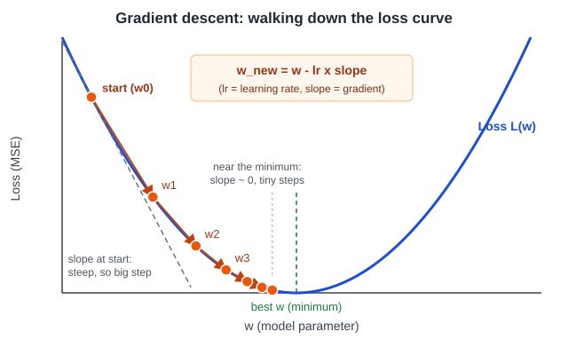

# 3장. 선형 회귀와 경사하강법

📖 [◀ 목차](00-목차.md) | [◀ 이전: 2장. 개발 환경과 데이터 다루기](ch02-개발환경과데이터다루기.md) | [다음: 4장. 로지스틱 회귀와 분류 ▶](ch04-로지스틱회귀와분류.md)

---

이 장에서는 머신러닝의 가장 기본적인 두 가지 아이디어를 한꺼번에 익힙니다. 하나는 **선형 회귀**, 즉 데이터에 직선(또는 평면)을 맞추는 모델이고, 다른 하나는 그 직선을 찾아가는 방법인 **경사하강법**입니다. 선형 회귀 자체는 단순하지만, 경사하강법은 이 책 뒤쪽의 로지스틱 회귀와 신경망, 그리고 PyTorch의 딥러닝까지 거의 모든 모델을 학습시키는 핵심 도구입니다. 그래서 이 장에서는 scikit-learn에 맡기기 전에 NumPy만으로 직접 구현해 봅니다.

이 장을 마치면 다음을 할 수 있습니다.

- 회귀 문제와 선형 모델 `y = wx + b`의 의미를 설명할 수 있습니다.
- 손실 함수(MSE)가 "모델이 얼마나 틀렸는가"를 숫자 하나로 요약한다는 것을 설명할 수 있습니다.
- NumPy만으로 경사하강법을 구현하고, 학습률과 반복 횟수가 결과에 미치는 영향을 관찰할 수 있습니다.
- 특성이 여러 개인 선형 회귀를 행렬 연산으로(벡터화해서) 구현할 수 있습니다.
- scikit-learn의 `LinearRegression`으로 같은 문제를 풀고 직접 구현한 결과와 비교할 수 있습니다.
- `load_diabetes` 데이터셋에서 특성 표준화의 필요성과 모델 평가 지표(MSE, R²)를 확인할 수 있습니다.

## 3.1 회귀 문제와 선형 모델

머신러닝의 지도학습 문제는 크게 두 가지로 나뉩니다. 정답이 "고양이/개"처럼 범주이면 **분류**, 정답이 "집값 3억 2천만 원", "내일 최고기온 27.5도"처럼 연속적인 숫자이면 **회귀**(regression)입니다. 분류는 다음 장에서 다루고, 이 장은 회귀에 집중합니다.

회귀 모델 중 가장 단순한 것이 직선입니다. 입력 특성이 하나일 때 모델은 다음과 같습니다.

```text
y_hat = w * x + b
```

- `x`: 입력 특성 (예: 집의 면적)
- `y_hat`: 모델이 내놓은 예측값 (예: 예측한 집값). 정답 `y`와 구별하려고 모자(hat)를 씌워 읽습니다.
- `w`: **가중치**(weight). 직선의 기울기로, `x`가 1 늘 때 예측값이 얼마나 변하는지를 나타냅니다.
- `b`: **편향**(bias). 직선의 절편으로, `x`가 0일 때의 예측값입니다.

여기서 `w`와 `b`를 모델의 **파라미터**라고 합니다. 머신러닝에서 "학습한다"는 말은 주어진 데이터에 가장 잘 맞는 파라미터 값을 찾는다는 뜻입니다. 같은 데이터에도 `w=1, b=0`인 직선, `w=3, b=5`인 직선 등 후보는 무한히 많습니다. 그중 어느 것이 더 좋은지 판단하려면 "얼마나 잘 맞는가"를 재는 기준이 필요합니다.

## 3.2 실습용 데이터 만들기

먼저 정답을 알고 있는 데이터를 만들어 봅시다. 실제 데이터에서는 "진짜 `w`와 `b`"가 무엇인지 알 수 없지만, 인공 데이터에서는 알고 있으니 학습이 제대로 되었는지 검증할 수 있습니다. 진짜 관계는 `y = 3x + 5`이고, 여기에 평균 0, 표준편차 2인 잡음을 더합니다.

```python
import numpy as np

rng = np.random.default_rng(42)           # 재현 가능한 난수 생성기
x = rng.uniform(0, 10, size=50)           # 0~10 사이의 값 50개
y = 3.0 * x + 5.0 + rng.normal(0, 2.0, size=50)

print("데이터 개수:", x.shape[0])
print("x[:5] =", x[:5].round(2))
print("y[:5] =", y[:5].round(2))
```

```text
데이터 개수: 50
x[:5] = [7.74 4.39 8.59 6.97 0.94]
y[:5] = [29.58 18.3  31.34 27.18  4.91]
```

`np.random.default_rng(42)`처럼 시드를 고정하면 누가 실행해도 같은 데이터가 만들어집니다. 이 장의 모든 출력은 이 시드를 기준으로 합니다. 우리가 학습으로 찾아야 할 목표는 `w ≈ 3`, `b ≈ 5` 근처의 값입니다. 잡음 때문에 정확히 3과 5가 나오지는 않습니다.

## 3.3 손실 함수: 얼마나 틀렸는가

직선이 데이터에 얼마나 잘 맞는지는 **오차**(residual)로 잴 수 있습니다. 각 데이터마다 오차는 `정답 - 예측`입니다. 오차를 전부 더하면 양수 오차와 음수 오차가 서로 상쇄되어 엉망인 직선도 "합이 0"이 될 수 있습니다. 그래서 오차를 제곱해서 더합니다. 제곱을 하면 부호가 사라지고, 크게 틀린 데이터에 더 큰 벌점이 붙는 효과도 있습니다. 제곱 오차의 평균이 **평균 제곱 오차**(MSE, Mean Squared Error)입니다.

```text
MSE = (1/n) * ( (y1 - y_hat1)^2 + (y2 - y_hat2)^2 + ... + (yn - y_hat_n)^2 )
```

이처럼 모델이 얼마나 나쁜지를 하나의 숫자로 요약한 함수를 **손실 함수**(loss function)라고 합니다. 손실이 작을수록 좋은 모델이므로, 학습은 "손실을 최소로 만드는 파라미터를 찾는 일"로 바뀝니다.

```python
def predict(x, w, b):
    return w * x + b

def mse(y_true, y_pred):
    return np.mean((y_true - y_pred) ** 2)

for w, b in [(0.0, 0.0), (1.0, 0.0), (3.0, 5.0), (5.0, 0.0)]:
    loss = mse(y, predict(x, w, b))
    print(f"w={w}, b={b}  ->  MSE = {loss:.2f}")
```

```text
w=0.0, b=0.0  ->  MSE = 502.36
w=1.0, b=0.0  ->  MSE = 270.20
w=3.0, b=5.0  ->  MSE = 2.41
w=5.0, b=0.0  ->  MSE = 68.89
```

진짜 값에 가까운 `(3, 5)`에서 손실이 가장 작고, 멀어질수록 커집니다. 그렇다면 손실이 가장 작은 `(w, b)`를 어떻게 찾을까요? 모든 조합을 하나씩 대입해 볼 수도 있겠지만, 파라미터가 수십, 수백 개가 되면 불가능합니다. 이때 쓰는 방법이 경사하강법입니다.

## 3.4 경사하강법

### 산을 내려오는 방법

안개가 자욱한 산에서 가장 낮은 골짜기를 찾아야 한다고 상상해 봅시다. 지도는 없고 발밑의 경사만 느낄 수 있습니다. 이럴 때 쓸 수 있는 전략은 단순합니다. 지금 서 있는 곳에서 내리막이 가장 가파른 방향으로 한 걸음 내딛고, 다시 발밑을 살피고, 또 한 걸음 내딛는 것을 반복합니다. 이것이 **경사하강법**(gradient descent)입니다.



위 그림에서 가로축은 파라미터 `w`, 세로축은 손실입니다. 모델의 손실은 `w`에 따라 U자 모양 곡선을 그립니다. 시작점(w0)에서 곡선의 **기울기**(gradient, 경사)를 구하고, 기울기의 반대 방향, 즉 내리막 쪽으로 조금 이동합니다. 이동할 때 업데이트 규칙은 다음과 같습니다.

```text
w_새값 = w_현재값 - 학습률 * 기울기
```

그림에서 두 가지를 눈여겨보세요.

- 곡선이 가파른 곳(왼쪽)에서는 기울기가 크므로 한 걸음이 큽니다. 최솟값에 가까워지면 기울기가 0에 가까워지므로 걸음이 저절로 작아집니다. 목적지 근처에서 멈추려고 따로 브레이크를 걸 필요가 없습니다.
- 한 걸음의 크기는 기울기에 **학습률**(learning rate)이라는 상수를 곱해서 조절합니다. 학습률은 사람이 정해 주는 값이며 3.5절에서 크기에 따른 결과를 직접 확인합니다.

### 기울기는 어떻게 구하나

우리의 손실은 `w`와 `b` 두 파라미터에 의존하므로, 각각에 대한 기울기를 구합니다. 미분을 하면 다음과 같이 정리됩니다. 유도 과정은 생략하고 의미만 짚겠습니다.

```text
w의 기울기 = 2 * mean( (y_hat - y) * x )
b의 기울기 = 2 * mean( (y_hat - y) )
```

직관은 이렇습니다. 예측이 정답보다 크면(`y_hat - y > 0`) 직선이 너무 높이 떠 있으니 `b`를 줄여야 합니다. `b`의 기울기가 양수가 되고, 업데이트 규칙의 빼기(`-`) 때문에 `b`가 줄어듭니다. `w`의 식에 `x`가 곱해지는 이유는, `x`가 큰 데이터일수록 `w`를 바꿨을 때 예측이 더 많이 움직이기 때문입니다. 즉 오차가 큰 데이터, 그리고 `w`의 영향이 큰 데이터가 업데이트에 더 많이 기여합니다.

### NumPy로 구현하기

이제 이 과정을 그대로 코드로 옮깁니다. 파라미터는 둘 다 0에서 시작해, 반복할 때마다 (1) 예측하고, (2) 오차와 기울기를 구하고, (3) 파라미터를 갱신합니다. 손실이 정말 줄어드는지 확인하기 위해 매 반복의 손실을 `history`에 기록합니다.

```python
def fit_line(x, y, lr=0.01, n_iter=1000, verbose=False):
    """경사하강법으로 y = w*x + b 의 w, b 를 학습한다."""
    w, b = 0.0, 0.0                          # 시작점: 둘 다 0
    history = []                             # 반복마다 손실 기록
    for i in range(n_iter):
        error = (w * x + b) - y              # 예측 - 정답
        grad_w = 2 * np.mean(error * x)      # w 방향 기울기
        grad_b = 2 * np.mean(error)          # b 방향 기울기
        w -= lr * grad_w                     # 기울기 반대 방향으로 이동
        b -= lr * grad_b
        history.append(mse(y, w * x + b))    # 갱신 후 손실 기록
        if verbose and (i < 3 or (i + 1) % 500 == 0):
            print(f"반복 {i+1:5d}: w={w:7.4f}, b={b:7.4f}, MSE={history[-1]:.4f}")
    return w, b, history

w, b, history = fit_line(x, y, lr=0.01, n_iter=3000, verbose=True)
print()
print(f"학습 결과: w={w:.4f}, b={b:.4f}   (진짜 값: w=3, b=5)")
print(f"MSE: {history[0]:.2f} -> {history[-1]:.4f}")
```

```text
반복     1: w= 2.6853, b= 0.4145, MSE=38.4236
반복     2: w= 3.3731, b= 0.5332, MSE=7.7984
반복     3: w= 3.5479, b= 0.5759, MSE=5.7526
반복   500: w= 3.0980, b= 4.0382, MSE=2.3468
반복  1000: w= 3.0334, b= 4.4751, MSE=2.2947
반복  1500: w= 3.0253, b= 4.5296, MSE=2.2939
반복  2000: w= 3.0243, b= 4.5363, MSE=2.2939
반복  2500: w= 3.0242, b= 4.5372, MSE=2.2939
반복  3000: w= 3.0242, b= 4.5373, MSE=2.2939

학습 결과: w=3.0242, b=4.5373   (진짜 값: w=3, b=5)
MSE: 38.42 -> 2.2939
```

처음 몇 번의 반복에서 손실이 38에서 6 근처로 급격히 떨어지고, 이후로는 아주 천천히 줄어듭니다. 앞서 본 "가파른 곳에서는 큰 걸음, 평평한 곳에서는 작은 걸음"이 그대로 나타난 것입니다. 특히 `b`는 2000번 가까이 돌려야 수렴합니다. 이 데이터에서는 `x`가 0~10으로 퍼져 있어 `w` 방향이 `b` 방향보다 훨씬 가파르기 때문에, 같은 학습률로는 `w`가 먼저 맞춰지고 `b`는 뒤따라 천천히 올라갑니다.

학습 결과는 `w ≈ 3.02`, `b ≈ 4.54`로 진짜 값(3, 5)과 비슷하지만 똑같지는 않습니다. 이는 경사하강법이 부족해서가 아니라, 잡음이 섞인 50개의 데이터에 가장 잘 맞는 직선이 원래 그 값이기 때문입니다. 이것을 확인하려고, 선형 회귀의 수학적으로 정확한 해를 한 번에 계산하는 `np.linalg.lstsq`(최소제곱법)와 비교해 봅시다.

```python
A = np.column_stack([x, np.ones_like(x)])    # [x, 1] 형태의 설계 행렬
(w_ls, b_ls), *_ = np.linalg.lstsq(A, y, rcond=None)

print(f"경사하강법: w={w:.4f}, b={b:.4f}")
print(f"최소제곱법: w={w_ls:.4f}, b={b_ls:.4f}")
```

```text
경사하강법: w=3.0242, b=4.5373
최소제곱법: w=3.0242, b=4.5373
```

두 방법이 소수점 넷째 자리까지 같은 답을 냅니다. 경사하강법은 반복해서 정답에 다가가는 방법이고, 최소제곱법은 선형 회귀처럼 특별히 단순한 문제에서 정답을 곧바로 계산하는 방법입니다. 그런데도 우리가 경사하강법을 배우는 이유는, 신경망처럼 한 번에 풀어 주는 공식이 없는 모델이 대부분이기 때문입니다. 경사하강법은 손실의 기울기만 계산할 수 있으면 어떤 모델에도 적용할 수 있습니다.

> **용어 정리.** 위 구현은 반복마다 *전체* 데이터를 사용해 기울기를 구합니다. 이를 배치 경사하강법이라고 합니다. 데이터를 조금씩 나누어 쓰는 미니배치 경사하강법과 확률적 경사하강법(SGD)은 데이터가 많은 신경망 학습에서 자연스럽게 등장하므로, 그때 다시 설명합니다.

## 3.5 학습률이 너무 작거나 너무 클 때

학습률은 경사하강법에서 가장 중요한 **하이퍼파라미터**(사람이 정해 주는 설정값)입니다. 같은 데이터에 학습률만 바꿔 100번씩 반복해 봅시다.

```python
print("100번 반복했을 때")
for lr in [0.0001, 0.001, 0.01, 0.03, 0.05]:
    w_, b_, h = fit_line(x, y, lr=lr, n_iter=100)
    print(f"  lr={lr:<7}  w={w_:12.4g}  b={b_:12.4g}  최종 MSE={h[-1]:.4g}")

w_, b_, h = fit_line(x, y, lr=0.0001, n_iter=10000)
print("\nlr=0.0001로 10000번 반복:", f"w={w_:.3f}, b={b_:.3f}, MSE={h[-1]:.3f}")
```

```text
100번 반복했을 때
  lr=0.0001   w=       1.899  b=       0.298  최종 MSE=117.4
  lr=0.001    w=       3.591  b=       0.698  최종 MSE=5.423
  lr=0.01     w=       3.415  b=       1.898  최종 MSE=3.773
  lr=0.03     w=   -3.41e+09  b=  -5.047e+08  최종 MSE=4.415e+20
  lr=0.05     w=  -8.908e+43  b=  -1.319e+43  최종 MSE=3.013e+89

lr=0.0001로 10000번 반복: w=3.415, b=1.896, MSE=3.775
```

결과는 세 가지 양상으로 나뉩니다.

- **너무 작은 학습률(0.0001)**: 안전하지만 너무 느립니다. 100번 반복 후에도 `w`가 1.9에 머물러 있고 손실이 117입니다. 100배인 10000번을 돌려도 아직 MSE가 3.775로 목표(2.29)에 못 미칩니다.
- **적당한 학습률(0.001~0.01)**: 손실이 안정적으로 줄어듭니다. 100번 만에 MSE가 5.4와 3.8까지 내려왔습니다.
- **너무 큰 학습률(0.03 이상)**: 한 걸음이 너무 커서 골짜기를 건너뛰어 반대편 비탈에 착지하고, 거기서는 기울기가 더 커서 더 멀리 튕겨 나갑니다. 값이 점점 커지다가 결국 `10^20`, `10^89` 같은 숫자로 **발산**합니다.

발산하는 모습을 반복마다 손실로 직접 보면 더 분명합니다.

```python
for lr in [0.01, 0.03]:
    _, _, h = fit_line(x, y, lr=lr, n_iter=8)
    print(f"lr={lr}:", [f"{v:.3g}" for v in h])
```

```text
lr=0.01: ['38.4', '7.8', '5.75', '5.59', '5.56', '5.53', '5.5', '5.47']
lr=0.03: ['756', '1.14e+03', '1.72e+03', '2.6e+03', '3.93e+03', '5.93e+03', '8.97e+03', '1.36e+04']
```

`lr=0.01`은 손실이 38, 7.8, 5.75, ...로 꾸준히 줄어드는데, `lr=0.03`은 손실이 756, 1140, 1720, ...으로 매번 커집니다. 손실이 줄지 않고 커지고 있다면 학습률을 의심하세요. 그래서 경사하강법을 쓸 때는 손실 곡선을 항상 출력해 보는 습관을 들이는 것이 좋습니다. 실전에서는 0.1, 0.01, 0.001처럼 10배씩 차이 나는 값을 먼저 시도해 보고, 손실이 안정적으로 줄어드는 값 중 큰 쪽을 고르는 방식이 흔합니다.

## 3.6 특성이 여러 개일 때: 다중 선형 회귀와 벡터화

실제 문제에서는 특성이 하나인 경우가 드뭅니다. 집값이라면 면적, 방 개수, 역까지의 거리, 건축 연도 등이 모두 영향을 줍니다. 특성이 `d`개이면 가중치도 `d`개가 되고 모델은 이렇게 확장됩니다.

```text
y_hat = w1*x1 + w2*x2 + ... + wd*xd + b
```

이를 **다중 선형 회귀**라고 부릅니다. 직선이 평면(특성 2개), 고차원 초평면(특성 3개 이상)으로 바뀔 뿐 원리는 같습니다. 

### 반복문 대신 행렬 곱

특성이 늘어날 때마다 `w1`, `w2`, ...를 따로 코딩할 수는 없습니다. 대신 데이터를 `(샘플 수, 특성 수)` 모양의 행렬 `X`로, 가중치를 길이 `d`의 벡터 `w`로 두면 모든 샘플의 예측이 `X @ w + b` 한 줄로 계산됩니다. `@`는 행렬 곱 연산자입니다. 이렇게 반복문 없이 배열 전체에 연산을 적용하는 것을 **벡터화**(vectorization)라고 합니다. NumPy의 벡터화 연산은 C로 구현되어 있어 파이썬 `for` 문보다 훨씬 빠르고, 코드도 수식과 닮아 읽기 쉽습니다.

먼저 특성 3개짜리 인공 데이터를 만들고, 반복문과 행렬 곱이 같은 결과를 내는지 확인해 봅시다.

```python
rng = np.random.default_rng(0)
n = 200
X = rng.normal(size=(n, 3))                      # (200, 3) 행렬
true_w = np.array([2.0, -1.0, 0.5])
true_b = 4.0
y_multi = X @ true_w + true_b + rng.normal(0, 0.5, size=n)

print("X 모양:", X.shape, " y 모양:", y_multi.shape)

# 반복문으로 계산한 예측과 행렬 곱으로 계산한 예측 비교
loop_pred = np.array([sum(true_w[j] * X[i, j] for j in range(3)) + true_b
                      for i in range(n)])
print("반복문 == 행렬 곱:", np.allclose(loop_pred, X @ true_w + true_b))
```

```text
X 모양: (200, 3)  y 모양: (200,)
반복문 == 행렬 곱: True
```

기울기도 마찬가지로 벡터화됩니다. 1차원 때의 `mean(error * x)`는 행렬 곱 `X.T @ error / n`이 됩니다. `X.T`는 `X`의 전치 행렬(행과 열을 맞바꾼 것)로, `X.T @ error`는 각 특성 `j`에 대해 "오차에 그 특성 값을 곱해 모두 더한 값"을 한꺼번에 계산합니다. 이를 그대로 클래스로 정리하겠습니다. scikit-learn의 사용 방식(`fit`, `predict`)을 흉내 내면 뒤에서 비교하기도 편합니다.

```python
class LinearRegressionGD:
    """경사하강법으로 학습하는 다중 선형 회귀 (NumPy 구현)."""

    def __init__(self, lr=0.1, n_iter=500):
        self.lr = lr
        self.n_iter = n_iter

    def fit(self, X, y):
        n_samples, n_features = X.shape
        self.w_ = np.zeros(n_features)       # 특성마다 가중치 하나
        self.b_ = 0.0
        self.history_ = []
        for _ in range(self.n_iter):
            error = X @ self.w_ + self.b_ - y
            grad_w = 2 / n_samples * (X.T @ error)    # 길이 n_features 벡터
            grad_b = 2 * np.mean(error)
            self.w_ -= self.lr * grad_w
            self.b_ -= self.lr * grad_b
            self.history_.append(np.mean(error ** 2))  # 갱신 전 손실
        return self

    def predict(self, X):
        return X @ self.w_ + self.b_

model = LinearRegressionGD(lr=0.1, n_iter=500).fit(X, y_multi)
print("학습된 w =", model.w_.round(4), " b =", round(model.b_, 4))
print("진짜 값  w =", true_w, " b =", true_b)
print(f"손실: {model.history_[0]:.3f} -> {model.history_[-1]:.4f}")
```

```text
학습된 w = [ 1.955  -1.0481  0.5265]  b = 3.9819
진짜 값  w = [ 2.  -1.   0.5]  b = 4.0
손실: 19.808 -> 0.2500
```

가중치 세 개가 진짜 값 `[2, -1, 0.5]`에 가깝게 학습되었습니다. 여기서는 1차원 때보다 훨씬 큰 학습률(0.1)을 써도 안정적이고 500번 만에 수렴했는데, 이 데이터의 세 특성이 모두 평균 0, 표준편차 1 근처로 **크기가 고르기** 때문입니다. 이 점은 3.8절에서 다시 중요해집니다. 참고로 `history_`는 파라미터를 갱신하기 직전의 손실을 기록하므로 `fit_line`의 기록과 한 단계 어긋나 있지만, 학습 추이를 보는 데는 아무 문제가 없습니다.

## 3.7 scikit-learn의 LinearRegression과 비교

이제 같은 문제를 scikit-learn으로 풀어 봅시다. scikit-learn의 모든 모델은 `fit(X, y)`로 학습하고 `predict(X)`로 예측하는 같은 인터페이스를 가집니다. 학습된 파라미터는 이름 끝에 밑줄(`_`)이 붙은 속성에 저장됩니다. `LinearRegression`의 경우 가중치는 `coef_`, 편향은 `intercept_`입니다.

```python
from sklearn.linear_model import LinearRegression

sk = LinearRegression().fit(X, y_multi)

print("직접 구현  w =", model.w_.round(4), " b =", round(model.b_, 4))
print("sklearn    w =", sk.coef_.round(4), " b =", round(sk.intercept_, 4))
print("가중치 차이(최대 절댓값):", np.abs(model.w_ - sk.coef_).max())
```

```text
직접 구현  w = [ 1.955  -1.0481  0.5265]  b = 3.9819
sklearn    w = [ 1.955  -1.0481  0.5265]  b = 3.9819
가중치 차이(최대 절댓값): 1.2212453270876722e-15
```

두 결과가 사실상 같습니다(차이는 `10^-15` 수준의 부동소수점 오차). 한 가지 알아 둘 점은, `LinearRegression`은 내부에서 경사하강법이 아니라 선형대수의 최소제곱 풀이를 사용한다는 것입니다. 즉 scikit-learn은 정답을 한 번에 계산하고, 우리는 반복으로 같은 정답에 다가간 것입니다. 우리 구현이 `LinearRegression`과 같은 답에 도달했다는 것은 경사하강법이 올바르게 구현되었다는 가장 좋은 증거입니다.

## 3.8 실제 데이터: 당뇨병 진행도 예측

인공 데이터는 깨끗하지만 현실은 그렇지 않습니다. scikit-learn에 내장된 `load_diabetes` 데이터셋으로 실제 데이터를 다뤄 봅시다. 이 데이터는 442명의 환자에 대해 나이(`age`), 성별(`sex`), 체질량지수(`bmi`), 평균 혈압(`bp`), 여섯 가지 혈액 검사 수치(`s1`~`s6`) 등 10개의 특성과, 1년 뒤의 당뇨병 진행 정도를 나타내는 수치(`target`)를 담고 있습니다. 내장 데이터라서 별도의 다운로드가 필요 없습니다.

```python
from sklearn.datasets import load_diabetes

data = load_diabetes()
X_db, y_db = data.data, data.target

print("X 모양:", X_db.shape, " y 모양:", y_db.shape)
print("특성 이름:", data.feature_names)
print(f"y 통계: 평균 {y_db.mean():.1f}, 표준편차 {y_db.std():.1f}, "
      f"최소 {y_db.min():.0f}, 최대 {y_db.max():.0f}")
print("X 열별 표준편차:", X_db.std(axis=0).round(3))
```

```text
X 모양: (442, 10)  y 모양: (442,)
특성 이름: ['age', 'sex', 'bmi', 'bp', 's1', 's2', 's3', 's4', 's5', 's6']
y 통계: 평균 152.1, 표준편차 77.0, 최소 25, 최대 346
X 열별 표준편차: [0.048 0.048 0.048 0.048 0.048 0.048 0.048 0.048 0.048 0.048]
```

### 훈련/테스트 분할과 표준화

모델이 새로운 데이터에서도 잘 작동하는지 확인하려면, 학습에 쓰지 않은 데이터로 평가해야 합니다. 그래서 데이터를 훈련용(80%)과 테스트용(20%)으로 나눕니다. `train_test_split`의 `random_state`를 고정하면 매번 같은 방식으로 나뉩니다.

그다음은 **표준화**(standardization)입니다. 특성마다 값의 범위가 크게 다르면 경사하강법이 어려워집니다. 하나의 학습률이 어떤 방향에는 너무 크고 다른 방향에는 너무 작게 되기 때문입니다. 표준화는 각 특성에서 평균을 빼고 표준편차로 나누어 모든 특성을 평균 0, 표준편차 1로 맞춥니다. `StandardScaler`가 이를 해 줍니다. 여기서 반드시 지켜야 할 규칙이 하나 있습니다. 평균과 표준편차는 **훈련 데이터로만 계산**하고(`fit`), 그 값을 훈련과 테스트 데이터에 똑같이 적용(`transform`)해야 합니다. 테스트 데이터의 정보가 학습 과정에 새어 들어가면 평가가 실제보다 낙관적으로 나오기 때문입니다.

```python
from sklearn.model_selection import train_test_split
from sklearn.preprocessing import StandardScaler

X_train, X_test, y_train, y_test = train_test_split(
    X_db, y_db, test_size=0.2, random_state=42)
print("훈련:", X_train.shape, " 테스트:", X_test.shape)

scaler = StandardScaler().fit(X_train)       # 훈련 데이터로만 평균/표준편차 계산
Xtr = scaler.transform(X_train)
Xte = scaler.transform(X_test)
print("표준화 후 훈련 데이터 평균  :", Xtr.mean(axis=0).round(3))
print("표준화 후 훈련 데이터 표준편차:", Xtr.std(axis=0).round(3))
```

```text
훈련: (353, 10)  테스트: (89, 10)
표준화 후 훈련 데이터 평균  : [ 0.  0. -0.  0. -0. -0.  0.  0.  0. -0.]
표준화 후 훈련 데이터 표준편차: [1. 1. 1. 1. 1. 1. 1. 1. 1. 1.]
```

(평균에 `-0.`이 보이는 것은 0에 아주 가까운 음수라는 뜻이므로 0으로 읽으면 됩니다.) 참고로 `load_diabetes`의 특성은 이미 어느 정도 가공되어 있어서 열별 표준편차가 모두 0.048로 같지만, 값 자체가 매우 작아서 `y`(평균 152)와는 규모 차이가 큽니다. 표준화 전후로 같은 설정의 경사하강법을 비교해 봅시다. 평가 지표로는 MSE와 함께 **결정계수**(R², `r2_score`)를 사용합니다. R²는 "평균값만 예측하는 가장 단순한 모델보다 얼마나 나은가"를 나타내며, 1이면 완벽, 0이면 평균만 예측하는 것과 같은 수준, 음수이면 그보다도 못한 모델입니다.

```python
from sklearn.metrics import mean_squared_error, r2_score

raw = LinearRegressionGD(lr=0.1, n_iter=1000).fit(X_train, y_train)
std = LinearRegressionGD(lr=0.1, n_iter=1000).fit(Xtr, y_train)

print(f"[원본 특성] 훈련 MSE {raw.history_[-1]:7.1f}, "
      f"테스트 R2 {r2_score(y_test, raw.predict(X_test)):.3f}")
print(f"[표준화]    훈련 MSE {std.history_[-1]:7.1f}, "
      f"테스트 R2 {r2_score(y_test, std.predict(Xte)):.3f}")
```

```text
[원본 특성] 훈련 MSE  3444.1, 테스트 R2 0.417
[표준화]    훈련 MSE  2869.3, 테스트 R2 0.454
```

같은 학습률과 반복 횟수인데 표준화한 쪽의 훈련 MSE가 눈에 띄게 낮고(3444 대 2869) 테스트 R²도 높습니다. 원본 특성은 값이 작아서 `w`를 크게 키워야 하는데 학습률이 그만큼 크지 않아 아직 덜 학습된 상태입니다.

이번에는 표준화한 데이터에서 직접 구현과 `LinearRegression`을 비교합니다. 반복 횟수를 1000번과 5000번으로 달리해 봅니다.

```python
sk = LinearRegression().fit(Xtr, y_train)
baseline = np.full(len(y_test), y_train.mean())   # 평균값만 예측하는 기준 모델

print(f"평균값만 예측: 테스트 MSE {mean_squared_error(y_test, baseline):.1f}")
print(f"sklearn      : 테스트 MSE {mean_squared_error(y_test, sk.predict(Xte)):.1f}, "
      f"R2 {r2_score(y_test, sk.predict(Xte)):.4f}")

for n_iter in [1000, 5000]:
    gd = LinearRegressionGD(lr=0.1, n_iter=n_iter).fit(Xtr, y_train)
    print(f"직접 구현 {n_iter:4d}회: 테스트 MSE {mean_squared_error(y_test, gd.predict(Xte)):.1f}, "
          f"R2 {r2_score(y_test, gd.predict(Xte)):.4f}, "
          f"가중치 최대 차이 {np.abs(gd.w_ - sk.coef_).max():.4f}")
```

```text
평균값만 예측: 테스트 MSE 5361.5
sklearn      : 테스트 MSE 2900.2, R2 0.4526
직접 구현 1000회: 테스트 MSE 2895.3, R2 0.4535, 가중치 최대 차이 6.5477
직접 구현 5000회: 테스트 MSE 2900.2, R2 0.4526, 가중치 최대 차이 0.0040
```

몇 가지를 읽어 낼 수 있습니다.

1. 모델의 테스트 MSE(약 2900)는 평균값만 예측했을 때(약 5360)의 절반 수준입니다. 선형 회귀가 분명히 쓸모 있는 정보를 찾아냈다는 뜻이고, R²는 약 0.45입니다. 10개 특성의 선형 결합만으로는 설명되지 않는 부분이 절반 이상 남아 있다는 의미이기도 합니다. 실제 데이터는 흔히 이렇습니다.
2. 1000번 반복한 직접 구현은 테스트 점수는 비슷하지만 가중치가 `LinearRegression`과 최대 6.5 차이 납니다. 5000번이면 차이가 0.004로 줄어, 사실상 같은 답에 도달합니다.

왜 1000번으로는 가중치가 덜 맞았을까요? 아래 코드로 원인을 짐작해 봅시다.

```python
corr = np.corrcoef(X_db[:, 4], X_db[:, 5])[0, 1]
print(f"s1과 s2의 상관계수: {corr:.2f}")

print()
print("특성   sklearn   직접(1000회)")
gd1000 = LinearRegressionGD(lr=0.1, n_iter=1000).fit(Xtr, y_train)
for name, a, b_ in zip(data.feature_names, sk.coef_, gd1000.w_):
    print(f"{name:4s} {a:9.2f} {b_:9.2f}")
```

```text
s1과 s2의 상관계수: 0.90

특성   sklearn   직접(1000회)
age       1.75      1.79
sex     -11.51    -11.50
bmi      25.61     25.73
bp       16.83     16.79
s1      -44.45    -37.90
s2       24.64     19.52
s3        7.68      4.79
s4       13.14     12.24
s5       35.16     32.65
s6        2.35      2.40
```

`s1`과 `s2`는 상관계수가 0.90으로 거의 같은 정보를 담은 두 특성입니다. `s3`와 `s4`(상관계수 약 -0.74)처럼 서로 얽힌 혈액 검사 수치도 여럿 있습니다. 이런 특성들은 "한쪽 가중치를 키우고 다른 쪽을 줄여도 예측은 거의 같은" 길고 평평한 골짜기를 만들어서, 경사하강법이 그 바닥을 따라 천천히 이동하게 됩니다. 1000번 시점에 `LinearRegression`과 가장 크게 어긋난 가중치가 `s1`, `s2`, `s3`인 이유입니다. 예측 성능은 이미 거의 같으니 실용적으로는 문제가 아니지만, "특성들이 서로 비슷하면 가중치 하나하나를 해석하기 어렵다"는 교훈은 기억해 둘 만합니다. 가중치가 크다고 해서 그 특성이 중요하다고 단정할 수 없습니다.

## 3.9 정리하며

이 장에서 배운 것을 정리합니다.

- **회귀**는 연속적인 값을 예측하는 문제이고, **선형 회귀**는 `y_hat = w1*x1 + ... + wd*xd + b`로 예측하는 가장 단순한 모델입니다.
- **손실 함수**는 모델이 얼마나 틀렸는지를 하나의 숫자로 요약합니다. 선형 회귀에는 평균 제곱 오차(MSE)를 씁니다. 학습은 손실을 최소로 만드는 파라미터를 찾는 일입니다.
- **경사하강법**은 손실의 기울기를 구해, 그 반대 방향으로 `학습률 × 기울기`만큼 파라미터를 갱신하는 일을 반복합니다. 기울기만 계산할 수 있으면 어떤 모델에도 쓸 수 있어 이 책 전체에서 반복해서 사용합니다.
- **학습률**이 너무 작으면 학습이 느리고, 너무 크면 손실이 오히려 커지며 발산합니다. 손실이 줄어드는지 항상 확인합니다.
- **벡터화**(`X @ w + b`, `X.T @ error`)로 특성이 여러 개인 경우도 같은 코드 구조로 처리할 수 있습니다.
- 특성의 크기 차이는 경사하강법을 어렵게 하므로 **표준화**하고, 평균과 표준편차는 **훈련 데이터로만** 구합니다.
- `LinearRegression`은 같은 문제의 정답을 한 번에 계산하며, 우리의 직접 구현은 충분히 반복하면 같은 답에 도달합니다.
- 평가에는 학습에 쓰지 않은 **테스트 데이터**와 MSE, R² 같은 지표를 사용합니다.

다음 장에서는 이 틀을 거의 그대로 가져와 "합격/불합격", "양성/악성"처럼 범주를 맞히는 **분류** 문제로 넘어갑니다. 바뀌는 것은 모델의 출력을 확률로 바꾸는 함수와 손실 함수뿐이고, 경사하강법으로 학습한다는 구조는 같습니다.

## 연습문제

1. **손으로 계산하기.** 데이터가 `(x, y) = (1, 2), (2, 4), (3, 5)`이고 모델이 `w=1, b=0`일 때 MSE를 손으로 계산해 보세요. 그다음 `mse` 함수로 검증하고, `w=2, b=0`일 때의 MSE와 비교해 보세요.
2. **조기 종료.** `fit_line`을 수정해, 한 번의 갱신으로 손실이 줄어든 양이 `1e-8`보다 작아지면 반복을 멈추도록 하세요. `lr=0.01`일 때 몇 번째 반복에서 멈추는지 출력해 보고, 3.4절의 3000번 결과와 `w`, `b`를 비교해 보세요.
3. **표준화의 효과.** 3.2절의 `x`를 `(x - x.mean()) / x.std()`로 표준화한 뒤 `fit_line`에 `lr=0.1`로 100번만 반복해 보세요. 표준화하지 않은 `x`에서는 이보다 작은 `lr=0.05`도 발산했는데, 이번에는 어떻게 되나요? 그리고 표준화한 `x`로 얻은 `w`, `b`가 원래 단위로 어떻게 해석되는지 생각해 보세요. (힌트: `b`는 `x`가 평균일 때의 예측값입니다.)
4. **특성 하나만 쓰기.** 당뇨병 데이터에서 `bmi` 열(인덱스 2) 하나만 사용해 `LinearRegression`을 학습하고 테스트 R²를 구해 보세요. 10개 특성을 모두 쓴 0.45 정도의 값과 비교하면 `bmi` 하나가 얼마나 많은 정보를 담고 있다고 볼 수 있을까요?
5. **손실 함수 바꾸기.** MSE 대신 평균 절대 오차(MAE, `mean(|y_hat - y|)`)를 손실로 쓰면 `w`의 기울기가 어떤 식이 될지 생각해 보세요. (힌트: 절댓값의 기울기는 부호만 남습니다.) MSE와 비교했을 때 이상치 하나가 기울기에 미치는 영향은 어떻게 달라질까요?

---

📖 [◀ 목차](00-목차.md) | [◀ 이전: 2장. 개발 환경과 데이터 다루기](ch02-개발환경과데이터다루기.md) | [다음: 4장. 로지스틱 회귀와 분류 ▶](ch04-로지스틱회귀와분류.md)
