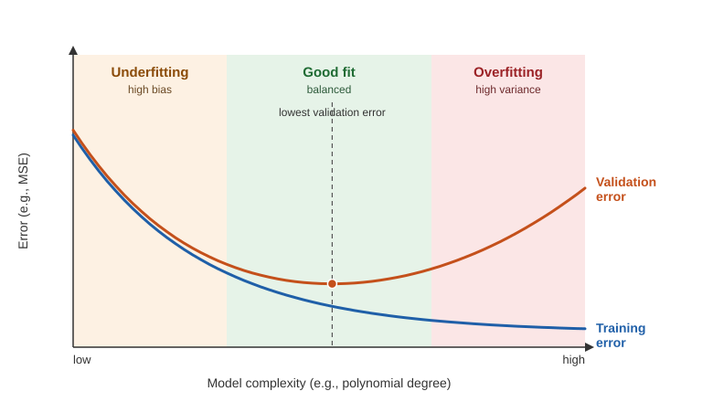

# 5장. 모델 평가와 검증

📖 [◀ 목차](00-목차.md) | [◀ 이전: 4장. 로지스틱 회귀와 분류](ch04-로지스틱회귀와분류.md) | [다음: 6장. 데이터 전처리와 특성 공학 ▶](ch06-데이터전처리와특성공학.md)

---

모델을 만드는 일보다 어려운 것은 "이 모델이 정말 쓸 만한가?"에 정직하게 답하는 일이다. 훈련 데이터에서 99%를 맞히는 모델도 처음 보는 데이터 앞에서는 무너질 수 있다. 이 장에서는 모델의 진짜 실력을 재는 방법, 그리고 그 측정을 망치는 대표적인 실수들을 다룬다.

이 장에서 배울 내용은 다음과 같다.

- 데이터를 훈련/검증/테스트로 나누는 이유와 방법
- 데이터 누수(data leakage)가 무엇이며 왜 위험한가
- 과소적합, 과대적합, 그리고 편향-분산 트레이드오프를 다항 회귀로 직접 실험하기
- 교차 검증(`KFold`, `StratifiedKFold`, `cross_val_score`)
- 분류 지표: 혼동 행렬, 정확도, 정밀도, 재현율, F1, ROC 곡선과 AUC
- 회귀 지표: MAE, MSE, RMSE, R²

이 장의 코드는 위에서 아래로 이어서 실행하도록 쓰여 있다. 앞 절에서 정의한 변수와 함수(`X`, `y`, `make_data`, `poly_model` 등)를 뒤 절에서 다시 사용한다. 그림은 직접 그리지 않고 숫자 출력으로 확인한다.

## 5.1 훈련 점수를 믿으면 안 되는 이유

머신러닝의 목표는 **일반화(generalization)**, 즉 학습 때 보지 못한 새 데이터에서도 잘 동작하는 것이다. 그런데 모델을 학습시킨 바로 그 데이터로 점수를 매기면 일반화 성능을 알 수 없다. 시험 문제와 정답을 미리 받아 외운 학생의 시험 점수가 그 학생의 실력을 말해 주지 못하는 것과 같다.

유방암 진단 데이터(`load_breast_cancer`)에서 결정 트리를 학습시켜 이 차이를 직접 확인해 보자. 결정 트리는 깊이를 제한하지 않으면 훈련 데이터를 거의 그대로 외울 수 있는 유연한 모델이다.

```python
import numpy as np
from sklearn.datasets import load_breast_cancer
from sklearn.model_selection import train_test_split
from sklearn.tree import DecisionTreeClassifier

X, y = load_breast_cancer(return_X_y=True)
print("데이터 크기:", X.shape, "/ 클래스별 개수:", np.bincount(y))

X_train, X_test, y_train, y_test = train_test_split(
    X, y, test_size=0.2, stratify=y, random_state=42
)
print("훈련 / 테스트 크기:", X_train.shape, X_test.shape)

tree = DecisionTreeClassifier(random_state=0).fit(X_train, y_train)
print(f"훈련 정확도: {tree.score(X_train, y_train):.3f}")
print(f"테스트 정확도: {tree.score(X_test, y_test):.3f}")
```

실행 결과:

```text
데이터 크기: (569, 30) / 클래스별 개수: [212 357]
훈련 / 테스트 크기: (455, 30) (114, 30)
훈련 정확도: 1.000
테스트 정확도: 0.912
```

훈련 정확도는 1.000, 테스트 정확도는 0.912다. 약 9%포인트의 차이가 바로 "외운 만큼의 착시"다. 훈련 데이터만 봤다면 완벽한 모델이라고 착각했을 것이다.

`train_test_split`의 인자를 짚고 가자.

- `test_size=0.2`: 전체의 20%를 테스트용으로 떼어 둔다.
- `stratify=y`: 분할 후에도 클래스 비율이 원본과 같도록 유지한다(**층화 추출**). 클래스 비율이 치우친 데이터에서 특히 중요하다.
- `random_state=42`: 분할이 매번 같도록 난수 씨앗을 고정한다. 결과를 재현하려면 필수다.

> 이 책의 출력은 모두 `random_state`를 고정해서 얻은 값이다. 여러분의 환경에서도 같은 scikit-learn 버전이라면 같은 숫자가 나온다. 버전이 달라 소수점 끝자리가 조금 다르더라도 흐름은 같아야 한다.

## 5.2 훈련·검증·테스트 세트

앞 절에서는 데이터를 두 조각으로 나눴다. 그런데 실전에서는 모델을 한 번만 학습시키지 않는다. 결정 트리의 `max_depth`를 몇으로 할지, 어떤 모델을 쓸지 등을 정하려고 여러 후보를 시험해 본다. 이때 후보를 비교하는 데 테스트 세트를 쓰면 문제가 생긴다. 테스트 점수를 보고 모델을 고르는 순간, 테스트 세트는 더 이상 "처음 보는 데이터"가 아니기 때문이다. 고른 모델은 테스트 세트에 은근히 맞춰진 것이고, 보고하는 점수는 실제보다 낙관적이 된다.

그래서 데이터를 세 조각으로 나눈다.

| 세트 | 역할 | 비유 |
|---|---|---|
| 훈련(train) 세트 | 모델의 파라미터를 학습한다 | 교과서와 문제집 |
| 검증(validation) 세트 | 하이퍼파라미터와 모델을 고른다 | 모의고사 |
| 테스트(test) 세트 | 최종 성능을 딱 한 번 보고한다 | 수능 |

`train_test_split`을 두 번 호출하면 세 조각이 된다. 아래 코드는 60% / 20% / 20%로 나누고, 검증 세트로 `max_depth`를 고른 뒤 테스트 세트로 마무리한다.

```python
# 먼저 테스트 세트를 떼어 두고, 남은 데이터를 다시 훈련/검증으로 나눈다
X_tmp, X_test, y_tmp, y_test = train_test_split(
    X, y, test_size=0.2, stratify=y, random_state=42
)
X_train, X_val, y_train, y_val = train_test_split(
    X_tmp, y_tmp, test_size=0.25, stratify=y_tmp, random_state=42
)
print("훈련 / 검증 / 테스트:", len(X_train), len(X_val), len(X_test))

best_depth, best_val = None, -1.0
for depth in [1, 2, 3, 4, 5, None]:
    model = DecisionTreeClassifier(max_depth=depth, random_state=0)
    model.fit(X_train, y_train)
    train_acc = model.score(X_train, y_train)
    val_acc = model.score(X_val, y_val)
    print(f"max_depth={str(depth):>4}  훈련 {train_acc:.3f}  검증 {val_acc:.3f}")
    if val_acc > best_val:
        best_depth, best_val = depth, val_acc

print("검증 세트로 고른 max_depth:", best_depth)

# 하이퍼파라미터가 정해졌으니 훈련+검증 데이터로 다시 학습하고,
# 테스트 세트는 마지막에 딱 한 번만 사용한다
final = DecisionTreeClassifier(max_depth=best_depth, random_state=0)
final.fit(X_tmp, y_tmp)
print(f"최종 테스트 정확도: {final.score(X_test, y_test):.3f}")
```

실행 결과:

```text
훈련 / 검증 / 테스트: 341 114 114
max_depth=   1  훈련 0.927  검증 0.895
max_depth=   2  훈련 0.968  검증 0.947
max_depth=   3  훈련 0.971  검증 0.947
max_depth=   4  훈련 0.985  검증 0.947
max_depth=   5  훈련 0.997  검증 0.956
max_depth=None  훈련 1.000  검증 0.956
검증 세트로 고른 max_depth: 5
최종 테스트 정확도: 0.930
```

`max_depth`가 커질수록 훈련 정확도는 0.927에서 1.000까지 계속 오르지만, 검증 정확도는 0.947 근처에서 더 이상 눈에 띄게 오르지 않는다. 검증 세트의 크기가 114개이므로 정확도 0.947과 0.956의 차이는 샘플 단 한 개를 더 맞힌 것(1/114 ≈ 0.009)에 불과하다는 점도 눈여겨보자. 이렇게 데이터가 작으면 검증 점수 하나가 우연에 크게 흔들린다. 이 문제는 5.6절의 교차 검증에서 해결한다.

코드에는 두 가지 관례가 들어 있다.

- 점수가 같을 때는 먼저 나온 후보(더 단순한 모델)를 유지하도록 `>`를 사용했다. 같은 성능이면 단순한 모델이 낫다.
- 하이퍼파라미터를 정한 뒤에는 훈련 세트와 검증 세트를 합쳐서 다시 학습한다. 데이터를 조금이라도 더 쓰는 편이 낫기 때문이다. 단, 테스트 세트는 여기서도 건드리지 않는다.

> **테스트 세트는 한 번만 연다.** 테스트 점수를 본 뒤 "조금만 더 고쳐 볼까?" 하고 모델을 수정하기 시작하면, 테스트 세트는 두 번째 검증 세트가 되어 버린다. 테스트 점수가 마음에 들지 않아도 그 점수가 여러분의 모델이 가진 실력이다.

## 5.3 데이터 누수

**데이터 누수(data leakage)**는 모델이 학습하는 시점에는 알 수 없는 정보가 학습 과정에 새어 들어가는 현상이다. 누수가 있으면 평가 점수는 훌륭하게 나오지만 실제 서비스에 넣으면 성능이 곤두박질친다. 가장 위험한 점은 코드에 오류도 경고도 없다는 것이다.

대표적인 누수 유형은 다음과 같다.

- **전처리 누수**: 스케일러, 결측치 대체기 등을 분할 전의 전체 데이터에 `fit`한다. 테스트 데이터의 평균과 분산이 훈련 과정에 섞인다(6장에서 자세히 다룬다).
- **특성 선택 누수**: 분할 전에 전체 데이터와 레이블을 보고 유용한 특성을 고른다. 아래에서 직접 실험한다.
- **타깃 누수**: 예측하려는 값의 결과로 생기는 열이 특성에 들어 있다. 예를 들어 "대출 연체 여부"를 예측하는데 "연체 독촉 전화 횟수" 열이 있는 경우다.
- **중복 누수**: 같은 샘플(또는 같은 사람의 여러 기록)이 훈련 세트와 테스트 세트에 나뉘어 들어간다.
- **시간 누수**: 시계열 데이터를 무작위로 섞어 분할해, 미래의 데이터로 과거를 예측하게 만든다.

특성 선택 누수가 얼마나 강력한지 보여 주는 실험을 해 보자. 특성 2000개와 레이블이 모두 **순수한 난수**인 데이터를 만든다. 이 데이터에는 배울 만한 규칙이 아예 없으므로, 어떤 모델이든 정확도는 50% 근처여야 한다.

```python
from sklearn.feature_selection import SelectKBest, f_classif
from sklearn.linear_model import LogisticRegression

# 특성 2000개, 샘플 200개. 특성도 레이블도 모두 순수한 난수다.
rng = np.random.default_rng(0)
X_noise = rng.normal(size=(200, 2000))
y_noise = rng.integers(0, 2, size=200)

# 잘못된 방법: 전체 데이터로 특성을 고른 뒤에 분리한다
selector = SelectKBest(f_classif, k=20).fit(X_noise, y_noise)
X_sel = selector.transform(X_noise)
X_tr, X_te, y_tr, y_te = train_test_split(X_sel, y_noise, test_size=0.3, random_state=0)
leaky_acc = LogisticRegression().fit(X_tr, y_tr).score(X_te, y_te)
print(f"[누수] 테스트 정확도: {leaky_acc:.3f}")

# 올바른 방법: 먼저 분리하고, 훈련 데이터로만 특성을 고른다
X_tr, X_te, y_tr, y_te = train_test_split(X_noise, y_noise, test_size=0.3, random_state=0)
selector = SelectKBest(f_classif, k=20).fit(X_tr, y_tr)
clean_acc = LogisticRegression().fit(selector.transform(X_tr), y_tr).score(
    selector.transform(X_te), y_te
)
print(f"[정상] 테스트 정확도: {clean_acc:.3f}")
```

실행 결과:

```text
[누수] 테스트 정확도: 0.750
[정상] 테스트 정확도: 0.450
```

규칙이 전혀 없는 데이터인데 "누수" 방식으로는 정확도 0.750이 나왔다. 반면 올바른 방식은 0.450으로, 동전 던지기 수준(테스트 샘플이 60개뿐이라 0.5 위아래로 흔들린다)이다.

무슨 일이 벌어진 것일까? 난수 특성 2000개 중에는 우연히 레이블과 상관이 높은 것이 몇 개 있기 마련이다. 전체 데이터로 "레이블과 가장 관련 깊은 20개"를 고르면, 그 선택에 **테스트 샘플의 레이블이 이미 반영**된다. 모델은 테스트 정답을 간접적으로 엿본 셈이다.

여기서 얻을 교훈은 한 문장으로 정리된다.

> **`fit`(통계 계산, 특성 선택, 모델 학습)은 오직 훈련 데이터에만 하고, 테스트 데이터에는 `transform`과 `predict`만 한다.**

교차 검증을 할 때는 매 폴드마다 이 규칙을 지켜야 해서 코드가 번거로워진다. scikit-learn은 전처리와 모델을 한 덩어리로 묶는 `Pipeline`으로 이 문제를 깔끔하게 해결한다. 6장에서 개념을 맛보고, 17장에서 본격적으로 다룬다. 바로 다음 절의 코드에서 쓰는 `make_pipeline`은 "전처리 단계와 모델을 순서대로 이어 붙여 하나의 모델처럼 쓰게 해 주는 도구"라고만 알고 넘어가자.

## 5.4 과소적합과 과대적합

모델이 훈련 데이터에 잘 맞는 것만으로는 부족하고, 새 데이터에도 잘 맞아야 한다. 그래서 두 가지 실패가 생긴다.

- **과소적합(underfitting)**: 모델이 너무 단순해서 데이터의 패턴조차 잡지 못한다. 훈련 오차도 검증 오차도 모두 높다.
- **과대적합(overfitting)**: 모델이 너무 유연해서 훈련 데이터의 우연한 잡음까지 외운다. 훈련 오차는 낮은데 검증 오차는 높다.



모델의 복잡도를 높이면 훈련 오차는 계속 줄어든다. 하지만 검증 오차는 어느 지점까지 줄다가 다시 올라가는 U자 모양을 그린다. 검증 오차가 가장 낮은 지점이 우리가 찾는 "적정 복잡도"다.

이 곡선을 실제 숫자로 확인하기 위해 **다항 회귀**로 실험한다. 다항 회귀는 입력 x에서 x, x², x³, …을 새 특성으로 만든 뒤 선형 회귀를 적용하는 방법이다. 차수(degree)가 모델의 복잡도 역할을 한다. 정답은 사인 곡선 `sin(2πx)`이고, 여기에 표준편차 0.3의 잡음을 더해 데이터를 만든다. 훈련 데이터는 일부러 20개로 적게 잡는다.

```python
from sklearn.linear_model import LinearRegression
from sklearn.metrics import mean_squared_error
from sklearn.pipeline import make_pipeline
from sklearn.preprocessing import PolynomialFeatures


def true_f(x):
    return np.sin(2 * np.pi * x)          # 우리가 모르는 "진짜 법칙"


def make_data(n, rng, noise=0.3):
    x = rng.uniform(0, 1, n)
    y = true_f(x) + rng.normal(0, noise, n)
    return x.reshape(-1, 1), y


def poly_model(degree):
    # x -> [x, x^2, ..., x^degree] 로 바꾼 뒤 선형 회귀를 적용
    return make_pipeline(
        PolynomialFeatures(degree, include_bias=False), LinearRegression()
    )


rng = np.random.default_rng(1)
X_train, y_train = make_data(20, rng)    # 훈련 데이터는 겨우 20개
X_val, y_val = make_data(500, rng)       # 검증 데이터는 넉넉하게 500개

print("차수   훈련 MSE   검증 MSE")
for degree in [1, 2, 3, 4, 6, 8, 10, 12]:
    model = poly_model(degree).fit(X_train, y_train)
    train_mse = mean_squared_error(y_train, model.predict(X_train))
    val_mse = mean_squared_error(y_val, model.predict(X_val))
    print(f"{degree:>3}   {train_mse:9.4f}  {val_mse:9.4f}")
```

실행 결과:

```text
차수   훈련 MSE   검증 MSE
  1      0.1635     0.3468
  2      0.1616     0.3497
  3      0.0862     0.1453
  4      0.0757     0.1600
  6      0.0681     0.2251
  8      0.0663     0.3283
 10      0.0630     1.8547
 12      0.0590     1.3186
```

결과를 읽어 보자.

- **차수 1~2 (과소적합)**: 훈련 MSE가 0.16이고 검증 MSE는 0.35다. 직선이나 포물선으로는 사인 곡선의 구불구불한 모양을 담을 수 없어 둘 다 높다.
- **차수 3 (적정)**: 검증 MSE가 0.1453으로 가장 낮다. 이 데이터의 잡음 분산이 0.3² = 0.09이므로, 아무리 좋은 모델도 0.09 아래로는 내려갈 수 없다. 0.1453은 그 바닥에 가장 가깝다.
- **차수 4 이상 (과대적합)**: 훈련 MSE는 0.0757, 0.0681, 0.0663, 0.0630, 0.0590으로 꾸준히 줄지만 검증 MSE는 0.1600에서 시작해 0.3283, 1.8547로 치솟는다.

훈련 MSE가 줄기만 하는 데는 이유가 있다. 차수가 높은 다항식은 차수가 낮은 다항식을 포함하므로(예: 3차식은 x³의 계수를 0으로 두면 2차식이다), 최소제곱법으로 구한 훈련 오차는 차수를 올려도 절대 늘지 않는다. **훈련 오차만으로는 모델의 복잡도를 고를 수 없다**는 뜻이다. 검증 오차를 봐야 한다.

과소적합과 과대적합에 대한 처방은 정반대다.

| 증상 | 처방 |
|---|---|
| 과소적합 (훈련/검증 모두 나쁨) | 더 유연한 모델로 교체, 유용한 특성 추가, 규제 완화 |
| 과대적합 (훈련 좋음, 검증 나쁨) | 훈련 데이터 늘리기, 모델 단순화, 규제 강화, 불필요한 특성 제거 |

한편 이 실험에서 검증 데이터를 500개나 만든 것은 곡선의 모양을 선명하게 보기 위한 사치다. 실전에서는 데이터가 귀하므로 검증에 쓸 수 있는 양이 제한된다. 이 문제도 5.6절에서 다시 만난다.

## 5.5 편향-분산 트레이드오프

앞 절의 곡선이 왜 U자가 되는지를 **편향(bias)**과 **분산(variance)**이라는 두 가지 오류의 합으로 설명할 수 있다. 같은 문제를 푸는 모델을 서로 다른 훈련 세트로 여러 번 학습시킨다고 상상해 보자.

- **편향**: 여러 번 학습시킨 모델들의 *평균 예측*이 정답에서 얼마나 벗어나 있는가. 모델이 너무 단순해서 정답의 모양을 체계적으로 놓칠 때 크다. 직선으로 사인 곡선을 맞추려는 경우가 그렇다.
- **분산**: 훈련 세트가 바뀔 때 예측이 얼마나 흔들리는가. 모델이 너무 유연해서 훈련 세트의 잡음에 민감할 때 크다.
- **잡음**: 데이터 자체에 섞인 무작위 오차. 어떤 모델도 줄일 수 없다.

새 데이터에서의 기대 오차는 이 세 가지의 합으로 분해된다.

> 기대 오차 = 편향² + 분산 + 잡음

복잡도를 올리면 편향은 줄지만 분산은 늘어난다. 이 맞바꿈이 **편향-분산 트레이드오프**다. 말로만 들으면 추상적이니, 훈련 세트를 300번 새로 뽑아서 편향²과 분산을 실제로 측정해 보자.

```python
grid = np.linspace(0, 1, 100).reshape(-1, 1)   # 평가할 x 지점 100개
f_grid = true_f(grid.ravel())                  # 그 지점의 진짜 값
noise_var = 0.3 ** 2                           # 줄일 수 없는 잡음의 분산


def bias_variance(degree, n, trials=300, seed=0):
    rng = np.random.default_rng(seed)
    preds = []
    for _ in range(trials):                    # 훈련 세트를 trials번 새로 뽑아서
        Xb, yb = make_data(n, rng)
        preds.append(poly_model(degree).fit(Xb, yb).predict(grid))
    preds = np.array(preds)                    # 모양: (trials, 100)

    bias2 = np.mean((preds.mean(axis=0) - f_grid) ** 2)   # 평균 예측이 정답에서 벗어난 정도
    variance = np.mean(preds.var(axis=0))                 # 예측이 훈련 세트마다 흔들리는 정도
    return bias2, variance


print("차수   편향^2     분산    잡음   기대 오차(합)")
for degree in [1, 2, 3, 4, 5]:
    bias2, variance = bias_variance(degree, n=20)
    total = bias2 + variance + noise_var
    print(f"{degree:>3}  {bias2:8.4f} {variance:8.4f} {noise_var:6.2f}  {total:9.4f}")
```

실행 결과:

```text
차수   편향^2     분산    잡음   기대 오차(합)
  1    0.2051   0.0377   0.09     0.3328
  2    0.2109   0.0972   0.09     0.3980
  3    0.0056   0.0318   0.09     0.1274
  4    0.0092   0.1030   0.09     0.2022
  5    0.0009   0.3147   0.09     0.4056
```

표의 흐름은 다음과 같다.

- **차수 1, 2**: 편향²이 0.2 이상으로 크고 분산은 작다. 모델이 안정적이지만 정답 모양을 체계적으로 놓친다(과소적합).
- **차수 3**: 편향²이 0.0056으로 뚝 떨어지고 분산도 0.0318로 낮다. 합계가 0.1274로 가장 작다.
- **차수 4, 5**: 편향²은 0.01 이하로 더 줄지만 분산이 0.1030, 0.3147로 커지면서 합계가 오른다(과대적합).

> 이 실험의 분산 값은 소수의 "운 나쁜 훈련 세트"가 만드는 극단적인 예측 때문에 크게 부풀려진다. 특히 x가 0이나 1에 가까운 구간에서 고차 다항식은 데이터가 몇 개 없으면 크게 요동친다. 그래서 차수가 6, 7로 올라가면 분산이 수 배에서 수십 배로 폭증하기도 한다. 정확한 숫자보다 **차수가 올라갈수록 편향은 줄고 분산이 커지는 방향**을 읽어 내는 것이 목적이다.

분산은 데이터를 더 모으면 줄일 수 있다. 같은 차수 5 모델로 훈련 데이터의 개수만 바꿔 보자.

```python
# 같은 차수 5 모델이라도 훈련 데이터가 늘어나면 분산이 줄어든다
print("n(훈련 개수)   편향^2     분산")
for n in [20, 50, 200]:
    bias2, variance = bias_variance(5, n=n)
    print(f"{n:>9}   {bias2:8.4f} {variance:8.4f}")
```

실행 결과:

```text
n(훈련 개수)   편향^2     분산
       20     0.0009   0.3147
       50     0.0001   0.0161
      200     0.0000   0.0030
```

훈련 데이터가 20개에서 200개로 늘자 분산이 0.3147에서 0.0030으로 100분의 1 가까이 줄었다. "과대적합이면 데이터를 더 모아라"는 조언이 이 실험에 담겨 있다. 편향은 이미 작았으므로 데이터가 늘어도 거의 변함이 없다. 반대로 과소적합 상태의 모델은 데이터를 아무리 모아도 편향이 줄지 않는다. 그럴 때는 데이터가 아니라 모델을 바꿔야 한다.

## 5.6 교차 검증

검증 세트 하나로 모델을 고르는 방식에는 두 가지 약점이 있다.

1. 점수가 **어떤 샘플이 검증 세트에 들어갔느냐**에 따라 흔들린다(5.2절에서 샘플 한 개 차이를 봤다).
2. 데이터가 적을 때 검증용으로 떼어 놓는 양이 너무 아깝다.

**K-겹 교차 검증(K-fold cross-validation)**은 이 문제를 이렇게 푼다. 데이터를 K개의 조각(폴드)으로 나누고, 한 조각씩 돌아가며 검증 세트로 쓰면서 K번 학습/평가한 뒤 점수를 평균한다. K=5일 때의 모습은 다음과 같다.

```text
        폴드1   폴드2   폴드3   폴드4   폴드5
1회차:  [검증]  [훈련]  [훈련]  [훈련]  [훈련]
2회차:  [훈련]  [검증]  [훈련]  [훈련]  [훈련]
3회차:  [훈련]  [훈련]  [검증]  [훈련]  [훈련]
4회차:  [훈련]  [훈련]  [훈련]  [검증]  [훈련]
5회차:  [훈련]  [훈련]  [훈련]  [훈련]  [검증]
```

모든 샘플이 정확히 한 번씩 검증에 쓰이고 나머지 K-1번은 훈련에 쓰이므로 데이터를 알뜰하게 쓰고, 점수의 평균과 흩어진 정도(표준편차)까지 얻는다. 대신 학습을 K번 해야 하므로 계산 비용이 K배 든다.

### 5.6.1 KFold와 직접 만든 분할

`KFold`가 만드는 분할을 샘플 10개짜리 장난감 데이터로 직접 들여다보자. 비교를 위해 NumPy로 같은 기능을 하는 함수도 만들어 본다.

```python
from sklearn.model_selection import KFold

X_demo = np.arange(10).reshape(-1, 1)

print("== KFold(5), 섞지 않음 ==")
for train_idx, test_idx in KFold(n_splits=5).split(X_demo):
    print("훈련", train_idx, "검증", test_idx)

print("== KFold(5, shuffle=True) ==")
kf = KFold(n_splits=5, shuffle=True, random_state=0)
for train_idx, test_idx in kf.split(X_demo):
    print("훈련", train_idx, "검증", test_idx)


# NumPy로 직접 만든 K-겹 분할
def my_kfold(n, k, seed):
    idx = np.random.default_rng(seed).permutation(n)   # 인덱스를 섞고
    folds = np.array_split(idx, k)                     # k조각으로 나눈다
    for i in range(k):
        train_idx = np.concatenate(folds[:i] + folds[i + 1:])
        yield train_idx, folds[i]


print("== 직접 만든 my_kfold ==")
for train_idx, test_idx in my_kfold(10, 5, seed=0):
    print("훈련", np.sort(train_idx), "검증", np.sort(test_idx))
```

실행 결과:

```text
== KFold(5), 섞지 않음 ==
훈련 [2 3 4 5 6 7 8 9] 검증 [0 1]
훈련 [0 1 4 5 6 7 8 9] 검증 [2 3]
훈련 [0 1 2 3 6 7 8 9] 검증 [4 5]
훈련 [0 1 2 3 4 5 8 9] 검증 [6 7]
훈련 [0 1 2 3 4 5 6 7] 검증 [8 9]
== KFold(5, shuffle=True) ==
훈련 [0 1 3 4 5 6 7 9] 검증 [2 8]
훈련 [0 1 2 3 5 6 7 8] 검증 [4 9]
훈련 [0 2 3 4 5 7 8 9] 검증 [1 6]
훈련 [0 1 2 4 5 6 8 9] 검증 [3 7]
훈련 [1 2 3 4 6 7 8 9] 검증 [0 5]
== 직접 만든 my_kfold ==
훈련 [0 1 2 3 5 7 8 9] 검증 [4 6]
훈련 [0 1 3 4 5 6 8 9] 검증 [2 7]
훈련 [0 1 2 4 6 7 8 9] 검증 [3 5]
훈련 [1 2 3 4 5 6 7 8] 검증 [0 9]
훈련 [0 2 3 4 5 6 7 9] 검증 [1 8]
```

`KFold.split(X)`는 (훈련 인덱스, 검증 인덱스) 쌍을 폴드 수만큼 차례로 내놓는 제너레이터다. 몇 가지를 확인하자.

- `shuffle=False`(기본값)이면 앞에서부터 순서대로 잘라서 검증 폴드를 만든다. 데이터가 정렬되어 있으면 위험하다(5.6.3절).
- `shuffle=True`이면 먼저 섞은 뒤 자른다. `random_state`는 **`shuffle=True`일 때만** 의미가 있다.
- 직접 만든 `my_kfold`는 (1) 인덱스를 섞고 (2) `np.array_split`으로 K조각을 낸 뒤 (3) i번째 조각을 검증으로, 나머지를 합쳐서 훈련으로 쓴다. 이것이 `KFold`의 전부라고 해도 과언이 아니다. 난수 생성기가 달라서 어떤 샘플이 같은 폴드에 묶이는지는 `KFold`와 다르지만, 구조는 같다.

### 5.6.2 cross_val_score

폴드를 나누고, 학습하고, 점수를 매기는 반복문을 매번 직접 쓸 필요는 없다. `cross_val_score(모델, X, y, cv=...)`가 이 모든 과정을 대신해 준다. 각 폴드의 점수를 담은 배열을 돌려준다.

```python
from sklearn.model_selection import cross_val_score

tree = DecisionTreeClassifier(max_depth=3, random_state=0)
scores = cross_val_score(tree, X, y, cv=5)      # 분류기 + 정수 cv -> StratifiedKFold
print("폴드별 정확도:", np.round(scores, 3))
print(f"평균 {scores.mean():.3f} / 표준편차 {scores.std():.3f}")
```

실행 결과:

```text
폴드별 정확도: [0.912 0.895 0.939 0.947 0.894]
평균 0.917 / 표준편차 0.022
```

다섯 폴드의 정확도는 0.894에서 0.947까지 퍼져 있고 평균은 0.917, 표준편차는 0.022다. 검증 세트를 하나만 썼다면 이 중 하나의 숫자만 보고 "0.947이다!" 또는 "0.894다…" 하고 일희일비했을 것이다. 교차 검증은 **"이 모델의 실력은 대략 0.92 ± 0.02"**라는 훨씬 믿을 만한 문장을 준다.

`cross_val_score`의 기본 점수는 분류기라면 정확도, 회귀 모델이라면 R²다. `scoring="f1"`, `scoring="roc_auc"`처럼 문자열로 다른 지표를 고를 수 있다(5.7절, 5.8절 참고). 또한 `cross_val_score`는 폴드마다 모델을 **새로 복제해서** 학습시키므로, 넘겨 준 모델 객체 자체는 학습되지 않은 채로 남는다.

### 5.6.3 StratifiedKFold: 클래스 비율을 지키는 분할

분류 문제에서는 폴드마다 클래스 비율이 원본과 비슷해야 한다. `StratifiedKFold`는 이를 보장한다. 붓꽃(iris) 데이터를 이용해 차이를 극적으로 확인해 보자. 이 데이터는 레이블이 0, 0, …, 1, 1, …, 2, 2, … 순서로 **정렬**되어 있다.

```python
from sklearn.datasets import load_iris
from sklearn.model_selection import StratifiedKFold

X_iris, y_iris = load_iris(return_X_y=True)     # 레이블이 0,0,...,1,1,...,2,2 순서로 정렬됨
logreg = LogisticRegression(max_iter=1000)

print("KFold(3), 섞지 않음      :", cross_val_score(logreg, X_iris, y_iris, cv=KFold(3)))
print("KFold(3, shuffle=True)   :", cross_val_score(
    logreg, X_iris, y_iris, cv=KFold(3, shuffle=True, random_state=0)))
print("StratifiedKFold(3)       :", cross_val_score(
    logreg, X_iris, y_iris, cv=StratifiedKFold(3)))

print("\n검증 폴드 안의 클래스별 개수")
for name, splitter in [("KFold          ", KFold(3)), ("StratifiedKFold", StratifiedKFold(3))]:
    for _, test_idx in splitter.split(X_iris, y_iris):
        print(name, np.bincount(y_iris[test_idx], minlength=3))
```

실행 결과:

```text
KFold(3), 섞지 않음      : [0. 0. 0.]
KFold(3, shuffle=True)   : [0.98 0.96 0.96]
StratifiedKFold(3)       : [0.98 0.96 0.98]

검증 폴드 안의 클래스별 개수
KFold           [50  0  0]
KFold           [ 0 50  0]
KFold           [ 0  0 50]
StratifiedKFold [17 17 16]
StratifiedKFold [17 16 17]
StratifiedKFold [16 17 17]
```

섞지 않은 `KFold(3)`의 정확도는 세 폴드 모두 0.0이다. 분할이 순서대로 이뤄지니 첫 폴드의 검증 세트는 클래스 0만, 둘째는 클래스 1만, 셋째는 클래스 2만 담는다. 그러면 훈련 세트에는 검증 세트에 있는 클래스가 아예 없고, 모델은 한 번도 본 적 없는 클래스를 맞혀야 하니 전부 틀린다. 반면 `StratifiedKFold`는 폴드마다 클래스가 17/17/16개처럼 고르게 들어간다.

정리하면 다음과 같다.

- 분류 문제에는 `StratifiedKFold`를 쓴다. `cross_val_score`에 `cv=5`처럼 정수를 주고 분류기를 넘기면 자동으로 `StratifiedKFold`(섞지 않는 버전)가 사용된다.
- `KFold` 객체를 직접 넘기면 그 선택이 우선하므로 위의 사고가 날 수 있다. 데이터의 순서에 의미가 없다면 `shuffle=True`를 습관처럼 붙이자.
- 데이터에 **순서의 의미**가 있다면(시계열) 섞으면 안 된다. 이럴 때는 `TimeSeriesSplit`을 쓴다.
- 같은 사람/기기에서 나온 여러 샘플이 폴드에 흩어져 들어가면 중복 누수가 생긴다. 이런 데이터에는 묶음 단위로 나누는 `GroupKFold`가 있다.
- 폴드 분할을 여러 번 반복하는 `RepeatedKFold`, 샘플 한 개씩 검증하는 `LeaveOneOut`도 `sklearn.model_selection`에 있다.

### 5.6.4 교차 검증으로 모델 복잡도 고르기

이제 5.4절의 질문, "다항식의 차수를 몇으로 할까?"에 교차 검증으로 답해 보자. 이번에는 데이터를 60개로 늘리고 5겹 교차 검증을 한다. `neg_mean_squared_error`는 MSE에 음수 부호를 붙인 점수다(scikit-learn의 점수는 "클수록 좋다"는 규칙을 따르기 때문이다). 그래서 코드에서 부호를 다시 뒤집어 MSE로 읽는다.

```python
rng = np.random.default_rng(1)
X_cv, y_cv = make_data(60, rng)                 # 이번에는 60개 데이터로 차수를 고른다
cv = KFold(n_splits=5, shuffle=True, random_state=0)

print("차수   CV MSE(평균)   표준편차")
for degree in [1, 2, 3, 4, 5, 6, 8, 10]:
    scores = cross_val_score(
        poly_model(degree), X_cv, y_cv, cv=cv, scoring="neg_mean_squared_error"
    )
    mse = -scores                               # 점수는 "클수록 좋다"로 부호가 뒤집혀 있다
    print(f"{degree:>3}   {mse.mean():12.4f}   {mse.std():8.4f}")
```

실행 결과:

```text
차수   CV MSE(평균)   표준편차
  1         0.2768     0.2114
  2         0.3492     0.3191
  3         0.0636     0.0198
  4         0.0801     0.0482
  5         0.1840     0.2542
  6         0.1081     0.1028
  8         0.3059     0.4942
 10         0.5306     0.9432
```

CV MSE가 가장 낮은 차수는 3(0.0636)이고 표준편차도 0.0198로 가장 작다. 폴드가 바뀌어도 성능이 안정적이라는 뜻이다. 반대로 차수 4 이후에는 평균 MSE와 폴드 사이의 흩어짐(표준편차)이 대체로 함께 커진다(표준편차 0.0482에서 0.9432까지). 모델이 훈련 폴드의 사소한 변화에도 크게 흔들린다는 과대적합의 신호다. 차수 1, 2의 표준편차가 큰 것은 다른 이유로, 이 모델들이 어느 폴드에서든 곡선 모양을 놓쳐서 폴드마다 놓치는 정도가 달라지기 때문이다.

교차 검증을 이용한 모델 선택의 전체 흐름을 정리하면 다음과 같다.

1. 먼저 테스트 세트를 떼어 둔다.
2. 나머지(훈련용) 데이터에서 교차 검증으로 모델과 하이퍼파라미터를 고른다.
3. 고른 설정으로 훈련용 데이터 전체를 사용해 다시 학습한다.
4. 테스트 세트로 딱 한 번 최종 점수를 낸다.

위 코드는 2단계의 예시이며 편의상 테스트 세트는 따로 만들지 않았다. 후보 설정이 많을 때는 반복문을 대신 돌려 주는 `GridSearchCV`가 있는데, 이후 장에서 다룬다.

## 5.7 분류 모델의 평가 지표

"정확도 95%"는 좋은 말일까? 무엇을 틀렸는지에 따라 다르다. 분류 모델이 틀리는 방식은 한 가지가 아니기 때문이다. 이번 절에서는 유방암 데이터로 이진 분류의 평가 지표를 정리한다. 의료 문제이므로 **악성 종양을 양성(positive) 클래스, 즉 1**로 놓는 것이 자연스럽다. scikit-learn 데이터는 0이 악성이므로 `y = 1 - y`로 뒤집어 준다. 우리말에서 "양성"은 "양성 종양(benign)"과 "양성 클래스(positive)" 두 가지로 쓰여 헷갈리기 쉽다. 이 장에서 "양성/음성"은 항상 머신러닝의 positive/negative를 뜻하고, 종양은 "악성"과 "악성이 아님"으로 구별해 쓴다.

### 5.7.1 혼동 행렬과 네 가지 지표

**혼동 행렬(confusion matrix)**은 실제 값과 예측 값을 교차시킨 표다.

| | 예측: 음성(0) | 예측: 양성(1) |
|---|---|---|
| **실제: 음성(0)** | TN (진짜 음성) | FP (가짜 양성) |
| **실제: 양성(1)** | FN (가짜 음성) | TP (진짜 양성) |

TP, TN은 맞힌 경우이고 FP, FN은 두 종류의 오류다. FP는 "멀쩡한 사람을 악성이라고 했다"(헛경보), FN은 "악성인 사람을 정상이라고 했다"(놓침)에 해당한다. 이 네 숫자로 대부분의 지표가 정의된다.

| 지표 | 정의 | 직관 |
|---|---|---|
| 정확도(accuracy) | (TP+TN) / 전체 | 전체 중 맞힌 비율 |
| 정밀도(precision) | TP / (TP+FP) | 양성이라고 한 것 중 진짜 양성의 비율. "경보의 신뢰도" |
| 재현율(recall) | TP / (TP+FN) | 진짜 양성 중 잡아낸 비율. "놓치지 않는 능력" |
| F1 | 정밀도와 재현율의 조화 평균 | 둘 중 하나라도 낮으면 낮아지는 균형 지표 |

scikit-learn의 `confusion_matrix`는 **행이 실제 값, 열이 예측 값**이고, 레이블이 0과 1일 때 `.ravel()`하면 `TN, FP, FN, TP` 순서로 풀린다. 직접 정의대로 계산한 값과 `sklearn.metrics`의 함수 결과를 나란히 비교해 보자. 이번에는 스케일링을 먼저 하는 로지스틱 회귀 모델을 쓴다.

```python
from sklearn.metrics import (accuracy_score, confusion_matrix, f1_score,
                             precision_score, recall_score)
from sklearn.preprocessing import StandardScaler

X, y = load_breast_cancer(return_X_y=True)
y = 1 - y                          # 원래는 0=malignant(악성), 1=benign. 악성을 1(positive)로 뒤집는다
X_train, X_test, y_train, y_test = train_test_split(
    X, y, test_size=0.3, stratify=y, random_state=0
)

clf = make_pipeline(StandardScaler(), LogisticRegression()).fit(X_train, y_train)
y_pred = clf.predict(X_test)

cm = confusion_matrix(y_test, y_pred)
print(cm)
tn, fp, fn, tp = cm.ravel()
print(f"TN={tn}  FP={fp}  FN={fn}  TP={tp}")

# 정의 그대로 계산
print("--- 직접 계산 ---")
print(f"정확도 {(tp + tn) / (tp + tn + fp + fn):.4f}")
print(f"정밀도 {tp / (tp + fp):.4f}")
print(f"재현율 {tp / (tp + fn):.4f}")
precision, recall = tp / (tp + fp), tp / (tp + fn)
print(f"F1     {2 * precision * recall / (precision + recall):.4f}")

print("--- sklearn.metrics ---")
print(f"정확도 {accuracy_score(y_test, y_pred):.4f}")
print(f"정밀도 {precision_score(y_test, y_pred):.4f}")
print(f"재현율 {recall_score(y_test, y_pred):.4f}")
print(f"F1     {f1_score(y_test, y_pred):.4f}")
```

실행 결과:

```text
[[103   4]
 [  4  60]]
TN=103  FP=4  FN=4  TP=60
--- 직접 계산 ---
정확도 0.9532
정밀도 0.9375
재현율 0.9375
F1     0.9375
--- sklearn.metrics ---
정확도 0.9532
정밀도 0.9375
재현율 0.9375
F1     0.9375
```

혼동 행렬을 보면 171개 테스트 샘플 중 악성 64개에서 60개를 잡고 4개를 놓쳤으며(FN=4), 악성이 아닌 107개 중 4개를 악성으로 잘못 판정했다(FP=4). 직접 계산한 값과 sklearn의 값이 정확히 일치한다.

어떤 지표를 중시할지는 **오류의 비용**이 정한다.

- **스팸 메일 필터**: 정상 메일을 스팸함에 보내는 것(FP)이 치명적이다. 정밀도를 중시한다.
- **암 검진, 고장 예측**: 환자를 놓치는 것(FN)이 치명적이다. 재현율을 중시한다.
- 둘 다 중요하면 F1을 본다.

`precision_score`나 `recall_score`는 이진 분류에서 기본으로 `pos_label=1`을 양성으로 본다. 다중 클래스 문제에서는 `average="macro"`(클래스별 점수의 단순 평균), `"weighted"`(클래스 크기로 가중 평균), `"micro"`(전체를 합쳐 계산) 중에서 고른다. 모델이 한 번도 양성이라고 예측하지 않아 정밀도의 분모가 0이 되면 경고가 나오는데, `zero_division=0`으로 처리 방식을 정할 수 있다.

### 5.7.2 classification_report와 임계값

`classification_report`는 클래스별 지표를 한 번에 보여 준다. 그리고 `predict_proba`로 얻은 확률을 어느 값 이상에서 양성으로 볼지(**임계값, threshold**) 바꿔 보면 정밀도와 재현율이 서로 맞바뀌는 것을 볼 수 있다. `predict`는 기본적으로 임계값 0.5를 쓴다.

```python
from sklearn.metrics import classification_report

print(classification_report(y_test, y_pred, target_names=["benign", "malignant"]))

# 임계값을 바꾸면 정밀도와 재현율이 맞바뀐다
proba = clf.predict_proba(X_test)[:, 1]          # 악성일 확률
print("임계값  정밀도  재현율   FP   FN")
for threshold in [0.1, 0.3, 0.5, 0.7, 0.9]:
    pred_t = (proba >= threshold).astype(int)
    tn, fp, fn, tp = confusion_matrix(y_test, pred_t).ravel()
    print(f"{threshold:5.1f}  {precision_score(y_test, pred_t):6.3f}  "
          f"{recall_score(y_test, pred_t):6.3f}  {fp:3d}  {fn:3d}")
```

실행 결과:

```text
              precision    recall  f1-score   support

      benign       0.96      0.96      0.96       107
   malignant       0.94      0.94      0.94        64

    accuracy                           0.95       171
   macro avg       0.95      0.95      0.95       171
weighted avg       0.95      0.95      0.95       171

임계값  정밀도  재현율   FP   FN
  0.1   0.818   0.984   14    1
  0.3   0.859   0.953   10    3
  0.5   0.938   0.938    4    4
  0.7   1.000   0.922    0    5
  0.9   1.000   0.875    0    8
```

임계값을 0.9로 높이면 모델이 "확실할 때만" 악성이라 하므로 헛경보(FP)는 0이 되고 정밀도는 1.000이 되지만, 놓치는 환자(FN)가 8명으로 늘어 재현율이 0.875로 떨어진다. 반대로 임계값을 0.1로 낮추면 재현율은 0.984까지 오르지만 헛경보가 14건으로 늘어 정밀도는 0.818이 된다.

**정밀도와 재현율은 한쪽을 올리면 다른 쪽이 내려가는 관계**다. 모델의 성능이 같다면, 임계값은 "어느 쪽 오류가 더 아픈가"라는 비즈니스 판단으로 정하는 값이다. 암 진단이라면 임계값을 낮춰서 재현율을 확보하고, 헛경보는 정밀 검사로 걸러내는 것이 합리적일 것이다.

### 5.7.3 ROC 곡선과 AUC

임계값마다 (정밀도, 재현율)이 달라진다면, 임계값에 관계없이 모델의 "순위 매기는 능력"을 평가할 방법이 있을까? 그것이 **ROC 곡선**이다. 임계값을 높은 값에서 낮은 값으로 훑으면서 두 비율을 기록한다.

- **TPR(재현율)** = TP / (TP+FN): 진짜 양성 중 잡아낸 비율
- **FPR** = FP / (FP+TN): 진짜 음성 중 양성이라고 잘못 부른 비율

ROC 곡선은 가로축이 FPR, 세로축이 TPR이다. 임계값이 매우 높으면 아무것도 양성이라 하지 않으니 (0, 0)이고, 매우 낮으면 전부 양성이라 하니 (1, 1)이다. 이상적인 모델은 왼쪽 위 모서리 (0, 1)에 바싹 붙은 곡선을 그리고, 아무 정보도 없는 무작위 모델은 대각선이다. 곡선 아래 면적이 **AUC(Area Under the Curve)**이며 1에 가까울수록 좋고 무작위는 0.5다.

```python
from sklearn.metrics import roc_auc_score, roc_curve

fpr, tpr, thresholds = roc_curve(y_test, proba)
print("ROC 곡선 위의 점 개수:", len(fpr))
print("   FPR     TPR   임계값")
for f, t, th in list(zip(fpr, tpr, thresholds))[:9]:
    print(f"{f:6.3f}  {t:6.3f}  {th:7.3f}")
print(f"\nAUC = {roc_auc_score(y_test, proba):.4f}")
```

실행 결과:

```text
ROC 곡선 위의 점 개수: 14
   FPR     TPR   임계값
 0.000   0.000      inf
 0.000   0.016    1.000
 0.000   0.922    0.715
 0.019   0.922    0.600
 0.019   0.938    0.558
 0.037   0.938    0.500
 0.037   0.953    0.454
 0.121   0.953    0.213
 0.121   0.969    0.134

AUC = 0.9917
```

임계값이 높을 때(표의 윗부분)는 FPR이 0에 머문 채 TPR만 빠르게 올라간다. 임계값 0.715에서 이미 FPR 0.000에 TPR 0.922이므로, "아주 확신하는 경우"만 골라도 악성의 92%를 헛경보 없이 잡는다는 뜻이다. AUC는 0.9917이다. 참고로 `roc_curve`는 기본적으로 모양에 영향을 주지 않는 중간 점들을 생략(`drop_intermediate=True`)하기 때문에 점이 14개뿐이고, 첫 임계값은 "아무것도 양성이 아닌" 상태를 나타내는 `inf`다.

`roc_auc_score`에는 `predict`가 내놓는 0/1 레이블이 아니라 **양성 클래스의 점수나 확률**을 넣어야 한다는 점을 기억하자.

AUC에는 곡선 면적보다 직관적인 해석이 있다. **"무작위로 양성 하나와 음성 하나를 뽑았을 때, 모델이 양성에 더 높은 점수를 줄 확률"**이다. 모든 (양성, 음성) 쌍을 NumPy로 비교해서 확인해 보자.

```python
# AUC의 의미: 무작위로 뽑은 (양성, 음성) 쌍에서 양성의 점수가 더 높을 확률
pos = proba[y_test == 1]
neg = proba[y_test == 0]
wins = (pos[:, None] > neg[None, :]).mean()        # 모든 쌍을 비교
ties = (pos[:, None] == neg[None, :]).mean()       # 동점은 반반으로 친다
print(f"쌍 비교로 직접 계산한 AUC: {wins + 0.5 * ties:.4f}")
print(f"roc_auc_score             : {roc_auc_score(y_test, proba):.4f}")
```

실행 결과:

```text
쌍 비교로 직접 계산한 AUC: 0.9917
roc_auc_score             : 0.9917
```

곡선 아래 면적을 구하지 않고 쌍을 비교한 값이 `roc_auc_score`와 소수점 넷째 자리까지 똑같다. AUC가 0.99라는 것은 "양성과 음성 한 쌍을 놓고 순서를 맞힐 확률이 99%"라는 뜻이다. AUC는 임계값을 정하지 않은 상태에서 모델의 순위 능력만 평가하므로 모델끼리 비교할 때 편리하다. 단, 실제 서비스에서는 결국 임계값을 하나 골라야 한다.

### 5.7.4 클래스 불균형과 정확도의 함정

현실의 문제는 양성이 드문 경우가 많다. 사기 거래는 전체의 0.1%, 불량품은 1~5%인 식이다. 이럴 때 정확도는 심각하게 사람을 속인다. 양성이 5%인 데이터를 만들고, **아무것도 학습하지 않고 무조건 다수 클래스만 찍는** `DummyClassifier`와 실제 모델을 비교해 보자.

```python
from sklearn.datasets import make_classification
from sklearn.dummy import DummyClassifier

# 양성이 약 5%뿐인 불균형 데이터 (예: 사기 거래 탐지)
X_imb, y_imb = make_classification(
    n_samples=5000, n_features=10, n_informative=5, weights=[0.95, 0.05],
    class_sep=1.5, flip_y=0.0, random_state=0,
)
print("클래스별 개수:", np.bincount(y_imb))
Xa, Xb, ya, yb = train_test_split(
    X_imb, y_imb, test_size=0.3, stratify=y_imb, random_state=0
)


def report(name, model):
    pred = model.predict(Xb)
    auc = roc_auc_score(yb, model.predict_proba(Xb)[:, 1])
    print(f"{name:<17} 정확도 {accuracy_score(yb, pred):.3f}  "
          f"정밀도 {precision_score(yb, pred, zero_division=0):.3f}  "
          f"재현율 {recall_score(yb, pred):.3f}  F1 {f1_score(yb, pred):.3f}  AUC {auc:.3f}")


report("dummy", DummyClassifier(strategy="most_frequent").fit(Xa, ya))
report("logreg", LogisticRegression(max_iter=1000).fit(Xa, ya))
report("logreg+balanced", LogisticRegression(max_iter=1000, class_weight="balanced").fit(Xa, ya))
```

실행 결과:

```text
클래스별 개수: [4750  250]
dummy             정확도 0.950  정밀도 0.000  재현율 0.000  F1 0.000  AUC 0.500
logreg            정확도 0.995  정밀도 0.972  재현율 0.920  F1 0.945  AUC 0.985
logreg+balanced   정확도 0.985  정밀도 0.791  재현율 0.960  F1 0.867  AUC 0.985
```

"항상 음성"이라고 찍는 바보 모델의 정확도가 0.950이다. 하지만 정밀도, 재현율, F1은 모두 0이고 AUC는 0.5(무작위)다. 사기 거래를 하나도 못 잡는 모델이 95% 정확도를 자랑하는 셈이다.

따라서 불균형 데이터에서는 다음을 지킨다.

- 정확도 하나만 보고하지 않는다. 기준선(`DummyClassifier`)의 점수를 먼저 구해 비교 기준으로 삼는다.
- 정밀도, 재현율, F1, AUC를 함께 본다. 양성이 매우 드물 때는 정밀도-재현율 곡선(`precision_recall_curve`)과 `average_precision_score`가 ROC보다 문제의 난이도를 더 잘 드러내는 경우가 많다.
- 분할할 때 `stratify=y`, 교차 검증에서 `StratifiedKFold`로 양성 샘플이 모든 폴드에 있도록 한다.
- 소수 클래스에 더 큰 가중치를 주는 `class_weight="balanced"` 옵션을 쓸 수 있다. 위 결과에서 재현율이 0.920에서 0.960으로 오른 대신 정밀도가 0.972에서 0.791로 떨어졌다. 어느 쪽이 더 낫다고 일률적으로 말할 수 없고, 5.7.1절의 오류 비용 판단이 필요하다.
- 임계값을 조정하거나 데이터를 늘리고 줄이는 재표본 기법(별도 패키지인 imbalanced-learn 등)도 있다. 어느 경우든 **재표본은 훈련 데이터에만** 적용해야 한다. 검증/테스트 데이터까지 건드리면 5.3절의 누수가 된다.

## 5.8 회귀 모델의 평가 지표

회귀는 연속적인 값을 예측하므로 "맞았다/틀렸다" 대신 **오차의 크기**를 잰다. 실제 값을 y, 예측 값을 ŷ라 하자.

| 지표 | 정의 | 특징 |
|---|---|---|
| MAE | 평균(abs(y − ŷ)) | 오차의 평균 크기. 타깃과 단위가 같고 이상치에 덜 민감 |
| MSE | 평균((y − ŷ)²) | 큰 오차에 더 큰 벌점. 최적화하기 편함. 단위가 제곱 |
| RMSE | √MSE | MSE를 원래 단위로 되돌림. 큰 오차에 민감 |
| R² | 1 − (모델의 오차 제곱합 / 평균으로 예측했을 때의 오차 제곱합) | "평균만 예측하는 모델보다 얼마나 나은가" |

R²는 1이면 완벽하고, 0이면 "항상 평균만 예측하는 모델"과 같으며, 모델이 그 기준선보다 나쁘면 **음수**가 될 수 있다.

당뇨병 진행도 데이터(`load_diabetes`)에 선형 회귀를 적용하고, 지표를 정의대로 계산한 값과 `sklearn.metrics` 함수를 비교해 보자.

```python
from sklearn.datasets import load_diabetes
from sklearn.metrics import (mean_absolute_error, mean_squared_error,
                             r2_score, root_mean_squared_error)

X_d, y_d = load_diabetes(return_X_y=True)
Xtr, Xte, ytr, yte = train_test_split(X_d, y_d, test_size=0.25, random_state=0)
reg = LinearRegression().fit(Xtr, ytr)
pred = reg.predict(Xte)

# 정의 그대로 계산
err = yte - pred
mae = np.mean(np.abs(err))
mse = np.mean(err ** 2)
rmse = np.sqrt(mse)
r2 = 1 - np.sum(err ** 2) / np.sum((yte - yte.mean()) ** 2)
print(f"직접 계산  MAE {mae:.3f}  MSE {mse:.3f}  RMSE {rmse:.3f}  R2 {r2:.4f}")

print(f"sklearn    MAE {mean_absolute_error(yte, pred):.3f}  "
      f"MSE {mean_squared_error(yte, pred):.3f}  "
      f"RMSE {root_mean_squared_error(yte, pred):.3f}  R2 {r2_score(yte, pred):.4f}")

# 기준선: 항상 훈련 데이터의 평균만 예측하는 모델
baseline = np.full_like(yte, ytr.mean(), dtype=float)
print(f"평균만 예측: RMSE {root_mean_squared_error(yte, baseline):.3f}  R2 {r2_score(yte, baseline):.4f}")
print(f"타깃 표준편차(참고): {y_d.std():.3f}")
```

실행 결과:

```text
직접 계산  MAE 45.121  MSE 3180.160  RMSE 56.393  R2 0.3594
sklearn    MAE 45.121  MSE 3180.160  RMSE 56.393  R2 0.3594
평균만 예측: RMSE 70.464  R2 -0.0001
타깃 표준편차(참고): 77.006
```

직접 계산한 값과 sklearn의 결과가 같다. RMSE 56.393은 "모델의 예측이 평균적으로 약 56 정도 빗나간다"는 뜻이다. 타깃의 표준편차가 77.006이고 평균만 예측하는 기준선의 RMSE가 70.464이므로 이 모델은 기준선보다 낫지만 압도적이지는 않다. R²가 0.3594라는 것도 "타깃의 변동 중 약 36%를 설명한다"는 같은 이야기다. 기준선의 R²가 정확히 0이 아니라 -0.0001인 것은 테스트 세트의 평균이 훈련 세트의 평균과 조금 달라서다.

MAE와 RMSE는 비슷한 크기를 재는 것 같지만, **큰 오차를 다루는 방식**이 다르다. 8개 샘플 중 하나의 예측만 크게 빗나가는 경우를 만들어 비교해 보자. 이어서 교차 검증에서 회귀 지표를 `scoring`으로 고르는 방법도 확인한다.

```python
# 이상치 하나가 MAE와 RMSE에 미치는 영향
y_true = np.array([100.0, 102, 98, 101, 99, 100, 103, 97])
y_hat = y_true + np.array([1.0, -1, 1, -1, 1, -1, 1, -1])   # 모든 오차가 +-1
print(f"오차 +-1:   MAE {mean_absolute_error(y_true, y_hat):.2f}  "
      f"RMSE {root_mean_squared_error(y_true, y_hat):.2f}")

y_hat_out = y_hat.copy()
y_hat_out[0] += 20                                          # 한 샘플의 예측만 20 더 빗나가게 한다
print(f"한 개 +20:  MAE {mean_absolute_error(y_true, y_hat_out):.2f}  "
      f"RMSE {root_mean_squared_error(y_true, y_hat_out):.2f}")

# 교차 검증에서는 scoring 문자열로 지표를 고른다 (오차 계열은 부호를 뒤집은 neg_ 이름)
for scoring in ["r2", "neg_mean_absolute_error", "neg_root_mean_squared_error"]:
    s = cross_val_score(LinearRegression(), X_d, y_d,
                        cv=KFold(5, shuffle=True, random_state=0), scoring=scoring)
    print(f"{scoring:<28} {s.mean():9.3f}")
```

실행 결과:

```text
오차 +-1:   MAE 1.00  RMSE 1.00
한 개 +20:  MAE 3.50  RMSE 7.48
r2                               0.489
neg_mean_absolute_error        -44.292
neg_root_mean_squared_error    -54.527
```

모든 오차가 ±1일 때 MAE와 RMSE는 같다(1.00). 그런데 한 샘플의 오차만 21로 커지자 MAE는 3.50으로 3.5배가 된 반면, RMSE는 7.48로 7배 넘게 뛰었다. 오차를 제곱해서 평균을 내기 때문에 RMSE가 큰 오차에 훨씬 민감하다. 큰 실수가 특히 곤란한 문제라면 RMSE를, 이상치에 휘둘리지 않는 평균 오차를 보고 싶다면 MAE를 선택한다.

`scoring` 문자열에서 `neg_`가 붙은 이유는 5.6.4절과 같다. scikit-learn의 교차 검증과 모델 선택 도구는 점수가 **클수록 좋다**는 규칙을 따르므로, 작을수록 좋은 오차 지표는 부호를 뒤집은 `neg_mean_absolute_error`, `neg_root_mean_squared_error` 등으로 제공된다. 결과에 음수가 나오더라도 -44.292가 -54.527보다 낫다(오차가 작다)는 점만 기억하면 된다.

## 요약

- 모델은 학습에 쓰지 않은 데이터로 평가해야 한다. 훈련 점수는 일반화 성능이 아니라 암기한 정도를 보여 준다.
- 데이터는 훈련(학습), 검증(모델 선택), 테스트(최종 보고)로 나눈다. 테스트 세트는 마지막에 한 번만 사용한다. 분할할 때는 `random_state`로 재현성을 확보하고, 분류에서는 `stratify`로 클래스 비율을 지킨다.
- 데이터 누수는 평가 점수를 부풀리는 조용한 사고다. 스케일링, 특성 선택, 결측치 대체 등 `fit`이 필요한 모든 단계는 훈련 데이터에만 적용한다.
- 모델이 너무 단순하면 과소적합(편향이 큼), 너무 복잡하면 과대적합(분산이 큼)이 된다. 훈련 오차는 복잡도에 따라 계속 줄지만 검증 오차는 U자를 그린다. 분산은 데이터를 늘리면 줄고, 편향은 모델을 바꿔야 줄인다.
- 교차 검증은 데이터를 K조각으로 나눠 돌아가며 검증해 점수의 평균과 흩어짐을 알려 준다. 분류에는 `StratifiedKFold`, 정렬된 데이터에는 `shuffle=True`, 시계열에는 `TimeSeriesSplit`을 쓴다.
- 분류 지표는 혼동 행렬(TP, FP, FN, TN)에서 나온다. 오류 비용에 따라 정밀도와 재현율 중 무엇을 중시할지 정하고, 임계값으로 둘을 조절한다. ROC-AUC는 임계값과 무관한 순위 능력을 재는 지표다.
- 클래스가 불균형하면 정확도는 믿을 수 없다. 기준선 모델과 비교하고 정밀도, 재현율, F1, AUC를 함께 본다.
- 회귀 지표 MAE, MSE, RMSE는 오차의 크기를, R²는 평균 예측 기준선 대비 개선 정도를 나타낸다. RMSE는 큰 오차에, MAE는 이상치에 덜 민감하다.

## 연습문제

1. **분할의 운**: 5.1절의 결정 트리(`random_state=0`, 깊이 제한 없음)를 `train_test_split`의 `random_state`를 0부터 9까지 바꿔 가며 열 번 학습시키고, 각 테스트 정확도를 출력해 보자. 최댓값과 최솟값의 차이는 얼마인가? 이 결과가 "한 번의 분할로 얻은 점수를 그대로 믿으면 안 되는 이유"를 어떻게 설명하는지 서술하라.
2. **누수 찾기**: 다음 상황 중 데이터 누수에 해당하는 것을 모두 고르고 이유를 설명하라. (a) 전체 데이터의 평균과 표준편차로 스케일링한 뒤에 훈련/테스트를 나눴다. (b) 고객 이탈 예측 모델의 특성에 "해지 신청 후 상담 횟수"가 들어 있다. (c) 훈련 데이터에서만 `SimpleImputer`를 `fit`하고 테스트 데이터에는 `transform`만 했다. (d) 주가 예측에서 `train_test_split`의 기본값으로 날짜를 섞어서 나눴다.
3. **특성 선택 누수의 크기**: 5.3절의 실험에서 특성 개수를 2000에서 200, 20으로 줄이고(선택하는 특성은 `k=20` 그대로) "누수" 방식과 "정상" 방식의 테스트 정확도를 각각 구해 보자. 특성 개수가 줄수록 누수의 효과는 어떻게 달라지는가? 왜 그런지, 특성이 20개일 때는 왜 두 방식의 결과가 같은지 설명하라.
4. **손으로 계산하기**: 어떤 모델의 혼동 행렬이 TP=40, FP=10, FN=20, TN=930이다. 정확도, 정밀도, 재현율, F1을 계산하라. 정확도가 97%인데도 이 모델이 마음에 들지 않을 수 있는 이유를 설명하라.
5. **직접 만든 분할로 교차 검증하기**: `load_diabetes` 데이터에 `LinearRegression`을 적용하고, 5.6.1절의 `my_kfold(len(X_d), 5, seed=0)`로 만든 분할을 `cross_val_score(..., cv=list(my_kfold(...)))`에 넘겨 R² 점수의 평균을 구하라. 이를 `KFold(5, shuffle=True, random_state=0)`를 쓴 결과와 비교하고, 두 값이 다른 이유를 설명하라. (힌트: `cv`에는 `(훈련 인덱스, 검증 인덱스)` 쌍의 리스트를 넘길 수 있다.)

---

📖 [◀ 목차](00-목차.md) | [◀ 이전: 4장. 로지스틱 회귀와 분류](ch04-로지스틱회귀와분류.md) | [다음: 6장. 데이터 전처리와 특성 공학 ▶](ch06-데이터전처리와특성공학.md)
