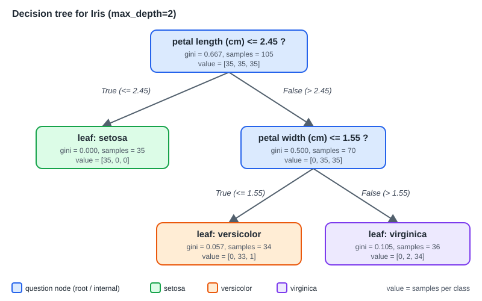

# 9장. 결정 트리와 앙상블

📖 [◀ 목차](00-목차.md) | [◀ 이전: 8장. 서포트 벡터 머신](ch08-서포트벡터머신.md) | [다음: 10장. 정규화와 하이퍼파라미터 튜닝 ▶](ch10-정규화와하이퍼파라미터튜닝.md)

---

지금까지 다룬 선형 모델은 "특성에 가중치를 곱해 더한다"는 하나의 식으로 예측했습니다. 이번 장의 모델은 접근이 전혀 다릅니다. 스무고개처럼 **"이 값이 어떤 기준보다 큰가?"** 라는 질문을 차례로 던지며 데이터를 나누고, 마지막에 남은 그룹의 다수 클래스를 답으로 내놓습니다. 이것이 결정 트리입니다.

결정 트리는 이해하기 쉽고 전처리가 거의 필요 없다는 장점이 있지만, 혼자서는 훈련 데이터에 쉽게 과대적합됩니다. 이 약점을 "여러 개를 모아서" 해결한 것이 앙상블이고, 그중 랜덤 포레스트와 그래디언트 부스팅은 정형 데이터(표 형태의 데이터)에서 지금도 가장 강력한 도구로 꼽힙니다.

이 장에서 배울 내용은 다음과 같습니다.

- 불순도(지니, 엔트로피)가 무엇이고 트리가 어떻게 "가장 좋은 질문"을 고르는지
- `DecisionTreeClassifier`와 `export_text`, 특성 중요도, 과대적합 제어
- 앙상블의 아이디어와 배깅/부스팅의 차이
- `RandomForestClassifier`와 OOB 점수
- `GradientBoostingClassifier`, `HistGradientBoostingClassifier`와 학습률-트리 개수의 관계
- 단일 트리, 랜덤 포레스트, 그래디언트 부스팅의 성능 비교

## 9.1 결정 트리: 질문으로 데이터 나누기

### 9.1.1 트리의 구조

붓꽃(iris) 데이터에서 꽃잎 길이와 꽃잎 너비만으로 품종을 맞히는 결정 트리를 하나 그려 보겠습니다.



그림을 위에서 아래로 읽으면 됩니다.

- **루트 노드(root node)**: 맨 위의 첫 질문입니다. 여기서는 "꽃잎 길이가 2.45cm 이하인가?"입니다.
- **내부 노드(internal node)**: 중간에 있는 질문입니다. 답에 따라 왼쪽(참) 또는 오른쪽(거짓) 가지로 내려갑니다.
- **리프 노드(leaf node)**: 더 이상 질문하지 않는 끝 노드입니다. 이 노드에 모인 훈련 표본의 다수 클래스가 예측값이 됩니다.
- **깊이(depth)**: 루트에서 가장 먼 리프까지 거쳐야 하는 질문의 수입니다. 위 트리의 깊이는 2입니다.

새로운 꽃이 들어오면 루트에서 시작해 질문에 답하며 내려가다가 리프에 도착하면 그 클래스를 반환합니다. 예측 과정에 곱셈이나 지수 함수가 없고 "if-else"만 있기 때문에, 사람이 규칙을 그대로 읽고 검증할 수 있습니다.

각 노드에 적힌 `gini`, `samples`, `value`는 다음 뜻입니다.

| 항목 | 의미 |
| --- | --- |
| `samples` | 그 노드에 도달한 훈련 표본 수 |
| `value` | 클래스별 표본 수 (세 품종이므로 값이 세 개) |
| `gini` | 그 노드가 얼마나 "섞여" 있는지를 나타내는 불순도 |

### 9.1.2 불순도: 얼마나 섞여 있는가

트리가 좋은 질문을 고르는 기준은 간단합니다. **질문으로 나눈 뒤 각 그룹이 더 "순수"해질수록 좋은 질문**입니다. 한 그룹에 한 가지 클래스만 있다면 완벽하게 순수하고, 여러 클래스가 고르게 섞여 있다면 가장 불순합니다.

이 "섞인 정도"를 숫자로 만든 것이 불순도입니다. 대표적인 두 가지를 소개합니다. 클래스 $k$의 비율을 $p_k$라고 할 때,

- **지니 불순도(Gini impurity)**: $1 - \sum_k p_k^2$
- **엔트로피(entropy)**: $-\sum_k p_k \log_2 p_k$

입니다. 둘 다 한 클래스가 100%이면 0이고, 클래스가 고르게 섞일수록 커진다는 점이 같습니다. 코드로 직접 계산해 봅시다.

```python
import numpy as np

def gini(counts):
    p = np.array(counts) / np.sum(counts)
    return 1 - np.sum(p ** 2)

def entropy(counts):
    p = np.array(counts) / np.sum(counts)
    p = p[p > 0]                      # log(0)을 피하려고 0인 항은 뺀다
    return np.sum(p * np.log2(1 / p))

cases = {
    "순수 (50, 0, 0)": [50, 0, 0],
    "약간 섞임 (45, 5, 0)": [45, 5, 0],
    "반반 (25, 25, 0)": [25, 25, 0],
    "완전 혼합 (34, 33, 33)": [34, 33, 33],
}
for name, counts in cases.items():
    print(f"{name} -> gini={gini(counts):.3f}, entropy={entropy(counts):.3f}")
```

```text
순수 (50, 0, 0) -> gini=0.000, entropy=0.000
약간 섞임 (45, 5, 0) -> gini=0.180, entropy=0.469
반반 (25, 25, 0) -> gini=0.500, entropy=1.000
완전 혼합 (34, 33, 33) -> gini=0.667, entropy=1.585
```

(`np.log2(1 / p)`는 `-np.log2(p)`와 같은 값입니다. 이렇게 쓰면 `-0.000` 같은 출력이 나오지 않습니다.)

두 지표는 값의 크기만 다를 뿐 "섞일수록 커진다"는 같은 방향을 가리킵니다. 실제로 둘 중 무엇을 쓰든 만들어지는 트리는 대부분 거의 비슷하고, scikit-learn의 기본값은 지니입니다(`criterion="gini"`, 엔트로피를 쓰려면 `criterion="entropy"`).

### 9.1.3 가장 좋은 질문 찾기: 직접 구현

트리가 하는 일을 한 문장으로 줄이면 이렇습니다.

> 모든 특성, 모든 분할 후보에 대해 "나눈 뒤 두 그룹의 가중 평균 불순도"를 계산하고, 그 값이 가장 작은 질문을 고른다.

분할 후보는 정렬한 값에서 이웃한 두 값의 중간점입니다. 한 특성에 대해 이 과정을 NumPy로 구현해 보겠습니다. 데이터는 훈련용 105개, 테스트용 45개로 나눈 붓꽃입니다.

```python
from sklearn.datasets import load_iris
from sklearn.model_selection import train_test_split

iris = load_iris()
Xi_tr, Xi_te, yi_tr, yi_te = train_test_split(
    iris.data, iris.target, test_size=0.3, stratify=iris.target, random_state=42)

def best_split(x, y, n_classes=3):
    """한 특성 x에서 가중 지니 불순도가 가장 낮아지는 분할점을 찾는다."""
    order = np.argsort(x)
    xs, ys = x[order], y[order]
    n = len(ys)
    best_thr, best_score = None, np.inf
    for i in range(1, n):
        if xs[i] == xs[i - 1]:            # 같은 값 사이에는 자를 수 없다
            continue
        thr = (xs[i] + xs[i - 1]) / 2     # 이웃한 두 값의 중간점이 후보
        left, right = ys[:i], ys[i:]
        g_left = gini(np.bincount(left, minlength=n_classes))
        g_right = gini(np.bincount(right, minlength=n_classes))
        score = (len(left) * g_left + len(right) * g_right) / n   # 가중 평균
        if score < best_score:
            best_thr, best_score = thr, score
    return best_thr, best_score

print("분할 전 지니 불순도:", round(gini(np.bincount(yi_tr)), 3))
for j, name in enumerate(iris.feature_names):
    thr, score = best_split(Xi_tr[:, j], yi_tr)
    print(f"{name:<18} 분할점={thr:.2f}  분할 후 불순도={score:.3f}")
```

```text
분할 전 지니 불순도: 0.667
sepal length (cm)  분할점=5.45  분할 후 불순도=0.412
sepal width (cm)   분할점=3.35  분할 후 불순도=0.533
petal length (cm)  분할점=2.45  분할 후 불순도=0.333
petal width (cm)   분할점=0.70  분할 후 불순도=0.333
```

분할 전에는 세 품종이 35개씩 섞여 있어 불순도가 0.667입니다. 꽃잎 길이를 2.45에서 자르면 왼쪽은 setosa 35개만 남아 불순도 0이고, 오른쪽은 두 품종이 반반이라 0.5입니다. 가중 평균은 $\frac{35}{105}\times 0 + \frac{70}{105}\times 0.5 = 0.333$이 됩니다. 꽃잎 너비를 0.70에서 잘라도 같은 결과(setosa를 완벽히 분리)가 나오므로 두 특성이 동점입니다. 동점일 때 어느 쪽을 고를지는 구현에 따라 다른데, 아래에서 보듯 scikit-learn은 꽃잎 길이를 골랐습니다.

트리는 이 과정을 루트에서 한 번 하고, 나뉜 각 그룹에서 다시 하고, 또 나뉜 그룹에서 다시 하는 식으로 **재귀적으로** 반복합니다. 그룹이 순수해지거나 정해 둔 한도(깊이 등)에 이르면 멈춥니다. scikit-learn의 결정 트리는 이 방식(CART 알고리즘)으로, 모든 질문이 "특성 하나 <= 값" 꼴의 이진 분할입니다.

### 9.1.4 DecisionTreeClassifier

이제 scikit-learn으로 같은 일을 해 보겠습니다. 깊이를 2로 제한한 트리를 학습하고, `export_text`로 학습된 규칙을 글자로 출력합니다.

```python
from sklearn.tree import DecisionTreeClassifier, export_text

tree = DecisionTreeClassifier(max_depth=2, random_state=42)
tree.fit(Xi_tr, yi_tr)

print(export_text(tree, feature_names=list(iris.feature_names)))
print("훈련 정확도:", round(tree.score(Xi_tr, yi_tr), 3))
print("테스트 정확도:", round(tree.score(Xi_te, yi_te), 3))
print("깊이:", tree.get_depth(), "/ 리프 수:", tree.get_n_leaves())

for name, imp in zip(iris.feature_names, tree.feature_importances_):
    print(f"{name:<18} 중요도 {imp:.3f}")

print(tree.predict(Xi_te[:3]))
print(tree.predict_proba(Xi_te[:3]).round(3))
```

```text
|--- petal length (cm) <= 2.45
|   |--- class: 0
|--- petal length (cm) >  2.45
|   |--- petal width (cm) <= 1.55
|   |   |--- class: 1
|   |--- petal width (cm) >  1.55
|   |   |--- class: 2

훈련 정확도: 0.971
테스트 정확도: 0.889
깊이: 2 / 리프 수: 3
sepal length (cm)  중요도 0.000
sepal width (cm)   중요도 0.000
petal length (cm)  중요도 0.544
petal width (cm)   중요도 0.456
[2 1 1]
[[0.    0.056 0.944]
 [0.    0.971 0.029]
 [0.    0.971 0.029]]
```

결과를 하나씩 읽어 봅시다.

- **규칙 출력**: `export_text`가 출력한 규칙이 앞의 그림과 정확히 같습니다. 직접 구현한 `best_split`이 찾은 2.45가 루트의 질문으로 쓰였습니다. 클래스 0, 1, 2는 각각 setosa, versicolor, virginica입니다.
- **정확도**: 깊이 2만으로 훈련 97.1%, 테스트 88.9%입니다. 테스트 표본이 45개뿐이라 표본 하나가 2.2%p나 차지한다는 점을 염두에 두세요. 작은 데이터에서의 숫자 몇 퍼센트 차이는 큰 의미가 없습니다.
- **특성 중요도**: `feature_importances_`는 각 특성이 불순도를 얼마나 줄였는지를 합산해 전체 합이 1이 되도록 정규화한 값입니다. 트리가 쓰지 않은 꽃받침 특성은 0이고, 꽃잎 길이와 너비가 거의 전부를 설명합니다.
- **확률 예측**: `predict_proba`는 해당 리프에 모인 훈련 표본의 클래스 비율입니다. 두 번째, 세 번째 표본이 도착한 리프에는 33/34 = 0.971이 versicolor입니다. 리프가 순수하지 않을 때 확률이 0과 1 사이의 값이 나옵니다.

> **트리는 스케일링이 필요 없습니다.** 질문이 "값 <= 기준" 꼴이라서 특성의 단위나 크기가 결과에 영향을 주지 않습니다. 로지스틱 회귀나 K-최근접 이웃과 달리 `StandardScaler`를 쓰지 않아도 됩니다.

### 9.1.5 과대적합과 가지치기

깊이를 제한하지 않으면 트리는 훈련 데이터를 완벽하게 맞출 때까지 계속 가지를 칩니다. 순수한 리프가 될 때까지 쪼개면 훈련 정확도는 100%가 되지만, 이는 잡음까지 외운 결과일 가능성이 높습니다.

이를 확인하려면 잡음이 섞인 데이터가 적당합니다. `make_moons`로 반달 모양의 두 클래스를 만들되 잡음을 크게(`noise=0.35`) 주겠습니다. 이 데이터는 잡음 때문에 완벽한 분류가 원래 불가능하다는 점이 중요합니다.

```python
from sklearn.datasets import make_moons

Xm, ym = make_moons(n_samples=1000, noise=0.35, random_state=7)
Xm_tr, Xm_te, ym_tr, ym_te = train_test_split(
    Xm, ym, test_size=0.3, stratify=ym, random_state=7)

print("max_depth  리프수  훈련정확도  테스트정확도")
for depth in [1, 2, 3, 5, 8, 14, None]:
    t = DecisionTreeClassifier(max_depth=depth, random_state=0).fit(Xm_tr, ym_tr)
    print(f"{str(depth):>9}  {t.get_n_leaves():>6}  {t.score(Xm_tr, ym_tr):>10.3f}  {t.score(Xm_te, ym_te):>11.3f}")
```

```text
max_depth  리프수  훈련정확도  테스트정확도
        1       2       0.793        0.743
        2       4       0.887        0.850
        3       7       0.889        0.863
        5      23       0.899        0.860
        8      55       0.947        0.867
       14      92       0.990        0.870
     None     102       1.000        0.877
```

표를 보면 다음과 같은 패턴이 보입니다.

- **훈련 정확도**는 깊이가 깊어질수록 계속 올라 `None`(제한 없음)에서 1.000이 됩니다. 리프가 102개나 되어 표본 700개를 거의 하나씩 외운 셈입니다.
- **테스트 정확도**는 깊이 3 근처부터 0.86~0.88 부근에서 더 오르지 않습니다. 잡음 때문에 이 데이터의 한계가 그 정도이기 때문입니다.
- 그 결과 **훈련-테스트 격차**가 깊이 3에서는 2.6%p였는데 제한이 없을 때는 12.3%p로 벌어집니다. 이것이 과대적합의 전형적인 모습입니다. 트리가 복잡해졌는데 새 데이터에서 얻은 이득은 없습니다.
- 깊이 1은 질문 하나뿐이라 훈련 데이터조차 79%밖에 못 맞힙니다. 이쪽은 **과소적합**입니다.

> 테스트 정확도가 깊이에 따라 오르락내리락하는 폭(0.5~1.5%p)은 테스트 표본 300개의 우연한 변동 범위 안에 있습니다. 이 표만 보고 "깊이 14가 8보다 낫다"고 결론 내리면 안 됩니다. 이런 미세 조정을 올바르게 하는 방법은 5.6절의 교차 검증을 바탕으로 10장에서 다룹니다.

깊이 외에도 트리의 복잡도를 줄이는 하이퍼파라미터가 여럿 있습니다. 이렇게 트리가 자라는 것을 미리 막거나 줄이는 것을 **가지치기(pruning)** 라고 부릅니다.

| 하이퍼파라미터 | 의미 |
| --- | --- |
| `max_depth` | 트리의 최대 깊이 |
| `min_samples_split` | 노드를 더 나누려면 최소 이만큼의 표본이 있어야 함 |
| `min_samples_leaf` | 리프 하나에 최소 이만큼의 표본이 있어야 함 |
| `max_leaf_nodes` | 리프 개수의 상한 |
| `ccp_alpha` | 다 키운 뒤 불필요한 가지를 잘라내는 비용-복잡도 가지치기의 강도 |

`min_samples_leaf`를 바꿔 보겠습니다. 리프에 표본이 최소 몇 개 있어야 한다고 요구하면, 표본 한두 개를 위한 자잘한 가지가 사라집니다.

```python
print("min_samples_leaf  리프수  훈련정확도  테스트정확도")
for leaf in [1, 5, 10, 20, 40]:
    t = DecisionTreeClassifier(min_samples_leaf=leaf, random_state=0).fit(Xm_tr, ym_tr)
    print(f"{leaf:>16}  {t.get_n_leaves():>6}  {t.score(Xm_tr, ym_tr):>10.3f}  {t.score(Xm_te, ym_te):>11.3f}")
```

```text
min_samples_leaf  리프수  훈련정확도  테스트정확도
               1     102       1.000        0.877
               5      54       0.926        0.887
              10      35       0.903        0.860
              20      24       0.900        0.863
              40      14       0.880        0.827
```

리프의 최소 표본 수를 키울수록 리프 수가 줄고(102 -> 14) 훈련 정확도가 내려갑니다. 값이 너무 크면(40) 이번에는 테스트 정확도까지 내려가 과소적합 쪽으로 넘어갑니다. 적당한 중간값을 찾는 것이 하이퍼파라미터 튜닝의 일입니다.

### 9.1.6 결정 트리의 약점: 불안정성

결정 트리는 해석하기 쉽지만 약점이 하나 더 있습니다. **훈련 데이터가 조금만 달라져도 트리의 모양이 크게 바뀝니다.** 맨 위의 질문 하나가 바뀌면 그 아래 가지가 모두 달라지기 때문입니다.

유방암 진단 데이터(`load_breast_cancer`)에서 훈련 데이터를 **복원추출**(뽑은 표본을 다시 돌려놓고 뽑는 방식)로 다섯 번 다시 뽑아 깊이 3의 트리를 학습해 보겠습니다.

```python
from sklearn.datasets import load_breast_cancer

cancer = load_breast_cancer()
Xc_tr, Xc_te, yc_tr, yc_te = train_test_split(
    cancer.data, cancer.target, test_size=0.25, stratify=cancer.target, random_state=0)

rng = np.random.RandomState(0)
for k in range(5):
    idx = rng.choice(len(Xc_tr), size=len(Xc_tr), replace=True)   # 복원추출
    t = DecisionTreeClassifier(max_depth=3, random_state=0).fit(Xc_tr[idx], yc_tr[idx])
    root = cancer.feature_names[t.tree_.feature[0]]
    print(f"표본 {k}: 루트 질문의 특성 = {root:<22} 테스트 정확도 = {t.score(Xc_te, yc_te):.3f}")
```

```text
표본 0: 루트 질문의 특성 = worst perimeter        테스트 정확도 = 0.916
표본 1: 루트 질문의 특성 = worst concave points   테스트 정확도 = 0.930
표본 2: 루트 질문의 특성 = worst perimeter        테스트 정확도 = 0.916
표본 3: 루트 질문의 특성 = worst radius           테스트 정확도 = 0.916
표본 4: 루트 질문의 특성 = mean concave points    테스트 정확도 = 0.923
```

같은 데이터에서 조금씩 다르게 뽑았을 뿐인데 루트 질문에 쓰이는 특성이 네 가지로 갈립니다. 이처럼 데이터에 민감한 모델을 **분산이 크다**고 말합니다. 그리고 분산이 큰 모델은 서로 다른 의견을 내놓는다는 뜻이므로, 여럿을 모아 평균을 내면 오히려 이득이 큽니다. 다음 절의 출발점입니다.

## 9.2 앙상블: 여럿이 낫다

### 9.2.1 아이디어

앙상블(ensemble)은 **여러 모델의 예측을 모아 하나의 최종 예측을 만드는 방법**입니다. 여러 사람에게 물어본 평균 추정치가 대개 한 전문가의 추정보다 정확하다는 "집단 지성"과 같은 원리입니다. 다만 이 원리가 통하려면 두 가지 조건이 필요합니다.

1. 각 모델이 무작위 추측보다는 낫다.
2. 모델들이 **서로 다른 실수**를 한다. 모두 똑같이 틀리면 모아도 소용이 없습니다.

결정 트리는 바로 이 조건에 잘 맞습니다. 앞 절에서 보았듯 데이터에 따라 달라지는(다양한) 모델이기 때문입니다. 트리를 모으는 대표적인 두 가지 전략이 있습니다.

### 9.2.2 배깅과 부스팅

| 구분 | 배깅(bagging) | 부스팅(boosting) |
| --- | --- | --- |
| 모델을 만드는 방식 | 서로 독립적으로, 동시에 | 앞 모델의 결과를 보고 순서대로 |
| 각 모델이 보는 데이터 | 복원추출한 부트스트랩 표본 | 앞 모델이 틀린 부분에 집중 |
| 각 모델의 성격 | 깊고 복잡한 트리(분산이 큼) | 얕고 단순한 트리(약한 모델) |
| 합치는 방법 | 평균 또는 다수결 | 가중해서 더함 |
| 주로 줄이는 것 | 분산(들쭉날쭉함) | 편향(체계적인 부족함) |
| 대표 모델 | 랜덤 포레스트 | 그래디언트 부스팅 |

비유하면 배깅은 **여러 학생이 각자 같은 문제를 풀고 투표**하는 것이고, 부스팅은 **한 학생이 오답 노트를 만들며 틀린 문제를 조금씩 보완**해 나가는 것입니다.

### 9.2.3 배깅 직접 구현

배깅은 몇 줄이면 구현됩니다. 훈련 데이터에서 복원추출로 같은 크기의 표본을 뽑고(부트스트랩), 그 표본마다 트리를 하나씩 학습한 뒤 다수결로 합칩니다. 먼저 부트스트랩 표본에 원본 표본이 몇 %나 들어가는지부터 확인합니다.

```python
from sklearn.ensemble import BaggingClassifier

# 부트스트랩 표본에는 원본의 몇 %가 들어 있을까?
n = len(Xc_tr)
rng = np.random.RandomState(1)
ratios = [len(np.unique(rng.choice(n, size=n, replace=True))) / n for _ in range(200)]
print(f"부트스트랩 표본의 고유 표본 비율(200회 평균): {np.mean(ratios):.3f}  (이론값 약 0.632)")

# 손으로 만든 배깅: 부트스트랩 표본마다 트리 하나, 다수결로 합친다
rng = np.random.RandomState(0)
all_pred = []
for k in range(101):
    idx = rng.choice(n, size=n, replace=True)
    t = DecisionTreeClassifier(random_state=k).fit(Xc_tr[idx], yc_tr[idx])
    all_pred.append(t.predict(Xc_te))
all_pred = np.array(all_pred)                      # (트리 수, 테스트 표본 수)

single = (all_pred == yc_te).mean(axis=1)          # 트리 하나하나의 정확도
vote = (all_pred.mean(axis=0) > 0.5).astype(int)   # 다수결
print(f"트리 한 그루 평균 정확도: {single.mean():.3f} (최저 {single.min():.3f}, 최고 {single.max():.3f})")
print(f"101그루 다수결 정확도:    {(vote == yc_te).mean():.3f}")

bag = BaggingClassifier(estimator=DecisionTreeClassifier(), n_estimators=101, random_state=0)
bag.fit(Xc_tr, yc_tr)
print(f"BaggingClassifier:        {bag.score(Xc_te, yc_te):.3f}")
```

```text
부트스트랩 표본의 고유 표본 비율(200회 평균): 0.632  (이론값 약 0.632)
트리 한 그루 평균 정확도: 0.916 (최저 0.846, 최고 0.958)
101그루 다수결 정확도:    0.937
BaggingClassifier:        0.937
```

두 가지를 볼 수 있습니다.

- 부트스트랩 표본에는 원본 표본의 약 **63.2%** 만 들어갑니다(원본에서 한 번도 안 뽑힐 확률이 $(1-1/n)^n \approx e^{-1} \approx 0.368$이기 때문입니다). 나머지 약 36.8%는 그 트리가 보지 못한 표본이 되는데, 이것이 곧 9.3절의 OOB 점수의 재료입니다.
- 트리 한 그루는 평균 91.6%이고 운이 나쁜 트리는 84.6%까지 내려가지만, 101그루를 다수결로 합치면 93.7%입니다. 나쁜 트리가 섞여 있어도 평균을 내면 안정되기 때문입니다. 직접 만든 코드와 scikit-learn의 `BaggingClassifier`가 같은 값을 냈습니다. (`BaggingClassifier`는 다수결이 아니라 클래스 확률의 평균으로 합치지만, 이 데이터에서는 결과가 같았습니다.)

## 9.3 랜덤 포레스트

랜덤 포레스트(random forest)는 배깅에 한 가지를 더한 것입니다. 배깅만 하면 강력한 특성 하나가 모든 트리의 루트를 차지해 트리들이 서로 닮아 버립니다. 닮은 모델은 모아 봐야 효과가 작습니다. 그래서 **트리의 각 분할마다 전체 특성 중 무작위로 고른 일부 특성만 후보로** 삼습니다. 이렇게 하면 트리들이 서로 더 다양해져 평균의 효과가 커집니다.

> 랜덤 포레스트 = 부트스트랩 표본 + 분할마다 무작위 특성 일부 + 깊게 키운 트리 + 평균

분류에서 후보 특성의 수(`max_features`)의 기본값은 전체 특성 수의 제곱근(`"sqrt"`)입니다. 유방암 데이터는 특성이 30개이므로 분할마다 약 5개만 봅니다.

### 9.3.1 OOB 점수

앞에서 본 것처럼 각 트리는 훈련 표본의 약 36.8%를 보지 못합니다. 그러므로 각 표본에 대해 **그 표본을 훈련에 쓰지 않은 트리들만 모아** 예측하고 정답과 비교하면, 별도의 검증 데이터 없이도 일반화 성능을 추정할 수 있습니다. 이것이 **OOB(Out-Of-Bag) 점수**입니다. `oob_score=True`로 켭니다.

```python
from sklearn.ensemble import RandomForestClassifier

rf = RandomForestClassifier(n_estimators=300, oob_score=True, random_state=0)
rf.fit(Xc_tr, yc_tr)
print(f"훈련 정확도: {rf.score(Xc_tr, yc_tr):.3f}")
print(f"OOB 점수:    {rf.oob_score_:.3f}")
print(f"테스트 정확도: {rf.score(Xc_te, yc_te):.3f}")
print("분할마다 고려하는 특성 수(max_features):", rf.max_features)

print("\n나무 수에 따른 변화")
for n_trees in [30, 100, 300]:
    m = RandomForestClassifier(n_estimators=n_trees, oob_score=True, random_state=0)
    m.fit(Xc_tr, yc_tr)
    print(f"n_estimators={n_trees:<4} OOB={m.oob_score_:.3f}  테스트={m.score(Xc_te, yc_te):.3f}")

print("\n특성 중요도 상위 5개")
for i in np.argsort(rf.feature_importances_)[::-1][:5]:
    print(f"{cancer.feature_names[i]:<22} {rf.feature_importances_[i]:.3f}")
```

```text
훈련 정확도: 1.000
OOB 점수:    0.962
테스트 정확도: 0.944
분할마다 고려하는 특성 수(max_features): sqrt

나무 수에 따른 변화
n_estimators=30   OOB=0.960  테스트=0.944
n_estimators=100  OOB=0.960  테스트=0.944
n_estimators=300  OOB=0.962  테스트=0.944

특성 중요도 상위 5개
worst perimeter        0.145
worst radius           0.134
worst concave points   0.121
worst area             0.101
mean concave points    0.100
```

- 훈련 정확도는 1.000이지만 테스트는 94.4%입니다. 개별 트리가 훈련 데이터를 외우는 것은 여전하지만, 평균을 내는 덕분에 단일 트리(앞 절에서 약 90~93%)보다 좋은 일반화 성능을 보입니다.
- **OOB 점수(0.962)가 테스트 정확도(0.944)와 가깝습니다.** 테스트 세트를 건드리지 않고도 대략적인 성능을 알 수 있다는 뜻입니다. 테스트 세트가 작거나 데이터를 아껴 써야 할 때 편리합니다.
- 나무를 늘려도 성능이 크게 달라지지 않습니다. 랜덤 포레스트는 **나무를 많이 늘린다고 과대적합이 심해지지 않는** 편입니다. 나무가 많을수록 평균이 안정될 뿐입니다. 나무가 너무 적으면(예: 10그루 이하) 어떤 표본은 모든 트리의 훈련에 쓰여서 OOB 예측값이 없다는 경고가 나올 수 있으니, OOB를 쓸 때는 나무를 충분히 두세요.
- 특성 중요도는 둘레, 반지름, 오목한 점 등 "가장 나쁜 값(worst)" 계열이 상위권입니다. 단일 트리 하나보다 훨씬 안정적인 순위입니다.

> **중요도 해석 주의.** `feature_importances_`는 훈련 데이터에서 불순도를 얼마나 줄였는지를 센 값입니다. 서로 상관이 높은 특성(위의 반지름, 둘레, 면적은 서로 강하게 연결되어 있습니다)은 중요도가 나뉘어 각각 작게 보일 수 있고, 값의 종류가 많은 특성이 유리하게 계산되는 경향도 있습니다. 더 믿을 만한 대안으로 `sklearn.inspection.permutation_importance`(특성 하나의 값을 섞었을 때 점수가 얼마나 떨어지는지 측정)가 있습니다.

랜덤 포레스트의 주요 하이퍼파라미터는 `n_estimators`(나무 수), `max_features`(분할마다 보는 특성 수), 그리고 개별 트리의 `max_depth`, `min_samples_leaf` 등입니다. 기본값만으로도 꽤 잘 작동해서 "일단 돌려 보는 모델"로 많이 쓰입니다.

## 9.4 그래디언트 부스팅

배깅 계열이 "크고 복잡한 모델을 많이 모아 평균"하는 방식이라면, 부스팅은 반대 방향입니다. **작고 단순한 모델을 순서대로 하나씩 더해 가며 오차를 줄입니다.**

### 9.4.1 직접 구현: 잔차를 맞히는 트리 쌓기

그래디언트 부스팅의 핵심 아이디어는 다음 반복문입니다.

1. 일단 평균으로 예측한다.
2. 정답과 현재 예측의 차이, 즉 **잔차**를 계산한다.
3. 얕은 트리로 **잔차를 맞히도록** 학습한다.
4. 그 트리의 예측을 **학습률(learning rate)만큼만** 현재 예측에 더한다.
5. 2~4를 반복한다.

학습률로 곱해서 조금씩만 보정하는 이유는 한 번에 크게 고치면 잡음에 휘둘리기 때문입니다. 회귀 문제로 구현하면 가장 직관적입니다. 사인 곡선에 잡음을 섞은 데이터를 80개 만들고, 처음 보는 데이터 500개로 성능도 함께 확인합니다.

```python
from sklearn.tree import DecisionTreeRegressor

def make_data(n, rng):
    x = np.sort(rng.uniform(0, 6, n))
    return x.reshape(-1, 1), np.sin(x) + rng.normal(0, 0.2, n)   # 잡음의 분산은 0.04

rng = np.random.RandomState(0)
X1, y = make_data(80, rng)            # 훈련 데이터
X1_new, y_new = make_data(500, rng)   # 처음 보는 데이터

learning_rate = 0.1
pred = np.full_like(y, y.mean())              # 0단계: 평균으로 시작
pred_new = np.full_like(y_new, y.mean())
trees = []
for m in range(1, 301):
    residual = y - pred                       # 지금 모델이 틀린 만큼(잔차)
    t = DecisionTreeRegressor(max_depth=2, random_state=0).fit(X1, residual)
    pred = pred + learning_rate * t.predict(X1)           # 조금만 보정
    pred_new = pred_new + learning_rate * t.predict(X1_new)
    trees.append(t)
    if m in (1, 2, 5, 10, 30, 100, 300):
        train_mse = np.mean((y - pred) ** 2)
        test_mse = np.mean((y_new - pred_new) ** 2)
        print(f"트리 {m:>3}개: 훈련 MSE = {train_mse:.4f}, 새 데이터 MSE = {test_mse:.4f}")
print(f"(참고) 평균만 쓸 때 훈련 MSE = {np.mean((y - y.mean()) ** 2):.4f}")

def boost_predict(X_new):
    out = np.full(len(X_new), y.mean())
    for t in trees:
        out += learning_rate * t.predict(X_new)
    return out

print(np.allclose(boost_predict(X1), pred))
```

```text
트리   1개: 훈련 MSE = 0.4172, 새 데이터 MSE = 0.4396
트리   2개: 훈련 MSE = 0.3489, 새 데이터 MSE = 0.3702
트리   5개: 훈련 MSE = 0.2118, 새 데이터 MSE = 0.2314
트리  10개: 훈련 MSE = 0.1092, 새 데이터 MSE = 0.1248
트리  30개: 훈련 MSE = 0.0306, 새 데이터 MSE = 0.0486
트리 100개: 훈련 MSE = 0.0152, 새 데이터 MSE = 0.0513
트리 300개: 훈련 MSE = 0.0025, 새 데이터 MSE = 0.0632
(참고) 평균만 쓸 때 훈련 MSE = 0.5000
True
```

(MSE는 평균제곱오차로, 작을수록 좋습니다.) 이 출력에서 부스팅의 성격이 그대로 드러납니다.

- 트리 한 그루씩 더할 때마다 훈련 오차가 꾸준히 줄어듭니다. 평균만 쓸 때의 0.5가 300그루에서는 0.0025까지 내려갑니다.
- 그런데 새 데이터의 오차는 **어느 시점부터 오히려 올라갑니다.** 이 데이터의 잡음 분산은 0.04라서, 아무리 잘 맞춰도 오차를 0.04 아래로 줄이는 것은 불가능합니다. 훈련 MSE가 0.0025까지 내려갔다는 것은 모델이 잡음까지 외웠다는 뜻이고, 그 대가로 새 데이터의 MSE가 30그루일 때 0.0486에서 300그루일 때 0.0632로 나빠졌습니다.
- 즉 **부스팅은 트리 개수를 계속 늘리면 과대적합됩니다.** 배깅 계열(랜덤 포레스트)이 나무를 늘려도 괜찮았던 것과 대비되는 중요한 차이입니다.

scikit-learn의 `GradientBoostingRegressor`와 `GradientBoostingClassifier`는 이 아이디어를 구현한 것입니다. 분류에서는 "잔차" 대신 로그 손실의 기울기(gradient)를 맞히도록 트리를 학습합니다. 이름의 "그래디언트"가 여기서 왔고, 잔차는 제곱 오차 손실일 때의 (음의) 기울기와 같은 값입니다.

### 9.4.2 학습률과 트리 개수의 관계

부스팅의 가장 중요한 하이퍼파라미터는 두 개입니다.

- `n_estimators`: 더할 트리의 개수
- `learning_rate`: 각 트리의 기여를 얼마나 반영하는지(작을수록 조금씩 고침)

이 두 값은 서로 맞물려 있습니다. **학습률을 낮추면 같은 수준에 도달하는 데 더 많은 트리가 필요합니다.** 반면 학습률이 크면 몇 개 안 되는 트리로도 빠르게 훈련 데이터에 맞춰지고, 그만큼 빨리 과대적합됩니다.

앞의 `make_moons` 데이터로 학습률을 세 가지로 바꿔 보겠습니다. `staged_predict_proba`는 트리를 1개, 2개, 3개, ... 쌓을 때마다의 예측을 차례로 돌려주므로, 한 번의 학습으로 "트리 개수에 따른 테스트 손실 곡선"을 얻을 수 있습니다. 손실은 확률 예측의 품질을 재는 로그 손실(log loss, 작을수록 좋음)을 사용합니다.

```python
from sklearn.ensemble import GradientBoostingClassifier
from sklearn.metrics import log_loss

checkpoints = [10, 50, 100, 200, 500]
print("learning_rate | 테스트 log loss (트리 개수 " + ", ".join(map(str, checkpoints)) + ")")
for lr in [1.0, 0.1, 0.01]:
    gb = GradientBoostingClassifier(learning_rate=lr, n_estimators=500, max_depth=2, random_state=0)
    gb.fit(Xm_tr, ym_tr)
    losses = [log_loss(ym_te, p) for p in gb.staged_predict_proba(Xm_te)]   # 트리를 하나씩 더할 때마다
    best = int(np.argmin(losses)) + 1
    row = "  ".join(f"{losses[n - 1]:.3f}" for n in checkpoints)
    print(f"{lr:>13} | {row}   (최저 {min(losses):.3f} @ {best}개)")
```

```text
learning_rate | 테스트 log loss (트리 개수 10, 50, 100, 200, 500)
          1.0 | 0.296  0.498  0.548  0.672  1.040   (최저 0.293 @ 11개)
          0.1 | 0.434  0.299  0.279  0.284  0.313   (최저 0.277 @ 97개)
         0.01 | 0.643  0.517  0.438  0.361  0.302   (최저 0.302 @ 500개)
```

세 행을 비교하면 학습률과 트리 개수의 관계가 한눈에 보입니다.

- `learning_rate=1.0`: 트리 11개에서 이미 바닥(0.293)에 도달하고, 그 뒤로는 손실이 계속 커져 500개에서는 1.040이 됩니다. 너무 빨리 훈련 데이터에 맞추고 과신하게 된 것입니다.
- `learning_rate=0.1`: 97개 근처에서 최저(0.277)이고 이후 서서히 올라갑니다. 가장 좋은 최저값을 얻었습니다.
- `learning_rate=0.01`: 500개까지도 손실이 계속 내려가는 중입니다(최저가 마지막 지점). 트리가 더 필요합니다.

여기서 얻는 실전 요령은 다음과 같습니다.

- 학습률은 작게(0.05~0.1 정도) 두는 편이 일반적으로 더 안정적이고 좋은 결과를 줍니다. 대신 트리가 더 많이 필요하고, 학습 시간이 늘어납니다.
- 트리 개수는 "많을수록 좋은" 것이 아니라 **너무 적어도 많아도 안 되는** 값입니다. 학습률과 한 쌍으로 같이 정해야 합니다.
- 트리 개수를 정하는 가장 편한 방법은 충분히 크게 잡은 뒤 **조기 종료(early stopping)** 로 멈출 시점을 자동으로 정하는 것입니다. 다음에 나오는 `HistGradientBoostingClassifier`가 이를 지원합니다.

그 외에 `max_depth`(각 트리의 깊이, 보통 얕게 1~5), `subsample`(각 트리를 학습할 때 훈련 표본 중 일부만 쓰는 비율, 1.0보다 작게 하면 확률적 그래디언트 부스팅이 되어 과대적합을 줄이는 데 도움이 됩니다)도 중요한 하이퍼파라미터입니다.

### 9.4.3 HistGradientBoostingClassifier

`GradientBoostingClassifier`는 이해하기 쉽지만 표본이 수만 개를 넘으면 느립니다. scikit-learn은 대규모 데이터를 위한 `HistGradientBoostingClassifier`(회귀는 `HistGradientBoostingRegressor`)를 함께 제공합니다. 특성값을 최대 255개 구간(히스토그램의 칸)으로 미리 나누어 놓고 분할 후보를 구간 경계로만 검토하므로 훨씬 빠릅니다. 특징은 다음과 같습니다.

- 트리 개수 대신 `max_iter` 인자를 씁니다.
- **결측치(NaN)를 그대로** 입력해도 됩니다(따로 채울 필요가 없음).
- `early_stopping`으로 검증 점수가 더 나아지지 않으면 학습을 멈춥니다. 기본값 `"auto"`는 표본이 1만 개를 넘을 때만 조기 종료를 켜므로, 작은 데이터에서는 `early_stopping=True`로 직접 켜야 합니다.
- 범주형 특성을 직접 처리하는 `categorical_features` 옵션도 있습니다.

```python
from sklearn.ensemble import HistGradientBoostingClassifier

hgb = HistGradientBoostingClassifier(early_stopping=True, validation_fraction=0.2,
                                     n_iter_no_change=10, max_iter=500, random_state=0)
hgb.fit(Xc_tr, yc_tr)
print("실제로 만든 트리 수:", hgb.n_iter_, "(최대 500)")
print(f"테스트 정확도: {hgb.score(Xc_te, yc_te):.3f}")

# 결측치(NaN)가 있어도 그대로 학습할 수 있다
Xc_nan = Xc_tr.copy()
mask = np.random.RandomState(0).rand(*Xc_nan.shape) < 0.1     # 10%를 NaN으로
Xc_nan[mask] = np.nan
hgb_nan = HistGradientBoostingClassifier(random_state=0).fit(Xc_nan, yc_tr)
print(f"NaN 10% 상태로 학습 -> 테스트 정확도: {hgb_nan.score(Xc_te, yc_te):.3f}")
```

```text
실제로 만든 트리 수: 75 (최대 500)
테스트 정확도: 0.958
NaN 10% 상태로 학습 -> 테스트 정확도: 0.944
```

최대 500개까지 허용했지만, 훈련 데이터의 20%를 검증용으로 떼어 놓고 검증 점수가 10번 연속 나아지지 않자 75개에서 멈췄습니다. 트리 개수를 직접 고르는 고민을 대신해 주는 셈입니다. 또한 값의 10%를 NaN으로 바꿔도 따로 채우지 않고 그대로 학습해 94.4%를 얻었습니다.

## 9.5 단일 트리 vs 랜덤 포레스트 vs 그래디언트 부스팅

세 계열을 같은 조건에서 비교해 보겠습니다. 한 번의 훈련/테스트 분할은 우연에 흔들리므로, **5겹 교차 검증을 3번 반복**(총 15번 평가, 교차 검증은 5.6절)한 평균과 표준편차를 봅니다. 데이터는 지금까지 쓴 유방암 데이터와 `make_moons`(잡음 큼)입니다.

```python
from sklearn.model_selection import cross_val_score, RepeatedStratifiedKFold

models = {
    "단일 결정 트리": DecisionTreeClassifier(random_state=0),
    "랜덤 포레스트": RandomForestClassifier(n_estimators=200, random_state=0),
    "그래디언트 부스팅": GradientBoostingClassifier(random_state=0),
    "HistGradientBoosting": HistGradientBoostingClassifier(random_state=0),
}
cv = RepeatedStratifiedKFold(n_splits=5, n_repeats=3, random_state=0)

for data_name, (X, y) in {"유방암": (cancer.data, cancer.target), "moons": (Xm, ym)}.items():
    print(f"[{data_name}] 5겹 교차 검증 x 3회 반복")
    for name, model in models.items():
        s = cross_val_score(model, X, y, cv=cv)
        print(f"  {name}: 평균 {s.mean():.3f} (표준편차 {s.std():.3f})")
```

```text
[유방암] 5겹 교차 검증 x 3회 반복
  단일 결정 트리: 평균 0.927 (표준편차 0.019)
  랜덤 포레스트: 평균 0.965 (표준편차 0.012)
  그래디언트 부스팅: 평균 0.960 (표준편차 0.013)
  HistGradientBoosting: 평균 0.965 (표준편차 0.009)
[moons] 5겹 교차 검증 x 3회 반복
  단일 결정 트리: 평균 0.849 (표준편차 0.020)
  랜덤 포레스트: 평균 0.874 (표준편차 0.022)
  그래디언트 부스팅: 평균 0.874 (표준편차 0.017)
  HistGradientBoosting: 평균 0.875 (표준편차 0.013)
```

결과에서 읽을 수 있는 것은 다음과 같습니다.

- **앙상블이 단일 트리보다 확실히 낫습니다.** 유방암 데이터에서 92.7% -> 96~96.5%, moons에서 84.9% -> 약 87.5%로 올랐습니다. 유방암에서는 차이(3~4%p)가 표준편차(1~2%p)보다 분명히 크고, 표준편차도 줄어 결과가 더 안정적입니다. moons의 차이(약 2.5%p)도 표준편차(약 2%p)보다는 크지만 여유가 크지는 않습니다.
- **세 앙상블 사이의 차이는 거의 없습니다.** 랜덤 포레스트, 그래디언트 부스팅, HistGradientBoosting의 평균은 0.5%p 안쪽이고 표준편차(1~2%p)보다 훨씬 작습니다. 이 정도 차이로 우열을 말할 수는 없습니다. 특히 `make_moons`는 잡음 때문에 약 87~88%가 한계라서 어떤 강력한 모델도 그 이상 올라갈 수 없습니다.
- 기본 설정(튜닝 없음)만으로 이 정도이므로, 부스팅 계열은 하이퍼파라미터를 튜닝하면 더 나아질 여지가 있습니다. 다음 장의 주제입니다.

실무에서의 선택 지침을 정리하면 다음과 같습니다.

| 모델 | 장점 | 단점/주의 |
| --- | --- | --- |
| 단일 결정 트리 | 규칙을 읽을 수 있음, 전처리 거의 불필요 | 과대적합, 불안정 |
| 랜덤 포레스트 | 기본값이 튼튼함, 튜닝에 덜 민감, 병렬 학습 가능, OOB로 성능 추정 | 모델이 크고 느려질 수 있음, 개별 예측 설명이 어려움 |
| 그래디언트 부스팅 | 튜닝하면 최고 수준의 정확도를 내는 경우가 많음 | 하이퍼파라미터에 민감, 잡음에 과대적합되기 쉬움, 순차 학습이라 느림 |
| HistGradientBoosting | 큰 데이터에서 빠름, 결측치 처리, 조기 종료 | 아주 작은 데이터에서는 이점이 적음 |

기억해 둘 한계도 있습니다. 트리 계열은 훈련 데이터의 값 범위 밖으로 **외삽(extrapolation)** 하지 못합니다. 예를 들어 집값 예측에서 훈련 데이터에 없던 큰 평수가 들어오면 가장 큰 훈련 값 근처의 값으로 예측합니다. 또 이미지, 음성, 텍스트처럼 원시 신호를 다루는 문제에서는 딥러닝이 훨씬 강하고, 표 형태의 데이터에서는 이 장의 모델이 여전히 매우 경쟁력 있습니다.

## 9.6 더 알아보기: XGBoost, LightGBM, CatBoost

그래디언트 부스팅을 더 빠르고 정교하게 구현한 외부 라이브러리가 있습니다. 대표적으로 **XGBoost**, **LightGBM**, **CatBoost**가 있고, 정형 데이터 경진대회와 실무에서 널리 쓰입니다. 모두 scikit-learn과 호환되는 인터페이스를 제공하므로 이 장에서 익힌 `fit`/`predict`, 교차 검증, 하이퍼파라미터 튜닝 방식을 거의 그대로 쓸 수 있습니다. 이 책에서는 이름만 소개하고 설치와 사용법은 다루지 않습니다. 이 장의 `HistGradientBoostingClassifier`로 원리와 사용 감각을 익혀 두면 이들로 넘어가는 것은 어렵지 않습니다.

## 요약

- 결정 트리는 "특성 <= 값" 꼴의 질문을 재귀적으로 던지며 데이터를 나눕니다. 질문은 나눈 뒤 두 그룹의 **가중 평균 불순도**가 가장 낮아지도록 고릅니다.
- 불순도는 지니 불순도와 엔트로피로 잴 수 있고, 섞일수록 커집니다. scikit-learn의 기본값은 지니입니다.
- 제한 없이 키운 트리는 훈련 데이터를 외웁니다(훈련 100%, 테스트와의 격차 증가). `max_depth`, `min_samples_leaf`, `max_leaf_nodes`, `ccp_alpha` 등으로 복잡도를 제어합니다.
- `export_text`로 학습된 규칙을 읽을 수 있고, `feature_importances_`로 불순도 감소 기여도를 볼 수 있습니다. 단, 해석에는 주의가 필요합니다. 트리는 스케일링이 필요 없습니다.
- 트리는 데이터가 조금만 달라져도 모양이 바뀌는 **분산이 큰** 모델이고, 이 점이 앙상블이 효과적인 이유입니다.
- **배깅**은 부트스트랩 표본으로 독립적인 모델을 만들어 평균하며 분산을 줄이고, **부스팅**은 약한 모델을 순서대로 쌓아 앞 모델의 오차를 보완하며 편향을 줄입니다.
- **랜덤 포레스트**는 배깅에 분할마다 무작위 특성 선택을 더한 것입니다. 나무를 늘려도 과대적합이 심해지지 않고, **OOB 점수**로 별도의 검증 데이터 없이 성능을 추정할 수 있습니다.
- **그래디언트 부스팅**은 잔차(손실의 기울기)를 맞히는 얕은 트리를 학습률만큼씩 더해 갑니다. 학습률과 트리 개수는 한 쌍이며, 학습률을 낮추면 더 많은 트리가 필요하고, 트리를 너무 많이 쌓으면 과대적합됩니다.
- `HistGradientBoostingClassifier`는 큰 데이터에서 빠르고 NaN을 그대로 받으며 조기 종료를 지원합니다.
- 기본 설정에서도 앙상블은 단일 트리보다 뚜렷이 좋았지만, 앙상블끼리의 차이는 작았습니다. 우열은 교차 검증의 표준편차와 함께 판단해야 합니다.
- XGBoost, LightGBM, CatBoost는 같은 계열의 외부 구현으로, 필요할 때 찾아보면 됩니다.

## 연습문제

1. **불순도 계산.** 어떤 노드에 클래스 A가 30개, 클래스 B가 10개 있습니다. 이 노드의 지니 불순도와 엔트로피를 이 장의 `gini`, `entropy` 함수로 구하세요. 이 노드를 질문 하나로 나눠 왼쪽이 (28, 2), 오른쪽이 (2, 8)이 되었다면 분할 후 가중 평균 지니 불순도는 얼마이고 분할 전보다 얼마나 줄었습니까?

2. **깊이 고르기.** 유방암 데이터에서 `DecisionTreeClassifier`의 `max_depth`를 1부터 10까지 바꿔 가며 `cross_val_score(..., cv=5)`의 평균을 구하고, 훈련 정확도도 함께 출력해 표로 만드세요. 훈련 정확도와 교차 검증 점수의 격차는 깊이가 늘어남에 따라 어떻게 변합니까? 한 번의 `train_test_split` 결과로 깊이를 고르는 것보다 교차 검증이 나은 이유를 적어 보세요.

3. **max_features의 효과.** 유방암 데이터에서 `RandomForestClassifier(n_estimators=200, oob_score=True, random_state=0)`의 `max_features`를 `1`, `"sqrt"`, `None`(전체 특성)으로 바꿔 OOB 점수를 비교하세요. `max_features=None`이면 이 모델은 9.2절의 어떤 방식과 사실상 같아집니까? 세 설정에서 개별 트리들의 다양성이 어떻게 달라질지 예상하고, 결과와 비교해 보세요.

4. **부스팅 구현 변형.** 9.4.1절의 직접 구현 코드에서 `max_depth`를 1(스텀프라고 부릅니다)로 바꾸고, `learning_rate`를 0.1, 0.5, 1.0으로 바꿔 보세요. 트리 100개일 때의 훈련 MSE와 새 데이터 MSE를 비교하고, 학습률이 클 때 과대적합이 어떤 모습으로 나타나는지 설명하세요.

5. **개념 확인.** 다음에 답하세요.
   (a) 랜덤 포레스트는 나무를 늘려도 과대적합이 심해지지 않는데 그래디언트 부스팅은 트리를 늘리면 과대적합될 수 있는 이유는 무엇입니까?
   (b) 트리 계열 모델이 선형 모델보다 불리할 수 있는 상황의 예를 하나 들어 보세요. (힌트: 훈련 데이터의 범위 밖 입력)
   (c) `HistGradientBoostingClassifier`를 작은 데이터에 쓸 때 `early_stopping`을 왜 직접 켜야 할 수 있습니까?

---

📖 [◀ 목차](00-목차.md) | [◀ 이전: 8장. 서포트 벡터 머신](ch08-서포트벡터머신.md) | [다음: 10장. 정규화와 하이퍼파라미터 튜닝 ▶](ch10-정규화와하이퍼파라미터튜닝.md)
