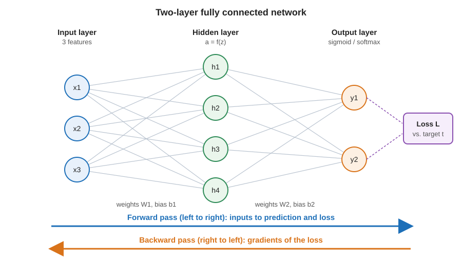

# 13장. 신경망 기초: 퍼셉트론과 역전파

📖 [◀ 목차](00-목차.md) | [◀ 이전: 12장. 차원 축소](ch12-차원축소.md) | [다음: 14장. PyTorch 입문 ▶](ch14-PyTorch입문.md)

---

지금까지 우리는 선형 모델, 결정 트리, 앙상블, SVM 같은 "전통적" 알고리즘을 다뤘습니다. 이 장부터는 오늘날 이미지 인식, 음성 인식, 언어 모델의 뿌리가 되는 **인공 신경망(artificial neural network)** 을 시작합니다.

신경망은 겉보기엔 낯설지만 재료는 이미 모두 알고 있는 것들입니다. 선형 모델의 `가중치 × 입력 + 편향`, 로지스틱 회귀의 시그모이드, 경사 하강법으로 손실을 줄이는 방법이 전부입니다. 새로운 것은 이 부품들을 **여러 층으로 쌓았을 때 기울기를 어떻게 효율적으로 계산하는가**, 즉 **역전파(backpropagation)** 하나뿐이라고 해도 과언이 아닙니다.

이 장에서는 다음 순서로 진행합니다.

- 뉴런 하나가 하는 일과 활성화 함수 네 가지를 비교합니다.
- 퍼셉트론이 왜 XOR을 풀지 못하는지 직접 실험하고, 은닉층이 그 한계를 어떻게 넘는지 봅니다.
- 순전파, 손실 함수, 역전파를 NumPy만으로 구현하고 수치 미분으로 검증합니다.
- 미니배치, 에폭, 학습률, 가중치 초기화가 학습에 미치는 영향을 실험합니다.
- `sklearn.neural_network.MLPClassifier`로 같은 문제를 풀어 직접 구현과 비교합니다.
- 마지막으로 "왜 딥러닝 프레임워크가 필요한가"를 짚으며 14장으로 넘어갑니다.

> 이 장의 코드 블록은 하나의 파일에 이어서 쓰는 것으로 생각하세요. 뒤쪽 블록은 앞 블록에서 정의한 함수와 변수(`np`, `X`, `TwoLayerNet` 등)를 그대로 사용합니다. 출력은 모두 Python 3.14, NumPy 2.5, scikit-learn 1.9 환경에서 실제로 실행한 결과입니다. 난수를 쓰는 부분은 시드를 고정했지만, 라이브러리 버전이 다르면 소수점 아래 값이 조금 달라질 수 있습니다.

## 13.1 뉴런 모델

### 입력 × 가중치 + 편향

인공 뉴런은 생물학적 뉴런을 아주 단순하게 흉내 낸 계산 단위입니다. 여러 입력을 받아, 입력마다 정해진 **가중치(weight)** 를 곱해서 모두 더하고, 여기에 **편향(bias)** 을 더한 뒤, **활성화 함수(activation function)** 에 통과시켜 출력을 만듭니다.

```text
z = w1*x1 + w2*x2 + ... + wn*xn + b      (가중합)
a = f(z)                                  (활성화)
```

가중치는 "이 입력이 얼마나 중요한가"를, 편향은 "입력이 모두 0이어도 이 뉴런이 얼마나 쉽게 켜지는가"를 나타냅니다. 선형 회귀나 로지스틱 회귀를 배웠다면 `z`까지는 완전히 같은 식입니다. 뉴런이 이들과 다른 점은 `f`를 마음대로 고를 수 있고, 이런 뉴런을 수십, 수백 개 연결한다는 데 있습니다.

```python
import numpy as np

x = np.array([1.0, 2.0, 3.0])    # 입력 3개
w = np.array([0.5, -0.2, 0.1])   # 입력마다 하나씩 있는 가중치
b = 0.3                          # 편향

z = np.dot(w, x) + b             # 입력 x 가중치의 합 + 편향
print("가중합 z =", z)
```

**실행 결과**

```text
가중합 z = 0.7
```

벡터 내적 한 번으로 가중합이 계산됩니다. `0.5*1.0 + (-0.2)*2.0 + 0.1*3.0 + 0.3 = 0.7` 입니다.

### 활성화 함수: 계단, 시그모이드, tanh, ReLU

가중합 `z`를 어떤 값으로 바꿔 내보낼지 정하는 것이 활성화 함수입니다. 대표적인 네 가지를 구현하고 같은 입력에 대한 출력을 나란히 놓아 보겠습니다.

```python
def step(z):
    return (z > 0).astype(float)

def sigmoid(z):
    return 1.0 / (1.0 + np.exp(-z))

def tanh(z):
    return np.tanh(z)

def relu(z):
    return np.maximum(0.0, z)

zs = np.array([-3.0, -1.0, 0.0, 1.0, 3.0])

print(f"{'z':>6}{'step':>8}{'sigmoid':>10}{'tanh':>9}{'relu':>7}")
for z in zs:
    z = np.array([z])
    print(f"{z[0]:6.1f}{step(z)[0]:8.1f}{sigmoid(z)[0]:10.3f}{tanh(z)[0]:9.3f}{relu(z)[0]:7.1f}")
```

**실행 결과**

```text
     z    step   sigmoid     tanh   relu
  -3.0     0.0     0.047   -0.995    0.0
  -1.0     0.0     0.269   -0.762    0.0
   0.0     0.0     0.500    0.000    0.0
   1.0     1.0     0.731    0.762    1.0
   3.0     1.0     0.953    0.995    3.0
```

| 함수 | 출력 범위 | 특징 |
|------|-----------|------|
| 계단(step) | 0 또는 1 | 초기 퍼셉트론이 사용. 기울기가 거의 모든 곳에서 0이라 경사 하강법을 쓸 수 없음 |
| 시그모이드(sigmoid) | 0 ~ 1 | 부드러운 계단. 확률처럼 해석할 수 있어 이진 분류의 출력층에 적합 |
| tanh | -1 ~ 1 | 시그모이드를 0 중심으로 옮겨 놓은 모양. 출력 평균이 0 근처라 은닉층에서 다루기 편함 |
| ReLU | 0 ~ 무한대 | `max(0, z)`. 계산이 가장 간단하고 깊은 망에서 학습이 잘 되어 은닉층의 기본 선택 |

계단 함수만 "미분 가능하지 않다"는 점이 중요합니다. 신경망은 손실을 가중치로 미분한 기울기를 따라 내려가며 학습하는데, 계단 함수는 기울기가 0이거나 정의되지 않아서 이 방법을 쓸 수 없습니다. 그래서 계단을 부드럽게 만든 시그모이드가 오랫동안 표준이었고, 지금은 ReLU가 그 자리를 차지했습니다.

### 활성화 함수의 기울기

역전파에서는 활성화 함수의 **미분값**이 곱해집니다. 이 값이 어떤지 확인해 보겠습니다.

```python
# 각 활성화 함수의 기울기(미분값)
def sigmoid_grad(z):
    s = sigmoid(z)
    return s * (1 - s)

def tanh_grad(z):
    return 1 - np.tanh(z) ** 2

def relu_grad(z):
    return (z > 0).astype(float)

zs = np.array([-6.0, -2.0, 0.0, 2.0, 6.0])
print(f"{'z':>6}{'sigmoid':>10}{'tanh':>9}{'relu':>7}")
for z in zs:
    z = np.array([z])
    print(f"{z[0]:6.1f}{sigmoid_grad(z)[0]:10.4f}{tanh_grad(z)[0]:9.4f}{relu_grad(z)[0]:7.1f}")
```

**실행 결과**

```text
     z   sigmoid     tanh   relu
  -6.0    0.0025   0.0000    0.0
  -2.0    0.1050   0.0707    0.0
   0.0    0.2500   1.0000    0.0
   2.0    0.1050   0.0707    1.0
   6.0    0.0025   0.0000    1.0
```

시그모이드의 기울기는 아무리 커도 0.25이고, `z`가 -6이나 6처럼 멀어지면 0.0025까지 떨어집니다. tanh도 `z`가 크면 0에 붙습니다. 이렇게 입력이 크거나 작아서 기울기가 거의 0이 되는 현상을 **포화(saturation)** 라 합니다. 층이 깊어질수록 이런 작은 값들이 계속 곱해져서 앞쪽 층의 기울기가 사라지는 **기울기 소실(vanishing gradient)** 문제가 생깁니다. 반면 ReLU는 `z > 0` 영역에서 기울기가 항상 1이라 이 문제가 훨씬 덜합니다. 대신 `z < 0`인 뉴런은 기울기가 0이므로, 한 번 음수 쪽에 갇히면 더 이상 학습되지 않는 "죽은 ReLU" 위험이 있습니다.

### 활성화 함수가 없으면 층을 쌓는 의미가 없다

활성화 함수에는 기울기 외에도 더 근본적인 역할이 있습니다. **비선형성**을 넣어 주는 것입니다. 활성화 없이 선형 층을 쌓으면 어떻게 되는지 확인해 보세요.

```python
# 활성화 함수 없이 선형 층을 두 번 쌓으면?
rng = np.random.default_rng(0)
W1 = rng.normal(size=(3, 4))
W2 = rng.normal(size=(4, 2))
X_demo = rng.normal(size=(5, 3))

two_layers = (X_demo @ W1) @ W2        # 층 2개
one_layer = X_demo @ (W1 @ W2)         # 가중치를 미리 곱해 둔 층 1개
print("결과가 같은가:", np.allclose(two_layers, one_layer))
print("합쳐진 가중치 shape:", (W1 @ W2).shape)
```

**실행 결과**

```text
결과가 같은가: True
합쳐진 가중치 shape: (3, 2)
```

`(X W1) W2`는 `X (W1 W2)`와 같습니다. 선형 층 두 개는 가중치를 미리 곱해 둔 선형 층 하나와 완전히 똑같은 일을 하므로, 아무리 많이 쌓아도 표현력은 선형 모델 하나를 넘지 못합니다(편향이 있어도 마찬가지입니다). 층 사이에 비선형 활성화 함수를 끼워야 비로소 "쌓는 효과"가 생깁니다.

## 13.2 퍼셉트론과 XOR 문제

### 퍼셉트론 학습 규칙

**퍼셉트론(perceptron)** 은 계단 함수를 쓰는 뉴런 하나입니다. 학습 규칙은 놀랄 만큼 단순합니다.

1. 샘플을 하나 꺼내 예측합니다.
2. 맞았으면 아무것도 하지 않습니다.
3. 틀렸으면 `w += lr * (정답 - 예측) * x`, `b += lr * (정답 - 예측)`로 고칩니다.

예측이 0인데 정답이 1이면 가중합이 커지는 방향으로, 예측이 1인데 정답이 0이면 작아지는 방향으로 경계를 옮기는 셈입니다. 이를 코드로 옮기고 논리 게이트 AND, OR, XOR을 학습시켜 보겠습니다.

```python
class Perceptron:
    """계단 함수를 쓰는 단일 뉴런. 틀린 샘플이 나올 때만 가중치를 고친다."""

    def __init__(self, lr=0.1, epochs=20):
        self.lr = lr
        self.epochs = epochs

    def predict(self, X):
        return (X @ self.w + self.b > 0).astype(int)

    def fit(self, X, y):
        self.w = np.zeros(X.shape[1])
        self.b = 0.0
        self.errors_per_epoch = []
        for _ in range(self.epochs):
            errors = 0
            for xi, yi in zip(X, y):
                pred = int(xi @ self.w + self.b > 0)
                update = self.lr * (yi - pred)   # 맞으면 0, 틀리면 +-lr
                self.w += update * xi
                self.b += update
                errors += int(update != 0.0)
            self.errors_per_epoch.append(errors)
        return self


X = np.array([[0, 0], [0, 1], [1, 0], [1, 1]], dtype=float)
gates = {
    "AND": np.array([0, 0, 0, 1]),
    "OR":  np.array([0, 1, 1, 1]),
    "XOR": np.array([0, 1, 1, 0]),
}

for name, y in gates.items():
    p = Perceptron(lr=0.1, epochs=20).fit(X, y)
    acc = (p.predict(X) == y).mean()
    print(f"{name:>3}  정확도={acc:.2f}  예측={p.predict(X)}  "
          f"에폭별 오분류 수={p.errors_per_epoch[:8]}...")
```

**실행 결과**

```text
AND  정확도=1.00  예측=[0 0 0 1]  에폭별 오분류 수=[1, 3, 3, 2, 1, 0, 0, 0]...
 OR  정확도=1.00  예측=[0 1 1 1]  에폭별 오분류 수=[1, 2, 1, 0, 0, 0, 0, 0]...
XOR  정확도=0.50  예측=[1 1 0 0]  에폭별 오분류 수=[2, 3, 4, 4, 4, 4, 4, 4]...
```

AND와 OR은 몇 에폭 만에 오분류가 0이 되어 정확도 1.00에 도달합니다. 그런데 XOR은 20에폭이 지나도 오분류가 4에서 줄지 않고 정확도는 0.50에 머뭅니다.

### 단층의 한계: XOR은 직선 하나로 나눌 수 없다

XOR은 두 입력이 **다를 때만** 1을 내는 함수입니다. 네 점 `(0,0)`, `(1,1)`은 0이고, `(0,1)`, `(1,0)`은 1입니다. 사각형의 대각선 방향으로 같은 클래스가 놓여 있어서, 어떤 직선을 그어도 두 클래스를 완벽하게 가를 수 없습니다.

```text
x2
1 |  [1]        [0]
  |
0 |  [0]        [1]
  +----------------- x1
     0           1
```

퍼셉트론은 `w·x + b = 0`이라는 **직선(고차원에서는 평면) 하나**로 공간을 둘로 나누는 모델입니다. 데이터가 직선으로 나뉘지 않으면 학습 규칙을 몇 번을 반복해도 해를 찾을 수 없고, 가중치는 계속 제자리에서 맴돕니다. 1969년에 이 한계가 널리 알려지면서 신경망 연구가 한동안 침체되었던 것으로 유명합니다.

### 은닉층이 해법이다

해법은 뉴런을 한 층 더 쌓는 것입니다. 사실 XOR은 **OR, NAND, AND** 세 가지 단순한 게이트를 조합하면 만들 수 있습니다.

```text
XOR(a, b) = AND( OR(a, b), NAND(a, b) )
```

각각은 직선 하나로 풀리는 문제이므로, 첫 번째 층에서 OR과 NAND를 계산하고 두 번째 층에서 그 결과를 AND로 합치면 됩니다. 가중치를 손으로 정해서 확인해 보겠습니다.

```python
def step_int(z):
    return (z > 0).astype(int)

def xor_two_layers(X):
    h1 = step_int(X[:, 0] + X[:, 1] - 0.5)    # OR : 하나라도 켜지면 1
    h2 = step_int(-X[:, 0] - X[:, 1] + 1.5)   # NAND: 둘 다 켜지면 0
    out = step_int(h1 + h2 - 1.5)             # AND : 둘 다 1일 때만 1
    return h1, h2, out

h1, h2, out = xor_two_layers(X)
print(" x1 x2 | h1(OR) h2(NAND) | 출력")
for (a, b_), u, v, o in zip(X, h1, h2, out):
    print(f"  {int(a)}  {int(b_)} |   {u}       {v}     |  {o}")
```

**실행 결과**

```text
 x1 x2 | h1(OR) h2(NAND) | 출력
  0  0 |   0       1     |  0
  0  1 |   1       1     |  1
  1  0 |   1       1     |  1
  1  1 |   1       0     |  0
```

두 입력 `(x1, x2)`는 은닉층을 지나면서 `(h1, h2)`라는 새로운 좌표로 바뀝니다. 새 좌표에서는 `(0,1)`과 `(1,0)`이 둘 다 `(1,1)`로, `(0,0)`은 `(0,1)`로, `(1,1)`은 `(1,0)`으로 옮겨져서 두 클래스가 직선 하나로 나뉘게 됩니다. 은닉층의 역할을 한 문장으로 말하면 **"데이터를 선형 분리가 가능한 새로운 표현으로 바꾸는 것"** 입니다.

여기서는 가중치를 사람이 정했지만, 실제로는 데이터를 보고 스스로 찾아야 합니다. 그러려면 계단 함수 대신 미분 가능한 활성화 함수를 쓰고, 은닉층의 가중치까지 포함한 모든 기울기를 계산할 수 있어야 합니다. 이것이 다음 절의 주제입니다.

## 13.3 순전파, 손실 함수, 역전파



*그림 13-1. 완전연결 신경망. 파란 화살표(순전파)는 왼쪽에서 오른쪽으로 예측과 손실을 계산하고, 주황색 화살표(역전파)는 오른쪽에서 왼쪽으로 기울기를 전달한다.*

우리가 만들 모델은 위 그림처럼 **입력 → 은닉층 → 출력층**으로 이루어진 2층 신경망입니다. 이웃한 층의 뉴런이 빠짐없이 모두 연결되어 있어 **완전연결(fully connected)** 층이라고 부릅니다.

### 순전파

입력에서 출력까지 계산을 차례로 진행하는 것을 **순전파(forward propagation)** 라 합니다. 샘플 여러 개를 행렬 `X`(샘플 수 × 특성 수)로 한꺼번에 처리하면 식이 아주 짧아집니다.

```text
Z1 = X  @ W1 + b1      은닉층의 가중합
A1 = f(Z1)             은닉층의 활성화 (f = ReLU, tanh 등)
Z2 = A1 @ W2 + b2      출력층의 가중합
P  = sigmoid(Z2)       클래스 1일 확률
```

`W1`의 shape은 `(입력 수, 은닉 뉴런 수)`, `W2`는 `(은닉 뉴런 수, 1)`입니다. 은닉 뉴런이 16개이고 특성이 2개라면 `W1`은 `(2, 16)`입니다.

### 손실 함수: 이진 교차 엔트로피

예측 `P`가 정답 `t`(0 또는 1)와 얼마나 어긋났는지를 숫자 하나로 재는 것이 손실 함수입니다. 이진 분류에서는 로지스틱 회귀와 같은 **이진 교차 엔트로피(binary cross-entropy)** 를 씁니다.

```text
L = -[ t * log(P) + (1 - t) * log(1 - P) ]       (샘플 평균)
```

정답이 1일 때 `P`가 1에 가까우면 손실이 0에 가깝고, 0에 가까우면 손실이 무한대로 치솟습니다. 자신 있게 틀릴수록 큰 벌을 받는 구조입니다.

### 역전파: 연쇄 법칙의 직관

이제 핵심입니다. 학습하려면 손실 `L`을 줄이는 방향, 즉 모든 가중치에 대한 `dL/dW`가 필요합니다. 은닉층 가중치 `W1`은 손실에 직접 영향을 주지 않고 `W1 → Z1 → A1 → Z2 → P → L`이라는 긴 사슬을 거쳐 영향을 줍니다. 이럴 때 쓰는 도구가 **연쇄 법칙(chain rule)** 입니다. "사슬을 이루는 각 단계의 변화율을 곱하면 전체 변화율이 된다"는 규칙입니다.

직관을 위해 비유를 하나 들겠습니다. 공장의 조립 라인에서 최종 제품에 불량이 났다고 합시다. 책임 추적은 이렇게 진행됩니다. 먼저 마지막 공정이 "내 입력이 이렇게 들어와서 이렇게 불량이 났다"고 자기 몫을 계산합니다. 그리고 그 공정은 "이전 공정이 이만큼 바뀌어야 했다"는 신호를 앞 공정에 넘깁니다. 앞 공정은 받은 신호에 자기 변환의 민감도를 곱해서 다시 더 앞 공정에 넘깁니다. 이렇게 **뒤에서 앞으로 한 번 훑으면 모든 공정의 책임이 계산됩니다.** 역전파가 바로 이 방식이며, 순전파 때 구해 둔 중간값(`Z1`, `A1` 등)을 재활용하기 때문에 가중치마다 따로 계산하는 것보다 훨씬 빠릅니다.

단계별로 짧게 유도해 보겠습니다. 샘플 한 개 기준이며, 평균을 내는 `1/N`은 마지막에 붙입니다.

**1단계. 출력층의 가중합 `Z2`에 대한 기울기**

`L`을 `P`로 미분한 값에 시그모이드의 미분 `P(1-P)`를 곱하면 항들이 놀랄 만큼 깔끔하게 정리됩니다.

```text
dL/dP  = -t/P + (1-t)/(1-P)
dP/dZ2 = P(1-P)
dL/dZ2 = dL/dP * dP/dZ2 = P - t
```

**"예측 - 정답"** 이라는 단순한 형태입니다. 시그모이드와 교차 엔트로피를 짝지어 쓰는 이유가 이것입니다. 선형 회귀의 오차와 모양이 같습니다.

**2단계. 출력층 가중치로 거슬러 가기**

`Z2 = A1 @ W2 + b2`는 선형식이므로 미분이 쉽습니다. `dZ2`를 이웃한 값에 곱하기만 하면 됩니다.

```text
dW2 = A1.T @ dZ2          (이 가중치에 연결된 입력 A1 이 곱해진다)
db2 = dZ2 의 합
dA1 = dZ2 @ W2.T          (기울기를 은닉층으로 넘긴다)
```

**3단계. 활성화 함수 통과**

`A1 = f(Z1)`이므로 활성화 함수의 기울기를 원소별로 곱합니다. 앞 절에서 본 그 미분값이 여기서 쓰입니다.

```text
dZ1 = dA1 * f'(Z1)        (원소별 곱)
```

**4단계. 입력층 가중치**

2단계와 똑같은 모양입니다.

```text
dW1 = X.T @ dZ1
db1 = dZ1 의 합
```

2단계와 4단계가 같은 꼴이라는 점에 주목하세요. **선형 층의 역전파는 층이 몇 개든 같은 규칙의 반복**입니다. 그래서 프레임워크는 층 종류마다 "순전파 규칙"과 "역전파 규칙"만 정의해 두고 나머지는 자동으로 연결합니다(이 이야기는 13.8절에서 이어집니다).

### 경사 하강법으로 갱신

기울기를 구했으면 손실이 줄어드는 반대 방향으로 가중치를 조금씩 옮깁니다.

```text
W = W - lr * dW
```

`lr`은 **학습률(learning rate)** 로, 한 걸음의 크기입니다.

### NumPy로 구현하기

지금까지의 순전파, 손실, 역전파, 경사 하강법을 하나의 클래스로 묶겠습니다. 활성화 함수와 초기화 방식을 인자로 바꿀 수 있게 만들어서 이후 실험에도 그대로 쓰겠습니다.

```python
class TwoLayerNet:
    """입력 -> 은닉층(활성화 함수) -> 출력 1개(시그모이드). 이진 분류용."""

    def __init__(self, n_in, n_hidden, activation="relu", init="he", seed=0):
        rng = np.random.default_rng(seed)
        self.activation = activation
        scale = {
            "zeros": 0.0,                    # 전부 0
            "small": 0.01,                   # 너무 작은 값
            "large": 3.0,                    # 너무 큰 값
            "xavier": np.sqrt(1.0 / n_in),   # 입력 수에 맞춘 크기(tanh에 어울림)
            "he": np.sqrt(2.0 / n_in),       # ReLU에 어울리는 크기
        }[init]
        self.W1 = rng.normal(0.0, 1.0, (n_in, n_hidden)) * scale
        self.b1 = np.zeros(n_hidden)
        self.W2 = rng.normal(0.0, 1.0, (n_hidden, 1)) * (scale if init != "zeros" else 0.0)
        self.b2 = np.zeros(1)

    # ---- 활성화 함수와 그 기울기 ----
    def _act(self, z):
        if self.activation == "relu":
            return np.maximum(0.0, z)
        if self.activation == "tanh":
            return np.tanh(z)
        return 1.0 / (1.0 + np.exp(-z))                  # sigmoid

    def _act_grad(self, z, a):                           # a = _act(z)
        if self.activation == "relu":
            return (z > 0).astype(float)
        if self.activation == "tanh":
            return 1.0 - a ** 2
        return a * (1.0 - a)

    # ---- 순전파 ----
    def forward(self, X):
        self.X = X
        self.Z1 = X @ self.W1 + self.b1
        self.A1 = self._act(self.Z1)
        self.Z2 = self.A1 @ self.W2 + self.b2
        self.P = 1.0 / (1.0 + np.exp(-np.clip(self.Z2, -500, 500)))
        return self.P

    def loss(self, X, y):
        P = np.clip(self.forward(X), 1e-12, 1 - 1e-12)
        return float(-np.mean(y * np.log(P) + (1 - y) * np.log(1 - P)))

    # ---- 역전파: 출력에서 입력 쪽으로 기울기를 전달 ----
    def backward(self, y):
        N = self.X.shape[0]
        dZ2 = (self.P - y) / N                  # 출력층: 시그모이드+교차 엔트로피의 기울기
        dW2 = self.A1.T @ dZ2
        db2 = dZ2.sum(axis=0)
        dA1 = dZ2 @ self.W2.T                   # 은닉층으로 거슬러 전달
        dZ1 = dA1 * self._act_grad(self.Z1, self.A1)
        dW1 = self.X.T @ dZ1
        db1 = dZ1.sum(axis=0)
        return {"W1": dW1, "b1": db1, "W2": dW2, "b2": db2}

    # ---- 학습 ----
    def fit(self, X, y, epochs=100, lr=0.1, batch_size=None, seed=0):
        y = y.reshape(-1, 1).astype(float)
        rng = np.random.default_rng(seed)
        N = X.shape[0]
        batch_size = batch_size or N
        history = []
        for _ in range(epochs):
            order = rng.permutation(N)                    # 에폭마다 순서를 섞는다
            for start in range(0, N, batch_size):
                idx = order[start:start + batch_size]
                self.forward(X[idx])
                grads = self.backward(y[idx])
                for name, g in grads.items():             # 경사 하강법 한 걸음
                    setattr(self, name, getattr(self, name) - lr * g)
            history.append(self.loss(X, y))
        return history

    def predict(self, X):
        return (self.forward(X) > 0.5).astype(int).ravel()
```

`backward` 안의 일곱 줄이 위에서 유도한 1~4단계와 정확히 대응됩니다. 첫 줄의 `/ N`은 손실을 샘플 평균으로 정의했기 때문에 붙는 것입니다. `fit`은 에폭마다 데이터 순서를 섞고, `batch_size`개씩 잘라 순전파, 역전파, 갱신을 반복합니다.

### 기울기 검증: 역전파가 맞게 구현되었는지

역전파는 손으로 유도한 식을 코드로 옮기는 일이라 실수가 끼어들기 쉽습니다. 그래서 **수치 미분(numerical gradient)** 으로 검산하는 것이 표준 절차입니다. 먼저 숫자를 전부 직접 정한 아주 작은 네트워크(입력 2, 은닉 2, 출력 1)로 값을 하나하나 따라가 보겠습니다. 이 예제는 14장에서 PyTorch의 자동 미분 결과와 비교할 때 다시 사용합니다.

```python
# 숫자를 전부 손으로 정한 아주 작은 네트워크: 입력 2 -> 은닉 2(시그모이드) -> 출력 1
net = TwoLayerNet(n_in=2, n_hidden=2, activation="sigmoid")
net.W1 = np.array([[0.1, 0.4],
                   [-0.3, 0.2]])
net.b1 = np.array([0.0, 0.1])
net.W2 = np.array([[0.7],
                   [-0.5]])
net.b2 = np.array([0.2])

x = np.array([[0.5, -1.0]])    # 샘플 1개 (1, 2)
t = np.array([[1.0]])          # 정답 레이블

p = net.forward(x)
print("z1 =", np.round(net.Z1, 4).tolist(), " a1 =", np.round(net.A1, 4).tolist())
print("z2 =", np.round(net.Z2, 4).tolist(), " p  =", np.round(p, 4).tolist())
print("loss =", round(net.loss(x, t), 6))
net.forward(x)
grads = net.backward(t)
for name, g in grads.items():
    print(f"d{name} =", np.round(g, 6).tolist())
```

**실행 결과**

```text
z1 = [[0.35, 0.1]]  a1 = [[0.5866, 0.525]]
z2 = [[0.3481]]  p  = [[0.5862]]
loss = 0.53415
dW1 = [[-0.035124, 0.0258], [0.070247, -0.0516]]
db1 = [-0.070247, 0.0516]
dW2 = [[-0.242762], [-0.217254]]
db2 = [-0.413833]
```

손으로 따라가 봅시다. 입력 `x = [0.5, -1.0]`에서 `z1 = [0.35, 0.1]`, 시그모이드를 통과한 `a1 = [0.5866, 0.525]`, 출력의 가중합은 `z2 = 0.3481`, 확률은 `p = 0.5862`입니다. 정답이 1인데 0.5862밖에 못 맞혔으니 손실이 0.534입니다. 출력층의 기울기는 `db2 = p - t = 0.5862 - 1 = -0.4138`로 위의 유도와 일치합니다. `dW2`는 여기에 `a1`을 곱한 값(`-0.4138 * 0.5866 = -0.2428`)입니다.

이제 가중치를 `eps`만큼 위아래로 흔들었을 때 손실이 얼마나 변하는지로 기울기를 따로 구해 비교합니다. `(L(w+eps) - L(w-eps)) / (2*eps)` 가 곧 중심 차분 미분입니다.

```python
def numerical_grad(net, x, t, name, eps=1e-5):
    """매개변수 값을 아주 조금 흔들어 보고 손실 변화로 기울기를 어림한다."""
    param = getattr(net, name)
    grad = np.zeros_like(param)
    it = np.nditer(param, flags=["multi_index"])
    for _ in it:
        i = it.multi_index
        old = param[i]
        param[i] = old + eps
        loss_plus = net.loss(x, t)
        param[i] = old - eps
        loss_minus = net.loss(x, t)
        param[i] = old                          # 원래 값으로 복구
        grad[i] = (loss_plus - loss_minus) / (2 * eps)
    return grad

net.forward(x)
analytic = net.backward(t)
for name in ["W1", "b1", "W2", "b2"]:
    num = numerical_grad(net, x, t, name)
    diff = np.max(np.abs(num - analytic[name]))
    print(f"{name}: 역전파와 수치 미분의 최대 차이 = {diff:.2e}")
```

**실행 결과**

```text
W1: 역전파와 수치 미분의 최대 차이 = 6.17e-12
b1: 역전파와 수치 미분의 최대 차이 = 6.17e-12
W2: 역전파와 수치 미분의 최대 차이 = 4.94e-12
b2: 역전파와 수치 미분의 최대 차이 = 7.34e-12
```

차이가 `1e-11` 수준이므로 역전파 구현은 올바릅니다. 수치 미분은 매개변수마다 순전파를 두 번씩 돌려야 해서 학습에 쓰기에는 너무 느리지만, **정답 확인용**으로는 훌륭합니다. 직접 역전파를 구현할 때는 반드시 이 검사를 거치는 습관을 들이세요. (ReLU는 `z = 0` 지점에서 미분이 정의되지 않으니, 그 근처에서는 두 값이 조금 어긋날 수 있습니다.)

## 13.4 XOR을 직접 학습시키기

13.2절에서는 사람이 가중치를 정해서 XOR을 풀었습니다. 이번에는 같은 문제를 데이터만 보고 스스로 풀게 하겠습니다. 은닉 뉴런 4개, 활성화 함수 tanh를 씁니다. 데이터가 4개뿐이라 배치 크기는 전체(`batch_size=None`)입니다.

```python
net = TwoLayerNet(n_in=2, n_hidden=4, activation="tanh", init="xavier", seed=1)
history = net.fit(X, gates["XOR"], epochs=3000, lr=0.5)

for epoch in [0, 100, 500, 1000, 2999]:
    print(f"에폭 {epoch + 1:>4}: 손실 = {history[epoch]:.4f}")

print()
print("확률  :", np.round(net.forward(X).ravel(), 3))
print("예측  :", net.predict(X))
print("정답  :", gates["XOR"])
```

**실행 결과**

```text
에폭    1: 손실 = 0.6843
에폭  101: 손실 = 0.2090
에폭  501: 손실 = 0.0120
에폭 1001: 손실 = 0.0053
에폭 3000: 손실 = 0.0016

확률  : [0.    0.998 0.998 0.003]
예측  : [0 1 1 0]
정답  : [0 1 1 0]
```

손실이 0.68(찍어 맞히는 수준, `ln 2 ≈ 0.693`)에서 시작해 0.002까지 내려갔고 네 점을 모두 맞혔습니다. 퍼셉트론이 끝내 풀지 못한 문제를, 은닉층 하나를 추가하고 미분 가능한 활성화 함수로 바꾸는 것만으로 해결했습니다.

## 13.5 make_moons 데이터로 학습하기

XOR은 샘플이 4개뿐인 장난감입니다. 조금 더 현실적인 비선형 문제로 `make_moons`를 써 보겠습니다. 두 개의 반달 모양이 맞물린 데이터라 직선 하나로는 절대 나눌 수 없습니다. 입력 특성은 평균 0, 표준편차 1로 맞추는 것이 신경망 학습에 유리하므로 `StandardScaler`를 적용합니다. 전처리는 학습 데이터에만 맞추고(`fit`), 테스트 데이터에는 변환만 적용합니다.

```python
from sklearn.datasets import make_moons
from sklearn.model_selection import train_test_split
from sklearn.preprocessing import StandardScaler

X_all, y_all = make_moons(n_samples=400, noise=0.25, random_state=42)
X_tr, X_te, y_tr, y_te = train_test_split(
    X_all, y_all, test_size=0.25, random_state=42, stratify=y_all)

scaler = StandardScaler().fit(X_tr)
X_tr, X_te = scaler.transform(X_tr), scaler.transform(X_te)
print("학습:", X_tr.shape, " 테스트:", X_te.shape, " 클래스 비율:", y_tr.mean().round(2))
```

**실행 결과**

```text
학습: (300, 2)  테스트: (100, 2)  클래스 비율: 0.5
```

이제 은닉 뉴런 16개, ReLU, 미니배치 32, 학습률 0.1로 200에폭 학습합니다.

```python
net = TwoLayerNet(n_in=2, n_hidden=16, activation="relu", init="he", seed=0)
history = net.fit(X_tr, y_tr, epochs=200, lr=0.1, batch_size=32)

for epoch in [0, 9, 49, 99, 199]:
    print(f"에폭 {epoch + 1:>3}: 손실 = {history[epoch]:.4f}")

print(f"학습 정확도 = {(net.predict(X_tr) == y_tr).mean():.3f}")
print(f"테스트 정확도 = {(net.predict(X_te) == y_te).mean():.3f}")
```

**실행 결과**

```text
에폭   1: 손실 = 0.5013
에폭  10: 손실 = 0.3249
에폭  50: 손실 = 0.2251
에폭 100: 손실 = 0.1762
에폭 200: 손실 = 0.1400
학습 정확도 = 0.950
테스트 정확도 = 0.930
```

손실이 꾸준히 줄고 테스트 정확도 0.93에 도달했습니다. 은닉층이 만든 결정 경계가 어떤 모양인지 문자로 그려 보겠습니다. 격자의 각 점을 모델에 넣어서 클래스 1이라고 예측하면 `#`, 0이면 `.`을 찍습니다.

```python
def ascii_boundary(net, scaler, cols=44, rows=14):
    """결정 경계를 문자로 그린다. 배경 '.'=클래스 0, '#'=클래스 1로 예측한 영역."""
    xs = np.linspace(-1.5, 2.5, cols)
    ys = np.linspace(1.5, -1.0, rows)           # 위쪽이 y가 큰 쪽
    grid = np.array([[a, b_] for b_ in ys for a in xs])
    pred = net.predict(scaler.transform(grid)).reshape(rows, cols)
    canvas = np.where(pred == 1, "#", ".")
    return canvas

canvas = ascii_boundary(net, scaler)
for row in canvas:
    print("".join(row))
```

**실행 결과**

```text
....................................########
...................................#########
..................................##########
.................................###########
.................................###########
..............#####.............############
............##########..........############
...........############.........############
..........###############......#############
.........###################################
........####################################
.......#####################################
.......#####################################
......######################################
```

가로축은 원래 좌표로 -1.5 ~ 2.5, 세로축은 위쪽 1.5에서 아래쪽 -1.0까지입니다. 직선이 아니라 구부러진 경계가 나온 것이 보입니다. ReLU 뉴런 하나는 "평면을 반으로 가르는 꺾임" 하나씩을 담당하고, 16개의 꺾임이 합쳐져서 곡선 모양의 경계를 근사합니다. 데이터 밖(화면 가장자리)의 영역은 학습된 적이 없으므로 경계가 어떻게 되든 큰 의미가 없다는 점도 기억해 두세요.

## 13.6 미니배치, 에폭, 학습률, 가중치 초기화

학습이 잘 되느냐는 알고리즘 자체만큼이나 이 네 가지 설정에 좌우됩니다.

### 미니배치와 에폭

용어부터 정리하겠습니다.

- **에폭(epoch)**: 학습 데이터 전체를 한 번 훑는 단위.
- **배치 크기(batch size)**: 가중치를 한 번 갱신하는 데 쓰는 샘플 수.
- **반복(iteration)**: 가중치를 한 번 갱신하는 단위. 한 에폭의 반복 수는 `샘플 수 / 배치 크기`.

기울기를 계산하는 방식은 세 가지입니다. 데이터 전체로 계산하는 **배치 경사 하강법**, 한 샘플씩 쓰는 **확률적 경사 하강법(SGD)**, 그 중간인 **미니배치 경사 하강법**입니다. 전체 데이터를 쓰면 기울기가 정확하지만 한 걸음에 드는 비용이 큽니다. 샘플 하나만 쓰면 기울기가 부정확하게 흔들리지만 아주 빠르게 여러 번 걸을 수 있습니다. 미니배치는 둘 사이에서 균형을 잡고, 행렬 연산을 한꺼번에 처리하는 GPU와도 잘 맞아서 사실상 표준이 되었습니다. 같은 30에폭을 돌리면서 배치 크기만 바꿔 보겠습니다.

```python
print(f"{'배치 크기':>8}{'1에폭당 갱신 횟수':>16}{'최종 손실':>12}{'테스트 정확도':>14}")
for bs in [len(X_tr), 64, 16, 1]:
    n = TwoLayerNet(2, 16, "relu", "he", seed=0)
    hist = n.fit(X_tr, y_tr, epochs=30, lr=0.05, batch_size=bs)
    updates = int(np.ceil(len(X_tr) / bs))
    acc = (n.predict(X_te) == y_te).mean()
    print(f"{bs:>8}{updates:>16}{hist[-1]:>12.4f}{acc:>14.3f}")
```

**실행 결과**

```text
   배치 크기      1에폭당 갱신 횟수       최종 손실       테스트 정확도
     300               1      0.4547         0.850
      64               5      0.3387         0.920
      16              19      0.2655         0.970
       1             300      0.1268         0.930
```

에폭 수가 같아도 배치가 작을수록 갱신 횟수가 많아서 손실이 더 많이 줄었습니다. 배치 300(전체)은 30에폭 동안 가중치를 고작 30번 갱신했으므로 아직 덜 학습된 상태입니다. 다만 배치 1은 손실은 가장 낮아도 테스트 정확도가 배치 16보다 낮게 나왔습니다. 기울기가 매번 거칠게 흔들리고, 샘플 하나씩 처리하므로 실제로는 훨씬 느리기도 합니다. 이 숫자는 시드 하나로 얻은 결과라 작은 차이에 큰 의미를 두면 안 됩니다. 배치 크기가 "갱신 횟수와 기울기의 정확도 사이의 거래"라는 경향만 읽으면 충분합니다.

### 학습률

학습률은 신경망에서 가장 먼저 만지게 되는 하이퍼파라미터입니다.

```python
print(f"{'학습률':>8}{'손실(10에폭)':>14}{'손실(100에폭)':>15}{'테스트 정확도':>14}")
for lr in [0.001, 0.01, 0.1, 1.0, 30.0]:
    n = TwoLayerNet(2, 16, "relu", "he", seed=0)
    hist = n.fit(X_tr, y_tr, epochs=100, lr=lr, batch_size=32)
    acc = (n.predict(X_te) == y_te).mean()
    print(f"{lr:>8}{hist[9]:>14.4f}{hist[-1]:>15.4f}{acc:>14.3f}")
```

**실행 결과**

```text
     학습률      손실(10에폭)      손실(100에폭)       테스트 정확도
   0.001        1.2798         0.5264         0.840
    0.01        0.5285         0.3234         0.920
     0.1        0.3249         0.1762         0.960
     1.0        0.1900         0.1524         0.890
    30.0        1.7245         2.6411         0.570
```

- **너무 작으면(0.001)** 안전하지만 느립니다. 100에폭이 지나도 손실이 0.53입니다.
- **적당하면(0.01 ~ 0.1)** 손실이 순조롭게 줄어듭니다.
- **너무 크면(30.0)** 걸음이 목표를 지나쳐서 손실이 오히려 커지고(발산) 정확도가 0.57까지 무너집니다.

골짜기를 내려가는 사람에 비유하면, 보폭이 너무 짧으면 해가 지도록 못 내려가고 너무 길면 골짜기를 넘어 반대편 언덕으로 튕겨 나갑니다. 학습률 1.0처럼 "아슬아슬하게 큰" 값은 손실은 낮아도 결과가 들쭉날쭉해서(여기서는 테스트 정확도가 0.89로 하락) 불안정합니다. 실무에서는 학습률을 작은 값에서 시작해 점차 줄이는 **학습률 스케줄**을 흔히 씁니다. 14장에서 다루는 Adam 같은 옵티마이저도 이 문제를 완화하려는 시도입니다.

### 가중치 초기화

"가중치는 처음에 아무 값이나 넣으면 되지 않나?"라고 생각할 수 있지만 그렇지 않습니다. 세 가지 초기화로 같은 문제를 학습시켜 보겠습니다.

```python
print(f"{'초기화':>8}{'손실(10에폭)':>14}{'손실(100에폭)':>15}{'테스트 정확도':>14}")
for init in ["zeros", "small", "he"]:
    n = TwoLayerNet(2, 16, "relu", init, seed=0)
    hist = n.fit(X_tr, y_tr, epochs=100, lr=0.1, batch_size=32)
    acc = (n.predict(X_te) == y_te).mean()
    print(f"{init:>8}{hist[9]:>14.4f}{hist[-1]:>15.4f}{acc:>14.3f}")
```

**실행 결과**

```text
     초기화      손실(10에폭)      손실(100에폭)       테스트 정확도
   zeros        0.6932         0.6932         0.500
   small        0.6726         0.3801         0.920
      he        0.3249         0.1762         0.960
```

**0으로 초기화하면 학습이 전혀 되지 않습니다.** 손실이 `0.6932 = ln 2`에서 꼼짝도 않고 정확도는 0.5입니다. ReLU에서는 `Z1`이 전부 0이라 기울기 `f'(0)=0`이 되어 은닉층으로 아무 신호도 전달되지 않습니다. tanh처럼 기울기가 0이 아닌 활성화 함수라면 어떨까요?

```python
# zeros 초기화를 tanh에 쓰면? -> 은닉 뉴런이 전부 똑같이 변한다
n = TwoLayerNet(2, 4, "tanh", "zeros", seed=0)
n.W2[:] = 0.5                      # 출력층만 0이 아닌 같은 값으로 맞춰 본다
n.fit(X_tr, y_tr, epochs=50, lr=0.1, batch_size=32)
print("W1 (열 = 은닉 뉴런 4개):")
print(np.round(n.W1, 4))
```

**실행 결과**

```text
W1 (열 = 은닉 뉴런 4개):
[[ 0.2286  0.2286  0.2286  0.2286]
 [-0.5358 -0.5358 -0.5358 -0.5358]]
```

은닉 뉴런 4개의 가중치가 학습 후에도 **완전히 똑같습니다.** 모든 뉴런이 같은 입력을 받고, 같은 기울기를 받아, 같은 방향으로만 움직였기 때문입니다. 뉴런이 4개여도 사실상 1개와 같은 모델입니다. 이를 **대칭 문제(symmetry problem)** 라 하며, 가중치를 무작위로 초기화하는 가장 큰 이유입니다. (편향은 0으로 시작해도 괜찮습니다. 대칭을 깨는 것은 가중치의 무작위성이기 때문입니다.)

무작위라면 값의 **크기**는 어떻게 정할까요? 초기값이 너무 작은 `small`(표준편차 0.01)은 위 표에서 10에폭이 지나도 손실이 0.6726으로 거의 줄지 않았고, 100에폭 뒤에도 0.3801로 `he`(0.1762)보다 한참 뒤처졌습니다. 얕은 2층 망에서는 이 정도로 끝나지만, **층이 깊어지면** 크기의 영향이 훨씬 커집니다. tanh 층 10개를 통과하면서 신호의 크기(표준편차)가 어떻게 변하는지 보겠습니다. 출력의 배열은 1, 2, 3, 5, 10번째 층의 값입니다.

```python
# 층이 깊어질 때 신호의 크기는 어떻게 변할까? (tanh 10층, 너비 100)
rng = np.random.default_rng(0)
h0 = rng.normal(size=(1000, 100))                 # 표준편차 1인 입력

for name, scale in [("너무 작음(0.01)", 0.01),
                    ("너무 큼(1.0)", 1.0),
                    ("Xavier(1/sqrt(n))", np.sqrt(1 / 100))]:
    h = h0
    stds = []
    for layer in range(10):
        W = rng.normal(0.0, 1.0, (100, 100)) * scale
        h = np.tanh(h @ W)
        stds.append(h.std())
    saturated = (np.abs(h) > 0.99).mean()         # 마지막 층에서 +-1에 붙은 뉴런 비율
    print(f"{name:>18} 층별 표준편차: {np.round(stds, 3)[[0, 1, 2, 4, 9]]}  포화 비율={saturated:.2f}")
```

**실행 결과**

```text
       너무 작음(0.01) 층별 표준편차: [0.099 0.01  0.001 0.    0.   ]  포화 비율=0.00
         너무 큼(1.0) 층별 표준편차: [0.959 0.958 0.957 0.958 0.958]  포화 비율=0.79
 Xavier(1/sqrt(n)) 층별 표준편차: [0.63  0.491 0.407 0.31  0.227]  포화 비율=0.00
```

- **너무 작은 초기값(0.01)**: 층을 지날 때마다 신호가 100분의 1씩 줄어서 3층만 지나도 0에 가까워집니다. 앞으로 보낼 신호도, 뒤에서 돌아올 기울기도 사라집니다.
- **너무 큰 초기값(1.0)**: 신호가 층마다 `-1`이나 `+1`에 붙어(포화 비율 0.79) 버립니다. 13.1절에서 본 것처럼 포화된 tanh의 기울기는 0에 가깝습니다.
- **Xavier 초기화**(표준편차 `1/sqrt(입력 수)`): 신호가 서서히 줄긴 해도 급격히 사라지거나 포화되지 않고 유지됩니다.

그래서 보통 입력 수에 맞춰 크기를 조절하는 초기화를 씁니다. tanh, 시그모이드에는 **Xavier(Glorot) 초기화**, ReLU에는 ReLU가 음수를 절반쯤 잘라내는 점을 고려해 분산을 2배로 키운 **He 초기화**(표준편차 `sqrt(2/입력 수)`)가 표준입니다. 우리 `TwoLayerNet`에 `"xavier"`, `"he"` 옵션이 있는 이유입니다.

## 13.7 MLPClassifier로 같은 문제 풀기

여기까지 구현한 구조는 scikit-learn에서 **다층 퍼셉트론(MLP, Multi-Layer Perceptron)** 이라고 부르며 `MLPClassifier`로 제공됩니다. 같은 설정으로 학습시켜 비교해 보겠습니다. `solver="sgd"`로 맞추고, 반복 횟수 안에 수렴하지 못했다는 `ConvergenceWarning`은 가려 두었습니다.

```python
import warnings
from sklearn.neural_network import MLPClassifier
from sklearn.exceptions import ConvergenceWarning

warnings.simplefilter("ignore", ConvergenceWarning)

mlp = MLPClassifier(hidden_layer_sizes=(16,), activation="relu",
                    solver="sgd", learning_rate_init=0.1, batch_size=32,
                    max_iter=200, random_state=0)
mlp.fit(X_tr, y_tr)

print("학습 정확도 :", round(mlp.score(X_tr, y_tr), 3))
print("테스트 정확도:", round(mlp.score(X_te, y_te), 3))
print("반복(에폭) 수:", mlp.n_iter_, " 마지막 손실:", round(mlp.loss_, 4))
print("coefs_ shape:", [c.shape for c in mlp.coefs_])
print("intercepts_ shape:", [b_.shape for b_ in mlp.intercepts_])
```

**실행 결과**

```text
학습 정확도 : 0.943
테스트 정확도: 0.92
반복(에폭) 수: 71  마지막 손실: 0.1393
coefs_ shape: [(2, 16), (16, 1)]
intercepts_ shape: [(16,), (1,)]
```

`coefs_`는 층별 가중치 목록(`[W1, W2]`에 해당), `intercepts_`는 편향 목록입니다. shape이 `(2, 16)`, `(16, 1)`로 우리의 `W1`, `W2`와 똑같습니다. 이진 분류라서 출력 뉴런이 하나(시그모이드)라는 점도 우리 구현과 같습니다. `n_iter_`가 200이 아니라 71인 것은 손실이 연속으로 10에폭 동안 `tol`(기본 1e-4)만큼도 개선되지 않아 조기에 멈췄기 때문입니다.

정확도는 직접 구현(0.930)과 `MLPClassifier`(0.920)가 거의 같습니다. 완전히 같지 않은 이유는 구현 세부 사항이 다르기 때문입니다.

- `solver="sgd"`는 기본적으로 **모멘텀 0.9**를 사용하므로 우리의 순수한 경사 하강법과 다릅니다.
- 가중치 초기화가 Glorot 방식의 균등분포이고, 편향도 무작위로 초기화합니다.
- 기본값으로 L2 규제(`alpha=0.0001`)가 손실에 더해집니다.

이름만 같은 알고리즘이라도 이런 세부 사항 때문에 숫자가 조금씩 달라지는 것은 자연스러운 일입니다. 이제 기본 설정(Adam 옵티마이저)과, 데이터가 아주 작을 때 어울리는 `lbfgs`도 시도해 보겠습니다.

```python
mlp2 = MLPClassifier(hidden_layer_sizes=(16,), max_iter=500, random_state=0)
mlp2.fit(X_tr, y_tr)
print("기본 설정(adam) 테스트 정확도:", round(mlp2.score(X_te, y_te), 3))
print("반복 수:", mlp2.n_iter_)

mlp_xor = MLPClassifier(hidden_layer_sizes=(4,), activation="tanh",
                        solver="lbfgs", max_iter=1000, random_state=1)
mlp_xor.fit(X, gates["XOR"])
print("XOR 예측:", mlp_xor.predict(X), " 정답:", gates["XOR"])
```

**실행 결과**

```text
기본 설정(adam) 테스트 정확도: 0.91
반복 수: 286
XOR 예측: [0 1 1 0]  정답: [0 1 1 0]
```

기본 설정인 `solver="adam"`은 학습률을 알아서 조절하는 옵티마이저라 학습률을 따로 고르지 않아도 대체로 무난하게 동작합니다. 샘플이 수천 개 이하인 작은 데이터에서는 `solver="lbfgs"`가 빠르고 안정적인 경우가 많은데, 위 출력의 마지막 줄처럼 `MLPClassifier`가 은닉 뉴런 4개로 XOR을 풀어내는 것도 확인할 수 있습니다.

마지막으로 우리 모델과 `MLPClassifier`가 정말 같은 구조인지, `coefs_`로 순전파를 직접 계산해서 확인해 보겠습니다.

```python
mine = TwoLayerNet(2, 16, "relu", "he", seed=0)
mine.fit(X_tr, y_tr, epochs=200, lr=0.1, batch_size=32)

# 같은 구조라면 sklearn의 coefs_[0]은 우리의 W1과 같은 shape (입력 수, 은닉 수)다.
print("우리 W1:", mine.W1.shape, " sklearn coefs_[0]:", mlp.coefs_[0].shape)
print(f"테스트 정확도  직접 구현={(mine.predict(X_te) == y_te).mean():.3f}"
      f"  MLPClassifier={mlp.score(X_te, y_te):.3f}")

# 직접 만든 순전파로 sklearn 모델의 예측을 재현해 보기
Z1 = X_te @ mlp.coefs_[0] + mlp.intercepts_[0]
A1 = np.maximum(0, Z1)
Z2 = A1 @ mlp.coefs_[1] + mlp.intercepts_[1]
P = 1 / (1 + np.exp(-Z2))
print("sklearn 예측과 일치:", np.array_equal((P > 0.5).astype(int).ravel(), mlp.predict(X_te)))
```

**실행 결과**

```text
우리 W1: (2, 16)  sklearn coefs_[0]: (2, 16)
테스트 정확도  직접 구현=0.930  MLPClassifier=0.920
sklearn 예측과 일치: True
```

`MLPClassifier`가 내부에서 하는 일은 13.3절의 순전파 수식 그대로입니다. 편하게 쓰는 도구의 속이 이제 투명하게 보일 것입니다. 하지만 `MLPClassifier`에는 분명한 한계가 있습니다. 층 종류가 완전연결 층뿐이고, 손실 함수나 구조를 마음대로 바꿀 수 없으며, 중간에 학습 과정을 끼워 넣기 어렵고, GPU를 쓰지 못합니다. 이미지를 위한 합성곱 층이나 문장을 위한 순환 층 같은 현대적 구조는 만들 수 없습니다.

## 13.8 딥러닝 프레임워크가 필요한 이유

이 장에서 우리는 역전파를 손으로 유도하고 구현했습니다. 은닉층이 하나뿐인 아주 작은 모델이었는데도 `backward` 안에 유도한 식을 하나하나 옮겨야 했습니다. 이 방식을 실제 모델에 그대로 쓴다고 상상해 봅시다.

- 층을 하나 추가하거나, 활성화 함수를 바꾸거나, 손실 함수를 바꿀 때마다 **미분을 다시 유도하고 `backward`를 다시 짜야** 합니다.
- 합성곱, 어텐션, 정규화 같은 복잡한 층의 미분은 유도하기도 어렵고 실수하기 쉽습니다. 실수한 줄도 모른 채 학습이 "그럭저럭" 되기도 해서 버그를 찾기가 더 어렵습니다.
- 수십~수백 층, 수억 개 이상의 매개변수를 CPU의 NumPy로 돌리기에는 너무 느립니다.

해법이 **자동 미분(automatic differentiation)** 입니다. 핵심 아이디어는 다음과 같습니다.

1. 순전파 계산을 할 때, 프레임워크가 **어떤 연산이 어떤 순서로 수행되었는지를 그래프(계산 그래프)로 기록**합니다.
2. 연산마다 "내 출력의 기울기가 주어지면 내 입력의 기울기는 이렇게 계산한다"는 규칙이 이미 정의되어 있습니다. `+`, `*`, `@`, `exp`, `log`, `max` 같은 기본 연산 몇 십 개의 규칙만 있으면 됩니다.
3. 손실에서 시작해 기록된 그래프를 **거꾸로 따라가며** 연쇄 법칙을 자동으로 적용하면, 어떤 모양의 모델이든 모든 매개변수의 기울기가 나옵니다.

우리가 13.3절에서 손으로 한 일, 즉 "마지막 공정부터 거슬러 오며 신호를 넘긴다"를 프레임워크가 자동으로 해 주는 것입니다. 그래서 사용자는 순전파만 작성하면 됩니다. 여기에 GPU 가속, 다양한 층과 옵티마이저, 데이터를 배치로 공급하는 도구까지 더해지면 사실상 딥러닝 연구와 개발의 표준 도구가 됩니다.

다음 14장에서는 이 도구 중 하나인 **PyTorch**를 배웁니다. 먼저 이 장의 작은 네트워크(`tiny_grad`)의 기울기를 `loss.backward()` 한 줄로 구해서 방금 손으로 얻은 숫자와 정확히 같은지 확인하고, 이어서 같은 2층 신경망과 학습 루프를 PyTorch로 다시 만들어 보겠습니다. 이 장에서 직접 구현해 본 경험이 있으면 프레임워크 코드가 마법이 아니라 익숙한 부품의 조합으로 읽힐 것입니다.

## 요약

- 뉴런은 `z = w·x + b`를 계산하고 활성화 함수 `f(z)`를 통과시키는 단위입니다. 활성화 함수는 모델에 **비선형성**을 주며, 없으면 층을 아무리 쌓아도 선형 모델 하나와 같습니다.
- 계단 함수는 기울기가 없어 학습에 쓸 수 없고, 시그모이드와 tanh는 입력이 크면 **포화**해 기울기 소실이 생기기 쉬우며, ReLU는 은닉층의 기본 선택입니다.
- 퍼셉트론은 직선 하나로 가르는 모델이라 **XOR을 풀지 못합니다.** 은닉층을 더하면 데이터를 선형 분리가 가능한 표현으로 바꿔 해결할 수 있습니다.
- **순전파**로 예측과 손실을 구하고, **역전파**로 연쇄 법칙을 출력에서 입력 방향으로 적용해 모든 가중치의 기울기를 구합니다. 시그모이드와 교차 엔트로피를 쓰면 출력층의 기울기는 `예측 - 정답`으로 단순해집니다.
- 역전파 구현은 **수치 미분**으로 검증하는 것이 좋습니다.
- **미니배치**는 갱신 횟수와 기울기 정확도 사이의 절충이고, 학습률은 너무 작으면 느리고 너무 크면 발산합니다. 가중치를 **0으로 초기화하면 대칭 문제로 학습이 되지 않으며**, 크기는 Xavier/He처럼 층의 입력 수에 맞춰 정해야 깊은 망에서 신호가 유지됩니다.
- `MLPClassifier`는 같은 구조를 편하게 제공하지만 구조와 손실을 자유롭게 바꿀 수 없고 GPU를 쓸 수 없습니다. 자동 미분을 갖춘 **딥러닝 프레임워크**가 필요한 이유입니다.

## 연습문제

1. **활성화 함수 비교.** 13.5절의 `make_moons` 데이터에서 `TwoLayerNet`의 은닉층 활성화 함수를 `"relu"`, `"tanh"`, `"sigmoid"`로 바꾸어 같은 조건(은닉 16, 학습률 0.1, 100에폭, 배치 32)으로 학습하세요. 초기화는 각각 `"he"`, `"xavier"`, `"xavier"`를 사용하고, 100에폭 후 손실과 테스트 정확도를 표로 출력해 비교해 보세요. 어느 쪽이 가장 빨리 줄어드는지, 그 이유가 13.1절의 기울기 표와 어떻게 연결되는지 설명하세요.

2. **은닉 뉴런의 최소 개수.** XOR 문제를 `n_hidden`을 1, 2, 3, 4로 바꿔 가며 학습시켜 보세요(활성화는 `"tanh"`, 시드를 몇 개 바꿔 가며 반복). 은닉 뉴런이 1개일 때 풀리지 않는 이유를 13.2절의 "새 좌표로 옮긴다"는 관점에서 설명해 보세요. (힌트: 은닉 뉴런이 1개면 새 좌표는 몇 차원인가요?)

3. **기울기 검증 확장.** 13.3절의 `numerical_grad` 검사를 `activation="tanh"`와 `activation="relu"`로 바꾼 네트워크에서도 수행해 보세요. 배치 샘플을 10개 정도로 늘려서(예: `X_tr[:10]`, `y_tr[:10].reshape(-1, 1)`) 확인하고, 모든 매개변수의 차이가 충분히 작은지 점검하세요. ReLU에서 가끔 차이가 크게 나오는 경우가 있다면 어떤 상황 때문일지 생각해 보세요.

4. **학습률 감쇠 구현.** `TwoLayerNet.fit`을 수정해서 에폭이 지날수록 학습률을 줄이도록 만드세요. 예를 들어 `lr_epoch = lr * 0.98 ** epoch`로 매 에폭 2%씩 감소시킵니다. 같은 초기 학습률 1.0에서 감쇠를 쓴 경우와 쓰지 않은 경우의 최종 손실과 테스트 정확도를 13.6절의 결과와 비교해 보세요.

5. **MLPClassifier 탐색.** `make_circles(n_samples=400, noise=0.1, factor=0.5, random_state=0)` 데이터로 `MLPClassifier`를 학습시키세요. `hidden_layer_sizes`를 `(2,)`, `(8,)`, `(32,)`, `(16, 16)`으로 바꾸고, `alpha`를 `0.0001`과 `1.0`으로 바꿔서 테스트 정확도를 비교하세요. 은닉 뉴런이 너무 적을 때와 규제가 너무 강할 때 각각 어떤 현상이 생기는지 설명해 보세요.

---

📖 [◀ 목차](00-목차.md) | [◀ 이전: 12장. 차원 축소](ch12-차원축소.md) | [다음: 14장. PyTorch 입문 ▶](ch14-PyTorch입문.md)
