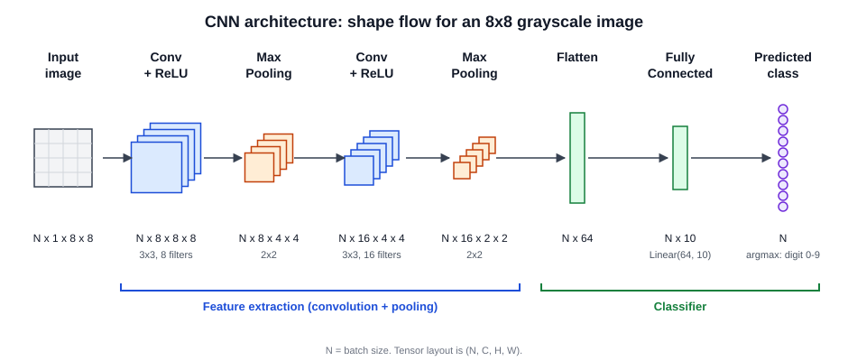

# 15장. 합성곱 신경망(CNN)과 이미지 분류

📖 [◀ 목차](00-목차.md) | [◀ 이전: 14장. PyTorch 입문](ch14-PyTorch입문.md) | [다음: 16장. 시퀀스 데이터와 RNN 입문 ▶](ch16-시퀀스데이터와RNN입문.md)

---

13장과 14장에서 우리는 완전연결층을 쌓은 신경망을 만들고 PyTorch로 학습시키는 방법을 익혔다. 이 구조는 표 형태의 데이터에서는 잘 동작하지만, 이미지를 다룰 때는 곧 한계에 부딪힌다. 이 장에서는 그 한계가 무엇인지 숫자로 확인한 다음, 이미지를 위해 고안된 합성곱 신경망(CNN, Convolutional Neural Network)의 핵심 연산을 NumPy로 직접 구현해 본다. 그 뒤 PyTorch로 작은 CNN을 만들어 텐서 shape이 층을 지나며 어떻게 변하는지 추적하고, 손글씨 숫자 이미지로 MLP와 CNN의 성능을 비교한다.

## 15.1 이미지를 완전연결층에 넣으면 생기는 문제

### 15.1.1 파라미터 폭발

이미지를 완전연결층(MLP)에 넣으려면 2차원 픽셀 격자를 1차원 벡터로 펼쳐야 한다. 그러면 입력 하나가 곧 픽셀 하나이고, 은닉층의 뉴런은 모든 픽셀과 연결된다. 이때 파라미터가 얼마나 필요한지 계산해 보자.

```python
def fc_params(n_in, n_out):
    """완전연결층의 파라미터 수: 가중치 n_in x n_out + 편향 n_out"""
    return n_in * n_out + n_out

def conv_params(c_in, c_out, k):
    """합성곱층의 파라미터 수: 필터 (k x k x c_in)가 c_out개 + 편향 c_out"""
    return c_in * c_out * k * k + c_out

print("28x28 흑백 이미지 -> 은닉 128:", f"{fc_params(28 * 28, 128):,}")
print("224x224 컬러 이미지 -> 은닉 1000:", f"{fc_params(224 * 224 * 3, 1000):,}")
print("3x3 필터 32개 (입력 3채널):", f"{conv_params(3, 32, 3):,}")
```

```
28x28 흑백 이미지 -> 은닉 128: 100,480
224x224 컬러 이미지 -> 은닉 1000: 150,529,000
3x3 필터 32개 (입력 3채널): 896
```

작은 28x28 흑백 이미지는 첫 층만 10만 개의 파라미터가 필요하다. 사진 한 장 정도의 해상도인 224x224 컬러 이미지가 되면 첫 층 하나가 1억 5천만 개로 늘어난다. 파라미터가 이렇게 많으면 메모리와 계산량도 문제지만, 이를 학습시킬 만큼의 데이터가 없으면 과대적합되기 쉽다. 반면 3x3 필터 32개로 이루어진 합성곱층은 이미지 크기와 상관없이 896개의 파라미터면 충분하다.

### 15.1.2 공간 정보 손실

둘째 문제는 이미지를 펼치는 순간 "이웃"이라는 개념이 사라진다는 것이다. 28x28 이미지를 784개의 숫자로 펼치면, 원래 위아래로 붙어 있던 픽셀이 784개 입력 중 멀리 떨어진 두 위치로 흩어진다. 완전연결층은 입력의 순서를 전혀 사용하지 않으므로, 모든 이미지의 픽셀을 똑같은 순서로 뒤섞어서 학습시켜도 학습 결과의 수준이 달라지지 않는다. 다시 말해 MLP에게 이미지는 "그림"이 아니라 784개의 서로 무관한 숫자일 뿐이다.

또 하나의 문제는 위치 변화에 약하다는 점이다. 숫자 "7"이 이미지 왼쪽에 있을 때와 한 칸 오른쪽에 있을 때, 활성화되는 입력 위치가 완전히 달라진다. MLP는 이 두 경우를 "같은 7"이라고 알려 주는 구조가 없으므로, 위치를 바꿔 가며 7을 모두 따로 배워야 한다.

CNN은 두 가지 아이디어로 이 문제들을 해결한다.

- 지역 연결(local connectivity): 뉴런 하나는 이미지 전체가 아니라 작은 영역(예: 3x3)만 본다. 이웃한 픽셀끼리 묶어서 보는 것이다.
- 가중치 공유(weight sharing): 같은 필터를 이미지의 모든 위치에 반복 적용한다. 그래서 파라미터가 적고, 필터가 찾는 패턴이 이미지의 어디에 있든 감지할 수 있다.

이 두 아이디어를 구현한 연산이 바로 합성곱이다.

## 15.2 합성곱 연산: 필터가 이미지 위를 훑는다

### 15.2.1 NumPy로 직접 계산하기

합성곱의 아이디어는 간단하다. 작은 숫자 격자인 필터(filter, 또는 커널 kernel)를 이미지의 왼쪽 위에 겹쳐 놓고, 겹친 칸끼리 곱해서 전부 더한다. 그 값을 결과의 한 칸에 적는다. 그다음 필터를 한 칸 옆으로 옮겨 같은 계산을 반복한다. 이미지를 모두 훑고 나면 결과 격자가 완성되는데, 이를 특성 맵(feature map)이라 부른다. 특성 맵은 "이 위치에 필터가 찾는 패턴이 얼마나 강하게 있는가"를 나타낸다.

이 과정을 함수로 만들어 보자. 아래 `conv2d`는 스트라이드(stride, 필터를 한 번에 옮기는 칸 수)와 패딩(padding, 이미지 둘레에 0을 덧대는 폭)까지 지원한다.

```python
import numpy as np

def conv2d(image, kernel, stride=1, padding=0):
    """2차원 합성곱. image: (H, W), kernel: (kh, kw)"""
    if padding > 0:
        image = np.pad(image, padding)          # 둘레를 0으로 채운다
    H, W = image.shape
    kh, kw = kernel.shape
    out_h = (H - kh) // stride + 1
    out_w = (W - kw) // stride + 1
    out = np.zeros((out_h, out_w))
    for i in range(out_h):
        for j in range(out_w):
            patch = image[i * stride:i * stride + kh, j * stride:j * stride + kw]
            out[i, j] = np.sum(patch * kernel)  # 겹친 칸끼리 곱해서 합
    return out
```

참고로 수학에서 말하는 엄밀한 합성곱은 필터를 상하좌우로 뒤집은 뒤 적용하지만, 딥러닝 라이브러리의 "합성곱"은 위 코드처럼 뒤집지 않고 그대로 겹쳐 계산한다(엄밀하게는 상호상관 cross-correlation). 필터 값을 학습으로 찾기 때문에 뒤집든 말든 결과에는 차이가 없고, PyTorch의 `nn.Conv2d`도 같은 방식이다.

이제 6x6 이미지를 만들자. 왼쪽 절반은 0(어두움), 오른쪽 절반은 9(밝음)로, 한가운데 세로 경계선이 있는 이미지다. 필터로는 세로 엣지를 찾는 소벨 커널을 쓴다. 왼쪽은 -1, -2, -1, 오른쪽은 +1, +2, +1이어서 "왼쪽이 어둡고 오른쪽이 밝으면" 큰 양수가 나온다. (이 저장소의 OpenCV 책 12장에서 다룬 소벨 필터와 같은 커널이다.)

```python
image = np.array([
    [0, 0, 0, 9, 9, 9],
    [0, 0, 0, 9, 9, 9],
    [0, 0, 0, 9, 9, 9],
    [0, 0, 0, 9, 9, 9],
    [0, 0, 0, 9, 9, 9],
    [0, 0, 0, 9, 9, 9],
], dtype=float)

vertical = np.array([[-1, 0, 1],
                     [-2, 0, 2],
                     [-1, 0, 1]], dtype=float)
horizontal = vertical.T                          # 가로 엣지용: 전치

print("세로 엣지 필터 결과:")
print(conv2d(image, vertical))
print("가로 엣지 필터 결과:")
print(conv2d(image, horizontal))
```

```
세로 엣지 필터 결과:
[[ 0. 36. 36.  0.]
 [ 0. 36. 36.  0.]
 [ 0. 36. 36.  0.]
 [ 0. 36. 36.  0.]]
가로 엣지 필터 결과:
[[0. 0. 0. 0.]
 [0. 0. 0. 0.]
 [0. 0. 0. 0.]
 [0. 0. 0. 0.]]
```

6x6 입력에 3x3 필터를 적용했더니 4x4 특성 맵이 나왔다. 세로 엣지 필터의 결과에서 가운데 두 열만 36이고 양쪽은 0이다. 경계선(어두움과 밝음이 만나는 곳)을 지나는 위치에서만 필터가 강하게 반응한 것이다. 반대로 가로 엣지 필터는 이 이미지에서 모두 0이다. 이미지에는 세로 경계만 있고 가로 경계는 없으니 반응할 곳이 없다.

값 하나를 손으로 확인해 보자. 특성 맵의 `[0, 1]`번 칸은 이미지의 0~2행, 1~3열 영역에서 나온다. 이 영역은 `[[0, 0, 9], [0, 0, 9], [0, 0, 9]]`이므로, 필터와 곱해서 더하면 `(-1×0 + 0×0 + 1×9) + (-2×0 + 0×0 + 2×9) + (-1×0 + 0×0 + 1×9) = 9 + 18 + 9 = 36`이다.

### 15.2.2 스트라이드와 패딩

스트라이드는 필터를 한 번에 몇 칸씩 옮길지 정한다. 기본값은 1이고, 2로 하면 칸을 건너뛰기 때문에 특성 맵이 더 작아진다. 패딩은 이미지 둘레에 0을 덧대어 가장자리 픽셀도 필터 중심에 놓일 수 있게 하고, 특성 맵이 줄어드는 것을 막는다.

```python
print("padding=1:")
print(conv2d(image, vertical, padding=1))

print("stride=2:")
print(conv2d(image, vertical, stride=2))
```

```
padding=1:
[[  0.   0.  27.  27.   0. -27.]
 [  0.   0.  36.  36.   0. -36.]
 [  0.   0.  36.  36.   0. -36.]
 [  0.   0.  36.  36.   0. -36.]
 [  0.   0.  36.  36.   0. -36.]
 [  0.   0.  27.  27.   0. -27.]]
stride=2:
[[ 0. 36.]
 [ 0. 36.]]
```

`padding=1`에서는 결과가 입력과 같은 6x6이 된다. 그런데 맨 오른쪽 열에 -27, -36이 나타났다. 이미지 오른쪽 끝 바깥에 덧댄 0이 필터에 "밝음(9)에서 어두움(0)으로 바뀌는 경계"로 보였기 때문이다. 이처럼 제로 패딩은 가장자리에 인공적인 경계를 만들 수 있지만, 실제로는 큰 문제가 되지 않는 경우가 많아서 널리 쓰인다. 또 위아래 끝의 값이 27로 작아지는 것은, 위아래 바깥의 0이 필터의 일부를 가렸기 때문이다.

`stride=2`에서는 필터가 두 칸씩 건너뛰어 결과가 2x2로 줄었다. 이미지를 성기게 훑으면 계산이 줄어드는 대신 위치 해상도가 낮아진다.

### 15.2.3 출력 크기 계산 공식

입력 크기, 필터 크기, 스트라이드, 패딩만 알면 특성 맵의 크기를 미리 계산할 수 있다. 입력 한 변의 길이를 `n`, 필터를 `k`, 스트라이드를 `s`, 패딩을 `p`라고 하면 다음과 같다.

```
출력 크기 = floor((n + 2p - k) / s) + 1
```

`n + 2p`는 패딩을 덧댄 뒤의 한 변 길이이고, 거기서 필터 크기 `k`를 빼면 필터가 움직일 수 있는 여유 공간이다. 이를 `s`로 나눈 몫만큼 움직일 수 있고, 처음 위치를 하나 더해 `+ 1`이다. 코드로 확인해 보자.

```python
def out_size(n, k, s=1, p=0):
    return (n + 2 * p - k) // s + 1

for n, k, s, p in [(6, 3, 1, 0), (6, 3, 1, 1), (6, 3, 2, 0), (28, 5, 1, 0), (224, 7, 2, 3)]:
    print(f"n={n:3d} k={k} s={s} p={p} -> {out_size(n, k, s, p)}")

print(conv2d(image, vertical, stride=2).shape, conv2d(image, vertical, padding=1).shape)
```

```
n=  6 k=3 s=1 p=0 -> 4
n=  6 k=3 s=1 p=1 -> 6
n=  6 k=3 s=2 p=0 -> 2
n= 28 k=5 s=1 p=0 -> 24
n=224 k=7 s=2 p=3 -> 112
(2, 2) (6, 6)
```

앞에서 직접 계산한 결과(4x4, 6x6, 2x2)가 공식과 정확히 일치한다. 많이 쓰는 조합 하나는 외워 두면 편하다. 필터 크기 3, 스트라이드 1일 때 패딩을 1로 두면 출력 크기가 입력과 같아진다. 필터가 5라면 패딩 2, 7이라면 패딩 3이다(홀수 크기 필터에서 `p = (k - 1) / 2`). 나눗셈이 딱 떨어지지 않으면 소수점 아래는 버려지고, 오른쪽이나 아래쪽 가장자리의 일부 픽셀은 계산에서 빠진다.

## 15.3 풀링과 채널

### 15.3.1 맥스 풀링

합성곱으로 특성 맵을 얻은 뒤에는 보통 풀링(pooling)으로 크기를 줄인다. 맥스 풀링(max pooling)은 특성 맵을 일정한 크기의 구역으로 나눠서, 구역마다 가장 큰 값 하나만 남긴다. 가장 흔한 2x2 구역, 스트라이드 2 설정에서는 가로와 세로가 정확히 절반이 된다.

```python
def max_pool2d(x, size=2):
    """겹치지 않는 size x size 구역마다 최댓값을 남긴다."""
    H, W = x.shape
    oh, ow = H // size, W // size
    out = np.zeros((oh, ow))
    for i in range(oh):
        for j in range(ow):
            out[i, j] = x[i * size:(i + 1) * size, j * size:(j + 1) * size].max()
    return out

fm = np.array([[1, 3, 2, 0],
               [4, 2, 1, 1],
               [0, 1, 5, 6],
               [2, 2, 7, 3]], dtype=float)
print(max_pool2d(fm))
```

```
[[4. 2.]
 [2. 7.]]
```

4x4 특성 맵이 2x2로 줄었다. 왼쪽 위 구역 `[[1, 3], [4, 2]]`에서는 4가, 오른쪽 아래 구역 `[[5, 6], [7, 3]]`에서는 7이 남았다. 풀링에는 파라미터가 없고, 두 가지 효과가 있다. 하나는 크기를 줄여 이후 층의 계산량과 파라미터를 줄이는 것이고, 다른 하나는 구역 안에서 패턴의 위치가 한두 칸 달라져도 결과가 같아지는 작은 위치 변화에 대한 둔감함이다. 최댓값을 남기는 방식이므로 "이 구역 어딘가에 패턴이 있었는가"만 기억하는 셈이다.

실제 CNN에서는 합성곱 결과에 ReLU를 먼저 적용하는 것이 일반적이다. 앞의 `padding=1` 특성 맵에 ReLU와 맥스 풀링을 차례로 적용해 보자.

```python
fmap = conv2d(image, vertical, padding=1)          # 6x6, 음수 포함
relu = np.maximum(fmap, 0)                          # ReLU: 음수는 0으로
print(max_pool2d(relu))
```

```
[[ 0. 36.  0.]
 [ 0. 36.  0.]
 [ 0. 36.  0.]]
```

6x6 특성 맵이 3x3으로 줄었고, ReLU가 가장자리의 인공적인 음수 응답(-27, -36)을 없앴다. 경계선이 있다는 정보는 가운데 열의 36으로 남아 있다.

### 15.3.2 채널

지금까지 이미지는 2차원 격자 하나였지만, 실제 이미지는 채널(channel)이라는 축이 하나 더 있다. 흑백 이미지는 채널이 1개이고, RGB 컬러 이미지는 채널이 3개다. 합성곱층을 통과한 특성 맵도 여러 채널을 가진다. 필터가 하나이면 특성 맵도 한 장(채널 1개)이지만, 필터를 32개 쓰면 특성 맵 32장이 쌓인 채널 32개의 출력이 된다. 필터마다 서로 다른 패턴(세로선, 가로선, 대각선, 모서리 등)을 찾도록 학습되는 셈이다.

입력이 여러 채널이면 필터도 입력 채널 수와 같은 깊이를 가져야 한다. 입력 채널이 3개이면 필터 하나는 `3 x 3 x 3`(채널 3, 세로 3, 가로 3)이며, 채널마다 따로 합성곱한 결과를 모두 더해 특성 맵 한 장을 만든다. 정리하면 합성곱층의 가중치 shape은 `(출력 채널 수, 입력 채널 수, 필터 세로, 필터 가로)`이고, 파라미터 수는 `출력 채널 × 입력 채널 × k × k + 출력 채널(편향)`이다. 15.1.1절에서 계산한 `conv_params`가 바로 이 식이다.

이 규칙을 NumPy로 구현해 보자. 앞에서 만든 `conv2d`를 재사용한다.

```python
def conv2d_multi(x, w, b):
    """x: (C_in, H, W), w: (C_out, C_in, kh, kw), b: (C_out,) -> (C_out, H', W')"""
    outs = []
    for f in range(w.shape[0]):
        # 입력 채널마다 합성곱한 뒤 전부 더하고, 필터마다 하나의 편향을 더한다
        fmap = sum(conv2d(x[c], w[f, c]) for c in range(x.shape[0])) + b[f]
        outs.append(fmap)
    return np.stack(outs)

rng = np.random.default_rng(0)
x = rng.normal(size=(3, 6, 6))          # 3채널 6x6 이미지
w = rng.normal(size=(2, 3, 3, 3))       # 필터 2개, 각 필터는 3채널 3x3
b = rng.normal(size=2)

y_np = conv2d_multi(x, w, b)
print("출력 shape:", y_np.shape)
print("파라미터 수:", w.size + b.size)
```

```
출력 shape: (2, 4, 4)
파라미터 수: 56
```

3채널 입력에 필터 2개를 적용하면 2채널 4x4 출력이 나오고, 파라미터는 `2×3×3×3 + 2 = 56`개다. 이미지의 가로세로 크기는 이 계산에 전혀 들어가지 않는다. 같은 필터를 어디서나 재사용하기 때문이다.

## 15.4 PyTorch로 CNN 정의하고 shape 추적하기

### 15.4.1 `nn.Conv2d`는 방금 만든 계산과 같다

PyTorch에서 합성곱층은 `nn.Conv2d(in_channels, out_channels, kernel_size, stride=1, padding=0)`로 만든다. 입력 텐서의 shape은 `(N, C, H, W)`다. `N`은 배치 크기, `C`는 채널 수, `H`와 `W`는 이미지의 높이와 너비다. 앞서 NumPy로 만든 `conv2d_multi`와 같은 값이 나오는지 확인해 보자. 같은 가중치를 `nn.Conv2d`에 복사해 넣는다.

```python
import torch
from torch import nn

conv = nn.Conv2d(in_channels=3, out_channels=2, kernel_size=3)
print("weight shape:", tuple(conv.weight.shape), " bias shape:", tuple(conv.bias.shape))

with torch.no_grad():
    conv.weight.copy_(torch.from_numpy(w))
    conv.bias.copy_(torch.from_numpy(b))

x_t = torch.from_numpy(x).float().unsqueeze(0)    # (3, 6, 6) -> (1, 3, 6, 6)
y_t = conv(x_t)
print("입력 shape:", tuple(x_t.shape), "-> 출력 shape:", tuple(y_t.shape))
print("NumPy 구현과 같은가:", np.allclose(y_np, y_t.squeeze(0).detach().numpy(), atol=1e-5))
```

```
weight shape: (2, 3, 3, 3)  bias shape: (2,)
입력 shape: (1, 3, 6, 6) -> 출력 shape: (1, 2, 4, 4)
NumPy 구현과 같은가: True
```

가중치 shape `(2, 3, 3, 3)`은 15.3.2절에서 정리한 `(출력 채널, 입력 채널, 세로, 가로)` 그대로다. `unsqueeze(0)`으로 배치 축을 하나 붙였다는 점에 주의하자. PyTorch의 합성곱층은 이미지 한 장이라도 항상 4차원 `(N, C, H, W)` 입력을 기대한다. `float()`로 바꾼 것은 PyTorch 기본 자료형이 `float32`인데 NumPy 난수는 `float64`라서, 그대로 넣으면 자료형 불일치 오류가 나기 때문이다. 결과가 NumPy 구현과 같으니, 우리가 직접 만든 합성곱이 PyTorch가 계산하는 것과 같은 연산이라는 것이 확인되었다.

참고로 `padding="same"`처럼 문자열을 줄 수도 있다. 이 경우 스트라이드 1에서 출력 크기가 입력과 같도록 패딩이 자동으로 정해진다. 이 책에서는 이해하기 쉽도록 숫자로 직접 지정한다.

### 15.4.2 작은 CNN과 shape 흐름

이제 `nn.Conv2d`, `nn.ReLU`, `nn.MaxPool2d`, `nn.Flatten`, `nn.Linear`를 조합해 8x8 흑백 이미지를 10개 클래스로 분류하는 작은 CNN을 정의하자. 이 구조는 다음 그림과 같다.



층 사이를 지날 때마다 텐서 shape이 어떻게 바뀌는지 `nn.Sequential`에서 한 층씩 통과시키며 출력해 보자.

```python
net = nn.Sequential(
    nn.Conv2d(1, 8, kernel_size=3, padding=1),    # 8x8 유지, 채널 1 -> 8
    nn.ReLU(),
    nn.MaxPool2d(2),                              # 8x8 -> 4x4
    nn.Conv2d(8, 16, kernel_size=3, padding=1),   # 4x4 유지, 채널 8 -> 16
    nn.ReLU(),
    nn.MaxPool2d(2),                              # 4x4 -> 2x2
    nn.Flatten(),                                 # (16, 2, 2) -> 64
    nn.Linear(16 * 2 * 2, 10),                    # 64 -> 10
)

x = torch.zeros(32, 1, 8, 8)       # 배치 32장, 채널 1, 8x8
print("input      ->", tuple(x.shape))
for layer in net:
    x = layer(x)
    print(f"{layer.__class__.__name__:10s} -> {tuple(x.shape)}")

print("전체 파라미터 수:", sum(p.numel() for p in net.parameters()))
for name, p in net.named_parameters():
    print(f"  {name:9s} {str(tuple(p.shape)):15s} {p.numel()}")
```

```
input      -> (32, 1, 8, 8)
Conv2d     -> (32, 8, 8, 8)
ReLU       -> (32, 8, 8, 8)
MaxPool2d  -> (32, 8, 4, 4)
Conv2d     -> (32, 16, 4, 4)
ReLU       -> (32, 16, 4, 4)
MaxPool2d  -> (32, 16, 2, 2)
Flatten    -> (32, 64)
Linear     -> (32, 10)
전체 파라미터 수: 1898
  0.weight  (8, 1, 3, 3)    72
  0.bias    (8,)            8
  3.weight  (16, 8, 3, 3)   1152
  3.bias    (16,)           16
  7.weight  (10, 64)        640
  7.bias    (10,)           10
```

흐름을 한 줄씩 읽어 보자.

1. 입력 `(32, 1, 8, 8)`: 흑백 이미지 32장.
2. 첫 `Conv2d(1, 8, 3, padding=1)`: 필터 8개를 적용한다. 패딩 1과 필터 3이므로 공식에 따라 크기는 그대로(8x8)이고 채널만 8로 늘어난다.
3. `ReLU`: shape은 그대로이고 음수만 0이 된다.
4. `MaxPool2d(2)`: 가로세로가 절반(4x4)이 된다. 채널 수는 변하지 않는다.
5. 둘째 `Conv2d(8, 16, 3, padding=1)`: 입력 채널이 8이므로 첫 번째 인자가 8이어야 한다. 4x4 크기를 유지하며 채널이 16이 된다.
6. 둘째 `MaxPool2d(2)`: `(16, 2, 2)`가 된다.
7. `Flatten`: 배치 축(32)은 두고 나머지 `16 × 2 × 2 = 64`를 한 줄로 펼친다.
8. `Linear(64, 10)`: 10개 클래스에 대한 점수(로짓)를 낸다.

이 구조에서 가장 실수하기 쉬운 곳은 `Flatten` 다음 `Linear`의 입력 크기(`16 * 2 * 2`)다. 합성곱과 풀링의 구성을 바꾸면 이 값도 바뀌므로, 위 코드처럼 더미 입력을 한 번 통과시켜 shape을 확인하는 습관이 유용하다.

파라미터 수는 합성곱층 두 개가 `72 + 8 + 1152 + 16 = 1,248`개, 마지막 선형층이 `650`개로 총 1,898개다. 8x8 입력을 평평하게 펼쳐 은닉 뉴런 32개에 연결하는 MLP의 첫 층만 해도 `64 × 32 + 32 = 2,080`개이니, CNN이 훨씬 적은 파라미터를 쓴다.

## 15.5 손글씨 숫자 분류: MLP와 CNN 비교

`sklearn.datasets.load_digits`는 8x8 크기의 손글씨 숫자 이미지 1,797장을 제공한다. 픽셀 값은 0~16 범위의 정수다. 이 이미지로 파라미터 수가 비슷한 MLP와 CNN을 같은 조건에서 학습시키고 성능을 비교해 보자.

### 15.5.1 실험 설계

비교를 공정하게 하기 위해 다음 원칙을 지킨다.

- 같은 데이터 분할(`random_state=42`, 클래스 비율 유지)을 쓴다.
- 같은 옵티마이저(Adam, 학습률 0.01), 같은 배치 크기(32), 같은 에폭 수(40)를 쓴다.
- 한 번의 결과는 초기화와 배치 순서에 따라 우연히 좋거나 나쁠 수 있으므로, 시드 5개로 반복해 평균과 표준편차를 본다.
- 정확도뿐 아니라 이미지를 오른쪽으로 1픽셀 밀었을 때의 정확도도 측정한다. 위치 변화에 대한 강건함이 CNN의 장점이라고 했으니, 실제로 그런지 확인하는 것이다.

```python
import numpy as np
import torch
from torch import nn
from torch.utils.data import TensorDataset, DataLoader
from sklearn.datasets import load_digits
from sklearn.model_selection import train_test_split

torch.set_num_threads(1)    # 이렇게 작은 모델은 멀티스레드 오버헤드가 더 크다 (재현성에도 유리)

# 1) 데이터: (N, 8, 8) 이미지를 0~1로 스케일링하고 채널 축을 추가한다
digits = load_digits()
X = (digits.images / 16.0).astype(np.float32)          # (1797, 8, 8)
y = digits.target.astype(np.int64)
X_train, X_test, y_train, y_test = train_test_split(
    X, y, test_size=0.25, stratify=y, random_state=42)

X_train_t = torch.from_numpy(X_train).unsqueeze(1)      # (N, 1, 8, 8)
X_test_t = torch.from_numpy(X_test).unsqueeze(1)
y_train_t = torch.from_numpy(y_train)
y_test_t = torch.from_numpy(y_test)
print("train:", tuple(X_train_t.shape), "test:", tuple(X_test_t.shape))

# 2) 모델 두 개: 파라미터 수가 비슷한 MLP와 CNN
def make_mlp():
    return nn.Sequential(
        nn.Flatten(),
        nn.Linear(64, 32), nn.ReLU(),
        nn.Linear(32, 10),
    )

def make_cnn():
    return nn.Sequential(
        nn.Conv2d(1, 8, kernel_size=3, padding=1), nn.ReLU(), nn.MaxPool2d(2),
        nn.Conv2d(8, 16, kernel_size=3, padding=1), nn.ReLU(), nn.MaxPool2d(2),
        nn.Flatten(),
        nn.Linear(16 * 2 * 2, 10),
    )

def count_params(model):
    return sum(p.numel() for p in model.parameters())

# 3) 학습과 평가
def train(model, epochs=40, lr=0.01, seed=0, augment=None):
    torch.manual_seed(seed)
    loader = DataLoader(TensorDataset(X_train_t, y_train_t),
                        batch_size=32, shuffle=True)
    loss_fn = nn.CrossEntropyLoss()
    optimizer = torch.optim.Adam(model.parameters(), lr=lr)
    for epoch in range(epochs):
        model.train()
        for xb, yb in loader:
            if augment is not None:         # 15.6절에서 사용하는 데이터 증강 훅
                xb = augment(xb)
            optimizer.zero_grad()
            loss = loss_fn(model(xb), yb)
            loss.backward()
            optimizer.step()
    return model

def accuracy(model, X, y):
    model.eval()                            # 평가 모드 (드롭아웃, 배치 정규화에서 중요)
    with torch.no_grad():
        pred = model(X).argmax(dim=1)
    return (pred == y).float().mean().item()

# 4) 시드 5개로 반복
shifted_test = torch.roll(X_test_t, shifts=1, dims=3)   # 오른쪽으로 1픽셀 이동

for name, make in [("MLP", make_mlp), ("CNN", make_cnn)]:
    clean, shifted = [], []
    for seed in range(5):
        torch.manual_seed(seed)             # 가중치 초기화도 시드에 맞춘다
        model = train(make(), seed=seed)
        clean.append(accuracy(model, X_test_t, y_test_t))
        shifted.append(accuracy(model, shifted_test, y_test_t))
    print(f"{name}: 파라미터 {count_params(model):,}개 | "
          f"테스트 정확도 {np.mean(clean):.3f} (±{np.std(clean):.3f}) | "
          f"1픽셀 이동 후 {np.mean(shifted):.3f}")
```

```
train: (1347, 1, 8, 8) test: (450, 1, 8, 8)
MLP: 파라미터 2,410개 | 테스트 정확도 0.972 (±0.005) | 1픽셀 이동 후 0.462
CNN: 파라미터 1,898개 | 테스트 정확도 0.977 (±0.005) | 1픽셀 이동 후 0.656
```

(PyTorch 버전이나 CPU 환경에 따라 소수점 아래 값은 조금씩 다를 수 있다. 아래 설명은 큰 경향을 기준으로 읽자. 코드 앞쪽의 `torch.set_num_threads(1)`은 이렇게 작은 모델에서는 여러 스레드를 쓰는 것이 오히려 느려지는 경우가 있어 넣은 설정이며, 결과를 재현하기 쉽게 하는 효과도 있다.)

### 15.5.2 결과 해석

결과를 정직하게 읽어 보자.

- 깨끗한 테스트 이미지에서는 CNN이 약간 높지만(0.977 대 0.972), 표준편차(±0.005 안팎)를 고려하면 두 모델의 차이는 거의 없다고 보는 편이 맞다. `load_digits`는 8x8의 작고 쉬운 데이터여서 MLP도 이미 충분히 잘 맞힌다. CNN의 장점이 가장 크게 드러나는 곳은 이런 쉬운 문제가 아니라 크고 복잡한 이미지다.
- 파라미터는 CNN이 약 21% 적다(1,898개 대 2,410개). 더 적은 파라미터로 같거나 더 나은 정확도를 냈다는 점은 가중치 공유의 효과를 보여 준다.
- 이미지를 오른쪽으로 1픽셀만 밀었을 뿐인데 두 모델 모두 정확도가 크게 떨어졌다. 특히 MLP는 0.97에서 0.46으로 무너졌고, CNN은 0.66으로 그보다는 낫다. 합성곱과 풀링이 위치 변화에 어느 정도 둔감해지는 효과를 주기 때문이다. 그렇다고 CNN이 이동에 완전히 강건한 것은 아니다. 이 실험은 8x8의 아주 작은 이미지여서 1픽셀이 전체 폭의 12.5%에 해당하므로 충격이 특히 크고, 실제 큰 이미지에서는 같은 1픽셀 이동의 영향이 훨씬 작다.

이동에 취약하다는 문제는 다음 절에서 다룰 데이터 증강으로 줄일 수 있다.

## 15.6 성능을 끌어올리는 도구들

이 절에서는 CNN 학습에서 자주 쓰는 세 가지 도구를 소개한다. 모두 "과대적합을 줄이고 새로운 데이터에 일반화하게 한다"는 같은 목표를 가진다.

### 15.6.1 데이터 증강

데이터 증강(data augmentation)은 학습 이미지를 무작위로 살짝 변형해서 모델이 더 다양한 모습을 보게 하는 기법이다. 이동, 회전, 좌우 반전, 밝기 조절, 일부 잘라내기 등이 있다. 정답 라벨을 바꾸지 않는 변형만 골라야 한다. 예를 들어 숫자 6을 위아래로 뒤집으면 9처럼 보이므로 상하 반전은 부적절하다.

여기서는 가장 단순한 증강으로, 배치 전체를 상하좌우로 최대 1픽셀 무작위로 밀어 보자. 구현은 `torch.roll` 한 줄이면 된다. (이 구현은 배치 안의 모든 이미지를 같은 만큼 미는 단순한 방식이다. 실제 증강 도구는 이미지마다 다르게 변형한다. 또한 `roll`은 밀려 나간 픽셀을 반대편으로 되돌려 붙이는데, 숫자 이미지는 가장자리가 대부분 비어 있어서 여기서는 큰 문제가 되지 않는다.)

```python
def random_shift(xb, max_shift=1):
    dy = int(torch.randint(-max_shift, max_shift + 1, (1,)))
    dx = int(torch.randint(-max_shift, max_shift + 1, (1,)))
    return torch.roll(xb, shifts=(dy, dx), dims=(2, 3))
```

### 15.6.2 드롭아웃과 배치 정규화

드롭아웃(dropout)은 학습 중에 뉴런의 출력을 확률 `p`로 무작위로 0으로 만드는 기법이다. 매번 일부 뉴런이 빠진 채로 학습하므로 특정 뉴런 하나에 과도하게 의존하지 않게 되고, 과대적합이 줄어든다. PyTorch에서는 `nn.Dropout(p)`를 쓰며, 평가할 때는 모든 뉴런을 사용한다.

배치 정규화(batch normalization)는 층의 출력을 미니배치 단위로 평균 0, 분산 1 근처가 되도록 정규화하는 기법이다. 층을 지날 때마다 값의 분포가 들쭉날쭉해지는 것을 막아서 학습이 안정되고 빨라지는 경향이 있다. 합성곱층 뒤에는 `nn.BatchNorm2d(채널 수)`를 붙인다.

두 층 모두 학습 때와 평가 때 동작이 다르다. 드롭아웃은 평가 때 끄고, 배치 정규화는 평가 때 학습 중 쌓아 둔 평균과 분산을 쓴다. 그래서 학습 전에 `model.train()`, 평가 전에 `model.eval()`을 호출해야 한다. 앞의 `accuracy` 함수에 `model.eval()`이 들어 있는 이유다.

### 15.6.3 효과 확인하기

앞의 15.5절 코드에 이어서, 증강과 정규화 층을 붙인 CNN 변형을 만들어 비교한다. `make_cnn_reg`는 합성곱 뒤에 배치 정규화를, 마지막 선형층 앞에 드롭아웃을 추가한 모델이다.

```python
def make_cnn_reg(p_drop=0.3):
    return nn.Sequential(
        nn.Conv2d(1, 8, kernel_size=3, padding=1), nn.BatchNorm2d(8),
        nn.ReLU(), nn.MaxPool2d(2),
        nn.Conv2d(8, 16, kernel_size=3, padding=1), nn.BatchNorm2d(16),
        nn.ReLU(), nn.MaxPool2d(2),
        nn.Flatten(),
        nn.Dropout(p_drop),
        nn.Linear(16 * 2 * 2, 10),
    )

experiments = [
    ("기본 CNN",              make_cnn,     None),
    ("+ 이동 증강",           make_cnn,     random_shift),
    ("+ BN, 드롭아웃",        make_cnn_reg, None),
    ("+ BN, 드롭아웃, 증강",  make_cnn_reg, random_shift),
]

for label, make, aug in experiments:
    clean, shifted = [], []
    for seed in range(5):
        torch.manual_seed(seed)
        model = train(make(), seed=seed, augment=aug)
        clean.append(accuracy(model, X_test_t, y_test_t))
        shifted.append(accuracy(model, shifted_test, y_test_t))
    print(f"{label:20s} 정확도 {np.mean(clean):.3f} | 1픽셀 이동 후 {np.mean(shifted):.3f}")
```

```
기본 CNN               정확도 0.977 | 1픽셀 이동 후 0.656
+ 이동 증강              정확도 0.940 | 1픽셀 이동 후 0.946
+ BN, 드롭아웃           정확도 0.982 | 1픽셀 이동 후 0.798
+ BN, 드롭아웃, 증강       정확도 0.940 | 1픽셀 이동 후 0.949
```

결과를 읽어 보자.

- 이동 증강을 쓰면 1픽셀 이동 후 정확도가 0.656에서 0.946으로 크게 올랐다. 모델이 이동된 이미지를 학습 중에 실제로 봤기 때문이다. 다만 이 테스트의 "1픽셀 이동"은 증강이 만들어 내는 변형과 같은 종류이므로 어느 정도 유리한 평가라는 점은 감안해야 한다.
- 대신 이동하지 않은 원본 이미지의 정확도는 0.977에서 0.940으로 약간 내려갔다. 증강은 공짜가 아니다. 이 모델은 파라미터가 1,898개뿐인 아주 작은 모델이라, 이동된 이미지까지 맞히느라 용량이 분산된 것으로 보인다. 8x8 이미지에서 1픽셀 이동은 상당히 큰 변화이기도 하다. 실제 프로젝트에서는 증강의 종류와 강도를 검증 데이터로 조절한다.
- 배치 정규화와 드롭아웃을 붙이면 원본 정확도는 0.982로 조금 올랐고(시드에 따른 편차가 ±0.005 정도이므로 확실한 차이로 보기는 어렵다), 이동 후 정확도는 0.656에서 0.798로 올랐다. 이 문제는 원본 이미지만 보면 이미 거의 다 맞히는 쉬운 문제여서 원본 정확도의 향상은 미미하지만, 처음 보는 변형에 대해서는 정규화가 도움이 되는 경향이 나타났다. 다만 두 층 중 어느 쪽이 얼마나 기여했는지는 이 실험만으로 분리할 수 없다.
- 이 숫자들은 이 환경에서 5개 시드로 얻은 값이므로, 세부 수치는 환경에 따라 달라질 수 있다. 증강이 이동에 대한 강건함을 높이고 원본 정확도를 조금 희생하는 경향이 있다는 큰 흐름이 중요하다.

## 15.7 사전 학습 모델과 전이 학습

실제 이미지 분류에서는 CNN을 처음부터 학습하는 경우보다, 이미 대규모 이미지 데이터로 학습된 모델을 가져다 쓰는 경우가 훨씬 많다. 이를 전이 학습(transfer learning)이라고 한다. 아이디어는 다음과 같다. 대규모 데이터셋(대표적으로 ImageNet)으로 학습된 CNN의 앞쪽 층은 엣지, 질감, 모서리 같은 범용적인 시각 특징을 이미 배웠다. 이 특징은 우리가 풀려는 문제(예컨대 제품 불량 분류)에도 쓸모가 있다. 그러니 앞쪽 층은 그대로 가져오고, 마지막 분류층만 우리 문제의 클래스 수에 맞게 바꿔 적은 양의 데이터로 학습하면 된다.

대표적인 사전 학습 모델 구조로는 ResNet, VGG, MobileNet, EfficientNet 등이 있다. PyTorch 생태계에서는 `torchvision.models`에 이런 구조와 사전 학습 가중치가 정리되어 있다. 전이 학습은 보통 두 가지 방식으로 쓴다. 하나는 앞쪽 층의 파라미터를 고정(`requires_grad = False`)하고 새로 붙인 마지막 층만 학습하는 방식이고, 다른 하나는 전체를 작은 학습률로 조금씩 다시 학습하는 미세 조정(fine-tuning)이다. 이 책의 예제는 8x8 이미지를 쓰기 때문에 ImageNet 모델(보통 224x224 컬러 이미지를 입력으로 가정한다)을 바로 적용할 수는 없다. 자세한 사용법은 `torchvision` 문서와 별도의 딥러닝 자료를 참고하자.

마지막으로 이 저장소의 OpenCV 책과의 관계를 한 줄로 정리하면, OpenCV 책은 사람이 숫자를 정해 준 필터(소벨 등)로 이미지를 처리하는 법을 다루고, CNN은 그 필터의 숫자를 데이터로부터 학습한다는 점이 다르며, 실무에서는 OpenCV로 이미지를 읽고 전처리해서 CNN에 넣는 식으로 둘을 함께 쓴다.

## 요약

- 이미지를 완전연결층에 넣으면 파라미터가 입력 크기에 비례해 폭발하고(224x224x3 입력에서 첫 층만 1억 5천만 개), 픽셀을 펼치면서 이웃 관계라는 공간 정보도 사라진다.
- CNN은 지역 연결(작은 영역만 보기)과 가중치 공유(같은 필터를 이미지 전체에 재사용)로 이 문제를 줄인다. 필터가 이미지를 훑으며 곱하고 더한 결과가 특성 맵이다.
- 출력 크기는 `floor((n + 2p - k) / s) + 1`이다. 필터 3, 스트라이드 1에서 패딩 1이면 크기가 유지된다.
- 맥스 풀링은 구역마다 최댓값을 남겨 크기를 줄이며 파라미터가 없다. 보통 ReLU 뒤에 적용한다.
- 합성곱층의 가중치 shape은 `(출력 채널, 입력 채널, 세로, 가로)`이고, 입력 텐서는 `(N, C, H, W)`다. `nn.Conv2d`는 NumPy로 직접 구현한 계산과 같은 값을 낸다.
- `nn.Conv2d`, `nn.ReLU`, `nn.MaxPool2d`, `nn.Flatten`, `nn.Linear`로 CNN을 만들 때는 `Flatten` 뒤의 `Linear` 입력 크기를 정확히 맞춰야 하며, 더미 입력으로 shape을 확인하는 습관이 유용하다.
- `load_digits` 실험에서 CNN은 더 적은 파라미터로 MLP와 비슷하거나 약간 높은 정확도를 냈고, 이미지를 1픽셀 밀었을 때는 MLP보다 훨씬 덜 무너졌다. 다만 이동에 완전히 강건하지는 않았다.
- 데이터 증강은 이동 같은 변형에 대한 강건함을 높이지만 원본 정확도를 조금 희생할 수 있다. 드롭아웃과 배치 정규화는 과대적합을 줄이고 학습을 안정시키며, 학습 모드와 평가 모드에서 동작이 다르므로 `model.train()`과 `model.eval()`을 반드시 구분해야 한다.
- 전이 학습은 대규모 데이터로 사전 학습된 모델(ResNet, MobileNet 등, `torchvision.models`)의 앞쪽 층을 재사용하고 마지막 층만 바꿔 학습하는 방법이다.

## 연습문제

1. 입력이 `(N, 3, 32, 32)`인 이미지에 `nn.Conv2d(3, 16, kernel_size=5, stride=1, padding=2)`를 적용했을 때 출력 shape과 이 층의 파라미터 수를 구하라. 이어서 `nn.MaxPool2d(2)`를 적용한 뒤의 shape도 구하라.
2. 15.2.1절의 `vertical` 필터를 `np.array([[1, 1, 1], [0, 0, 0], [-1, -1, -1]])`로 바꿔서 같은 `image`에 적용해 보자. 어떤 방향의 경계에 반응하는가? 결과가 모두 0이 되도록 `image`를 직접 만들어 보고, 그 이유를 설명하라.
3. `conv2d` 함수에서 `stride=3`, `padding=0`으로 6x6 이미지에 3x3 필터를 적용하면 출력 크기가 얼마인지 공식으로 먼저 계산하고, 코드로 확인하라. 그리고 `n=8, k=3, s=2, p=0`처럼 나누어떨어지지 않는 경우 출력 크기와, 입력의 어느 픽셀이 계산에서 빠지는지 설명하라.
4. 15.4.2절의 CNN에서 첫 번째 `Conv2d`의 필터 수를 8에서 16으로 늘릴 때, 둘째 `Conv2d`의 첫 번째 인자와 `Linear`의 입력 크기를 각각 어떻게 바꿔야 하는지 쓰고, 더미 입력으로 shape을 확인하라. 전체 파라미터 수는 어떻게 달라지는가?
5. 15.6.3절의 실험에서 `random_shift`의 `max_shift`를 2로 키우거나 `nn.Dropout`의 `p_drop`을 0.5로 키워 실험해 보자. 원본 테스트 정확도와 1픽셀 이동 후 정확도가 각각 어떻게 변하는지 관찰하고, 증강이나 정규화를 "더 세게" 하는 것이 항상 좋지 않은 이유를 결과를 근거로 설명하라.

---

📖 [◀ 목차](00-목차.md) | [◀ 이전: 14장. PyTorch 입문](ch14-PyTorch입문.md) | [다음: 16장. 시퀀스 데이터와 RNN 입문 ▶](ch16-시퀀스데이터와RNN입문.md)
